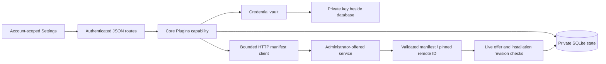

# Plugin connections

Hito connects to separately hosted HTTP services. It does not download or execute plugin code. The current implementation covers service offers, personal installation, manifest validation/review, credential storage, and removal. Provider search, catalogs, metadata ingestion, source resolution/relay, playlists, dashboard content, lyrics, and backing-track operations are still release work. Declaring a capability does not make that content available in Hito yet.

## Settings

Open Settings → Plugins. An administrator can expand **Services for this server** to offer a name and base address. Offers are shared choices, not shared credentials or automatic installations. Only administrators can choose addresses that Hito will contact. Ordinary accounts select an offered service and optionally enter its bearer token. No environment-variable editing is needed.

Each account owns its connections. Administrators cannot list, check, or clear another account's connection. Removing a personal connection clears its saved token. Withdrawing an offered service disconnects all installations of that service and clears their tokens. Both actions retain an inactive identity record. Reoffering the same address creates a new service identity.

**Check connection** fetches and validates the manifest. A changed name or capability declaration appears for review. Acceptance fetches the manifest again and requires the reviewed digest. A different remote plugin ID is rejected; remove and reconnect to accept a new identity. Failed requests and unaccepted reviews preserve the accepted manifest and credentials. **Save token** checks the replacement before saving it. **Clear saved token** is local and works even when the service is unavailable.

## Ownership and recovery



The core owns URL validation, HTTP policy, credential encryption, quotas, and transactions. Routes authenticate and map typed requests/results. React's workflow hook owns cancellation and account scope; components own form drafts and rendering. The SDK is Apache-2.0 and contains the wire manifest without a database dependency.

No SQLite transaction stays open during HTTP work. Install and refresh recheck live service/installation revisions before committing. A delayed response cannot restore a removed connection or withdrawn offer. An account can have 32 active installations; the server can offer 64 active services. Active account reads and credential-key discovery use indexes.

Personal provider data is not inserted into shared source/metadata tables. Before provider operations ship, installation/account visibility and current authority must reach search, source readiness, artwork, relay, and metadata provenance. A private provider connection must never make another account's content or credentials visible.

## HTTP manifest protocol, version 1

This is the implemented portion of the language-neutral protocol. Additional capability endpoints have not been specified or implemented.

A base address can use HTTP or HTTPS and a path prefix. It cannot contain user information, a query, or a fragment. Hito normalizes the trailing slash. For `https://provider.example/hito/`, it requests:

```http
GET /hito/v1/manifest
Accept: application/json
Accept-Encoding: identity
X-Hito-Plugin-Protocol: 1
Authorization: Bearer <personal token, only when configured>
```

Services must return a successful status with `Content-Type: application/json`, optional content-type parameters, and an uncompressed UTF-8 JSON manifest. Hito accepts no more than 65,536 response bytes, including chunked responses.

```json
{
  "id": "org.example.collection",
  "name": "My collection",
  "protocol_version": 1,
  "capabilities": ["search", "sources"]
}
```

The manifest permits only these fields. IDs contain 1–128 ASCII letters, numbers, dots, hyphens, or underscores. Names contain 1–256 bytes, cannot be blank, and cannot contain control characters. At least one known capability is required. Supported declarations are `search`, `catalog`, `metadata`, `sources`, `playlists`, `dashboard`, `lyrics`, and `backing_tracks`. Unknown capabilities and unsupported protocol versions are rejected.

The remote manifest ID, administrator service ID, and personal installation ID are separate. The reviewed digest is SHA-256 over a domain prefix and canonical SDK serialization, with capabilities sorted. JSON whitespace and capability ordering do not require review; semantic changes do.

The client disables automatic redirects, system proxies, and retries. It uses a two-second connection deadline, a ten-second total request deadline, four simultaneous requests globally, and one per account. Busy requests fail promptly. Private/self-hosted service addresses are supported because choosing an address is an administrator operation. Use HTTPS for services across untrusted networks. A service receives only the configured token and Hito protocol headers, never the browser's session cookie.

## Application API

The actual routes and wire schemas generate [OpenAPI](openapi.json) and the web TypeScript contract.

| Route | Behavior |
| --- | --- |
| `GET /api/v1/plugins` | Offered services, this account's installations, credential-storage readiness |
| `POST /api/v1/plugins/services` | Administrator offers a name and base address |
| `DELETE /api/v1/plugins/services/{id}` | Administrator withdraws the expected revision |
| `POST /api/v1/plugins` | Installs an offered service revision with an optional write-only bearer token |
| `POST /api/v1/plugins/{id}/refresh` | Checks an expected installation revision; optional reviewed digest and keep/replace credential action |
| `DELETE /api/v1/plugins/{id}/credential` | Clears this account's credential at the expected revision |
| `DELETE /api/v1/plugins/{id}` | Removes this account's installation at the expected revision |

Mutation JSON rejects unknown fields. Refresh returns `updated` or `review_required`. Responses expose only whether a credential is saved, never a token or encrypted credential. Conflicts require reloading current state; upstream failures return a safe 502 explanation without the service's response body. Browser mutations retain the existing same-origin/account checks and private no-store response policy.

## Credential key and backups

Bearer tokens are encrypted using RustCrypto XChaCha20-Poly1305 with a fresh random nonce and authenticated account/installation/service context. The versioned envelope includes a key fingerprint. Tokens are limited to 4,096 visible ASCII characters. They are not logged, returned, or saved in browser storage.

The key lives beside the configured database, replacing its extension with `.plugin-key`. The default is `/data/hito.plugin-key`. A new key is published atomically only when there are no encrypted credentials and no existing key. Linux/macOS readers reject symlinks, non-regular files, invalid length, and group/other permissions. The generated key uses mode 0600. Windows ACL and native recovery acceptance remain release gates.

Back up the complete stopped data volume, including SQLite WAL files, `hito.device-id`, and `hito.plugin-key`. See [operations](operations.md). A database-only backup cannot recover its encrypted plugin tokens.

A missing, malformed, inaccessible, or mismatched key disables credential storage and checks that need saved tokens. It does not prevent core startup or local playback. Settings still lists connections and allows clearing tokens or removing installations. Restore the matching private key with the server's ownership/permissions, then restart. Hito does not silently replace a bad key or overwrite encrypted credentials. If every saved credential is deliberately cleared, a missing key can be regenerated on restart. An existing invalid key still requires operator repair/removal while the server is stopped.

## Verification limits

Public core and HTTP tests use real temporary SQLite and owned loopback HTTP services. They cover account isolation, real prefixed manifest requests, unsupported manifests, HTTP status/content-type/redirect/size failures, a stalled request deadline and retry, duplicate installs, revision conflicts, delayed remove/withdraw fencing, credential persistence/rotation/review, malformed/missing/wrong key recovery, and trace redaction. Frontend checks cover failed drafts, manifest review, and late account responses. Docker browser tests exercise the real UI/API/fixture path.

These checks do not prove live official-provider compatibility, production TLS deployments, native-platform credentials, release latency, or complete plugin capabilities. Official adapters and their live accounts remain separate release tasks.
