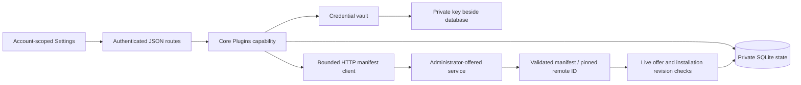
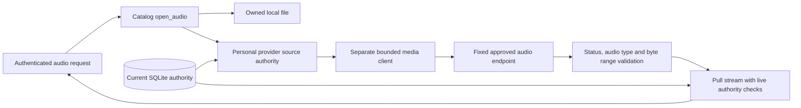

# Plugin connections

Hito connects to separately hosted HTTP services. It does not download or execute plugin code. Settings supports service offers, personal installation, manifest validation/review, credential storage, and removal. Source now includes authenticated provider search, durable adoption, and audio relay APIs. Browser discovery and selection, catalogs, enrichment, playlists, dashboard content, lyrics, and backing tracks remain release work. The normal development server still runs the connection-only deployment on migration 0018.

## Settings

Open Settings → Plugins. An administrator can expand **Services for this server** to offer a name and base address. Offers are shared choices, not shared credentials or automatic installations. Only administrators can choose addresses that Hito will contact. Ordinary accounts select an offered service and optionally enter its bearer token. No environment-variable editing is needed.

Each account owns its connections. Administrators cannot list, check, or clear another account's connection. Removing a personal connection clears its saved token. Withdrawing an offered service disconnects all installations of that service and clears their tokens. Both actions retain an inactive identity record. Reoffering the same address creates a new service identity.

**Check connection** fetches and validates the manifest. A changed name or capability declaration appears for review. Acceptance fetches the manifest again and requires the reviewed digest. A different remote plugin ID is rejected; remove and reconnect to accept a new identity. Failed requests and unaccepted reviews preserve the accepted manifest and credentials. **Save token** checks the replacement before saving it. **Clear saved token** is local and works even when the service is unavailable.

## Ownership and recovery



The core owns URL validation, HTTP policy, credential encryption, quotas, and transactions. Routes authenticate and map typed requests/results. React's workflow hook owns cancellation and account scope; components own form drafts and rendering. The SDK is Apache-2.0 and contains the wire manifest without a database dependency.

No SQLite transaction stays open during HTTP work. Install and refresh recheck live service/installation revisions before committing. A delayed response cannot restore a removed connection or withdrawn offer. An account can have 32 active installations; the server can offer 64 active services. Active account reads and credential-key discovery use indexes.

Personal provider data is confined to an owner-only library. It can reuse the recording/source graph without entering a shared library. Administrator membership changes reject personal libraries, and database constraints back that rule. Audio relay checks the owning account, accepted capability, active connection/service, and saved source binding before contacting the service and throughout streaming.

## Provider content groundwork

`Catalog::search_provider` returns transient provider results. It requires the accepted `search` capability and an expected installation revision. Search does not populate the library. `Catalog::adopt_provider` takes only an installation revision and opaque provider recording ID. It requires `sources`, refetches detail and the complete source list, then commits durable recording/source/release identities and observations atomically. The `metadata` capability is reserved for enrichment of existing content.


Provider IDs are namespaced by personal installation. Matching titles never merge recordings. A repeated selection preserves UUIDs and personal fields. Source IDs cannot silently move to a different recording. Failed responses leave previous catalog state intact. Only a complete successful source response withdraws missing sources. Removing a connection or withdrawing its service retains recordings and collection references but removes readiness. Reinstallation starts a separate identity scope.

Provider observations record the accepted manifest ID, installation, remote recording ID, optional remote revision, observation time, and validated detail JSON. File checksum, local source, and file inspection version remain null. Missing duration displays as zero; the retained provider JSON preserves whether it was actually reported. Recording checksums remain real file evidence or null. Provider source metadata explicitly uses `provider_response` provenance.

The outgoing JSON protocol uses these fixed paths relative to the approved base address:

| Operation | Request | Response limit |
| --- | --- | --- |
| `POST v1/search` | `query`, optional `cursor`, `limit` | 262,144 bytes, at most 50 items |
| `POST v1/recordings/detail` | `recording_id` | 32,768 bytes, one matching recording |
| `POST v1/sources` | `recording_id` | 32,768 bytes, complete list of at most 16 sources |

Detail returns `id`, `title`, `artist`, optional `duration_ms`, optional `release` with `id/title/artist`, optional positive disc/track numbers, and optional `revision`. Search returns `items` with the same recording fields plus optional `next_cursor`. Sources returns `items` containing `id`, `label`, and `ready`. No operation returns stream URLs or arbitrary request headers. The SDK validates these language-neutral JSON contracts.

Queries use at most 512 bytes; cursors use 2,048; IDs/revisions/source labels use 256; titles/artist names use 2,048. Text must be nonblank and contain no control characters. Durations must fit JavaScript's safe integer range. Unknown fields, duplicate IDs, oversized pages, mismatched detail IDs, invalid content types, and encoded responses are rejected. Requests use the same credential, admission, redirect, and deadline policy as manifest requests below. No SQLite transaction spans HTTP work.

## Audio relay

The provider serves `GET` and `HEAD v1/audio?source_id=<encoded opaque ID>`. Only Hito selects the approved service address and supplies its personal token. The browser requests the existing `/api/v1/sources/{id}/audio` route with Hito's durable source UUID. Provider URLs, tokens, browser cookies, and arbitrary request headers never become source data returned to the browser.



The relay accepts supported audio MIME types and identity encoding. Transfer-Encoding must be absent or a single chunked coding without Content-Length. It validates single byte-range responses, known lengths, and premature EOF. Unknown request range units are ignored. Multipart ranges are unsupported. HEAD ignores Range. If-Range is treated as an unmatched validator and returns a full representation. Only validated content type, lengths, range support, and Content-Range reach the browser, with private no-store caching. Provider cookies, redirects, filenames, and custom headers are discarded. MIME/framing validation does not verify the decoded recording or establish codec compatibility.

The media client has a two-second connect deadline, ten-second header deadline, and fifteen-second deadline for each actively awaited upstream body read. Consumer pauses and backpressure do not run that read timer. A healthy stream has no total-duration timeout. Redirects, proxies, and retries are disabled. Sixteen global slots and two per account are independent of control requests. Slots last through EOF, failure, or consumer cancellation. Hito yields at most 64 KiB per pull, retains at most one upstream client frame, and does not spawn an audio-buffering pump or persist a download.

Connection removal, service withdrawal, credential changes, capability withdrawal, and lost source ownership cancel active requests and bodies. A database-backed monitor checks unread streams every 250 ms with a one-second authorization-query deadline. Checks also surround each body read. Changes made by a separately opened service instance are visible. A cached readiness change prevents new opens but does not interrupt a healthy current stream. An unchanged connection check can advance its revision without revoking an existing stream. Transfer completion retains the opening log correlation and records only safe outcome, byte count, and elapsed time.

Browser discovery/selection, playback-time source refresh and recovery, conversion, official services, and live-provider checks remain unfinished. This API work is not a completed provider listening experience or a release performance claim.

## HTTP manifest protocol, version 1

This is the deployed connection protocol. The content and relay operations above are implemented in source and await the operational discovery slice before normal deployment.

A base address can use HTTP or HTTPS and a path prefix. It cannot contain user information, a query, or a fragment. Hito normalizes the trailing slash. For `https://provider.example/hito/`, it requests:

```http
GET /hito/v1/manifest
Accept: application/json
Accept-Encoding: identity
X-Hito-Plugin-Protocol: 1
Authorization: Bearer <personal token, only when configured>
```

Services must return a successful status with `Content-Type: application/json`, optional content-type parameters, and an uncompressed UTF-8 JSON manifest. Hito accepts no more than 65,536 response bytes, including chunked responses.

```json
{
  "id": "org.example.collection",
  "name": "My collection",
  "protocol_version": 1,
  "capabilities": ["search", "sources"]
}
```

The manifest permits only these fields. IDs contain 1–128 ASCII letters, numbers, dots, hyphens, or underscores. Names contain 1–256 bytes, cannot be blank, and cannot contain control characters. At least one known capability is required. Supported declarations are `search`, `catalog`, `metadata`, `sources`, `playlists`, `dashboard`, `lyrics`, and `backing_tracks`. Unknown capabilities and unsupported protocol versions are rejected.

The remote manifest ID, administrator service ID, and personal installation ID are separate. The reviewed digest is SHA-256 over a domain prefix and canonical SDK serialization, with capabilities sorted. JSON whitespace and capability ordering do not require review; semantic changes do.

The client disables automatic redirects, system proxies, and retries. It uses a two-second connection deadline, a ten-second total request deadline, four simultaneous requests globally, and one per account. Busy requests fail promptly. Private/self-hosted service addresses are supported because choosing an address is an administrator operation. Use HTTPS for services across untrusted networks. A service receives only the configured token and Hito protocol headers, never the browser's session cookie.

## Application API

The actual routes and wire schemas generate [OpenAPI](openapi.json) and the web TypeScript contract.

| Route | Behavior |
| --- | --- |
| `GET /api/v1/plugins` | Offered services, this account's installations, credential-storage readiness |
| `POST /api/v1/plugins/services` | Administrator offers a name and base address |
| `DELETE /api/v1/plugins/services/{id}` | Administrator withdraws the expected revision |
| `POST /api/v1/plugins` | Installs an offered service revision with an optional write-only bearer token |
| `POST /api/v1/plugins/{id}/refresh` | Checks an expected installation revision; optional reviewed digest and keep/replace credential action |
| `DELETE /api/v1/plugins/{id}/credential` | Clears this account's credential at the expected revision |
| `DELETE /api/v1/plugins/{id}` | Removes this account's installation at the expected revision |
| `POST /api/v1/plugins/{id}/search` | Searches with an expected installation revision, query, optional cursor, and bounded limit; returns transient results |
| `POST /api/v1/plugins/{id}/recordings` | Adopts or refreshes an opaque provider recording ID at an expected installation revision; returns its durable Hito recording |
| `GET /api/v1/sources/{id}/audio` | Streams authorized local or provider audio, including validated single byte ranges |
| `HEAD /api/v1/sources/{id}/audio` | Returns the authorized representation headers without a body |

Mutation JSON rejects unknown fields. Refresh returns `updated` or `review_required`. Responses expose only whether a credential is saved, never a token or encrypted credential. Conflicts require reloading current state; upstream failures return a safe 502 explanation without the service's response body. Browser mutations retain the existing same-origin/account checks and private no-store response policy.

## Credential key and backups

Bearer tokens are encrypted using RustCrypto XChaCha20-Poly1305 with a fresh random nonce and authenticated account/installation/service context. The versioned envelope includes a key fingerprint. Tokens are limited to 4,096 visible ASCII characters. They are not logged, returned, or saved in browser storage.

The key lives beside the configured database, replacing its extension with `.plugin-key`. The default is `/data/hito.plugin-key`. A new key is published atomically only when there are no encrypted credentials and no existing key. Linux/macOS readers reject symlinks, non-regular files, invalid length, and group/other permissions. The generated key uses mode 0600. Windows ACL and native recovery acceptance remain release gates.

Back up the complete stopped data volume, including SQLite WAL files, `hito.device-id`, and `hito.plugin-key`. See [operations](operations.md). A database-only backup cannot recover its encrypted plugin tokens.

A missing, malformed, inaccessible, or mismatched key disables credential storage and checks that need saved tokens. It does not prevent core startup or local playback. Settings still lists connections and allows clearing tokens or removing installations. Restore the matching private key with the server's ownership/permissions, then restart. Hito does not silently replace a bad key or overwrite encrypted credentials. If every saved credential is deliberately cleared, a missing key can be regenerated on restart. An existing invalid key still requires operator repair/removal while the server is stopped.

## Verification limits

Public core and HTTP tests use real temporary SQLite and owned loopback HTTP services. They cover account isolation, real prefixed manifest requests, unsupported manifests, HTTP status/content-type/redirect/size failures, a stalled request deadline and retry, duplicate installs, revision conflicts, delayed remove/withdraw fencing, credential persistence/rotation/review, malformed/missing/wrong key recovery, and trace redaction. Frontend checks cover failed drafts, manifest review, and late account responses. Docker browser tests exercise the real UI/API/fixture path.

These checks do not prove live official-provider compatibility, production TLS deployments, native-platform credentials, release latency, or complete plugin capabilities. Official adapters and their live accounts remain separate release tasks.
