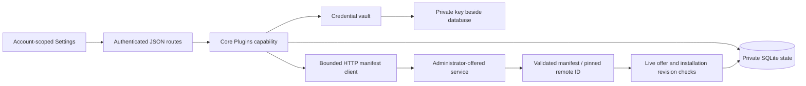
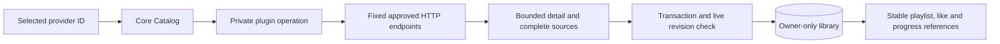
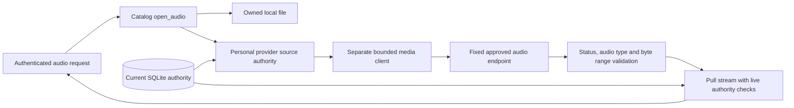
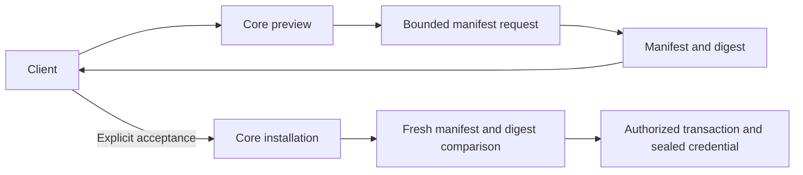
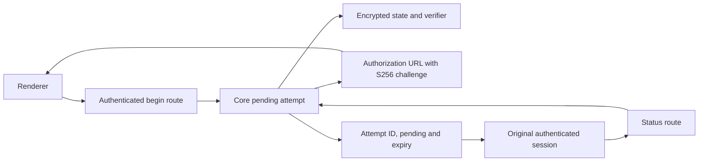

# Plugin connections

Hito connects to separately hosted HTTP services. It does not download or execute plugin code. Settings supports service offers, personal installation, manifest validation/review, credential storage, and removal. Discover supports private music search, durable adoption, and playback through authorized audio relay. These workflows and the source-refresh behavior below are implemented in the development build. Catalog browsing capabilities, enrichment, official playlist-provider adapters, dashboard content, lyrics, and backing tracks remain release work.

Generic playlist Import a copy is deployed on the local development server, with loopback-provider fixture and release-image browser coverage. See its [provider JSON examples](playlist-import.md#provider-json-examples), [copy/retry behavior](playlist-import.md#retry-the-same-request-or-create-a-new-copy) and current [acceptance limits](status.md#isolated-plugin-integration-checkpoint). Public Spotify import and hourly/daily Follow are also deployed locally; provider account authorization and remaining release acceptance are separate work.

## Settings

Open Settings → Plugins. An administrator expands **Services for this server**, enters the service address, and selects **Offer service**. Hito fetches the public manifest and uses its validated name. **Advanced settings** has an optional custom label for services that require a token before exposing their manifest. An explicit label skips this initial lookup; the personal connection still validates the manifest with its own optional token.

Offers are shared choices, not shared credentials or automatic installations. Only administrators can choose addresses that Hito will contact. Ordinary accounts select an offered service and optionally enter its bearer token. No environment-variable editing is needed. Existing service labels remain unchanged.

An automatic name lookup sends no credentials or browser cookies. Failed validation saves no offer. Hito rechecks the administrator's live session after the HTTP request, without holding a SQLite write transaction during network work.

Each account owns its connections. Administrators cannot list, check, or clear another account's connection. Removing a personal connection clears its saved token. Withdrawing an offered service disconnects all installations of that service and clears their tokens. Both actions retain an inactive identity record. Reoffering the same address creates a new service identity.

**Check connection** fetches and validates the manifest. A changed name or capability declaration appears for review. Acceptance fetches the manifest again and requires the reviewed digest. A different remote plugin ID is rejected; remove and reconnect to accept a new identity. Failed requests and unaccepted reviews preserve the accepted manifest and credentials. **Save token** checks the replacement before saving it. **Clear saved token** is local and works even when the service is unavailable.

## Discover music

Open Discover, choose a connected music service, and search for a track or artist. Only connections with an accepted search capability appear. Services that offer search without sources show results with Play and Add disabled.

Search returns one transient page and does not change the library. **Add to library** refetches authoritative detail and sources, then saves a durable private recording without starting audio. **Play** performs the same adoption before replacing the queue. Neither action downloads a persistent audio copy. Use Previous and Next for the service's opaque cursor pages. Completed adoptions keep their In library feedback across pages and searches for the current connection revision.

Changing accounts, services, or accepted connection revisions clears private results and feedback. A later search cancels the earlier search and pending selection. A later player command supersedes delayed provider Play; playback continues through page navigation. A failed search or selection offers Refresh services, which reloads accepted connections while preserving the search draft. Unavailable adopted tracks remain in the library and explain why playback cannot start.

## Ownership and recovery



The core owns URL validation, HTTP policy, credential encryption, quotas, and transactions. Routes authenticate and map typed requests/results. React's workflow hook owns cancellation and account scope; components own form drafts and rendering. The SDK is Apache-2.0 and contains the wire manifest without a database dependency.

No SQLite transaction stays open during HTTP work. Install and refresh recheck live service/installation revisions before committing. A delayed response cannot restore a removed connection or withdrawn offer. An account can have 32 active installations; the server can offer 64 active services. Active account reads and credential-key discovery use indexes.

Personal provider data is confined to an owner-only library. It can reuse the recording/source graph without entering a shared library. Administrator membership changes reject personal libraries, and database constraints back that rule. Audio relay checks the owning account, accepted capability, active connection/service, and saved source binding before contacting the service and throughout streaming.

## Provider content groundwork

`Catalog::search_provider` returns transient provider results. It requires the accepted `search` capability and an expected installation revision. Search does not populate the library. `Catalog::adopt_provider` takes only an installation revision and opaque provider recording ID. It requires `sources`, refetches detail and the complete source list, then commits durable recording/source/release identities and observations atomically. The `metadata` capability has a typed SDK extension in development below; host enrichment and automatic-matching integration remain unfinished.



Provider IDs are namespaced by personal installation. Matching titles never merge recordings. A repeated selection preserves UUIDs and personal fields. Source IDs cannot silently move to a different recording. Failed responses leave previous catalog state intact. Only a complete successful source response withdraws missing sources. Removing a connection or withdrawing its service retains recordings and collection references but removes readiness. Reinstallation starts a separate identity scope.

Provider observations record the accepted manifest ID, installation, remote recording ID, optional remote revision, observation time, and validated detail JSON. File checksum, local source, and file inspection version remain null. Missing duration displays as zero; the retained provider JSON preserves whether it was actually reported. Recording checksums remain real file evidence or null. Provider source metadata explicitly uses `provider_response` provenance.

The outgoing JSON protocol uses these fixed paths relative to the approved base address:

| Operation                   | Request                             | Response limit                                    |
| --------------------------- | ----------------------------------- | ------------------------------------------------- |
| `POST v1/search`            | `query`, optional `cursor`, `limit` | 262,144 bytes, at most 50 items                   |
| `POST v1/recordings/detail` | `recording_id`                      | 32,768 bytes, one matching recording              |
| `POST v1/sources`           | `recording_id`                      | 32,768 bytes, complete list of at most 16 sources |

Detail returns `id`, `title`, `artist`, optional `duration_ms`, optional `release` with `id/title/artist`, optional positive disc/track numbers, and optional `revision`. Search returns `items` with the same recording fields plus optional `next_cursor`. Sources returns `items` containing `id`, `label`, and `ready`. No operation returns stream URLs or arbitrary request headers. The SDK validates these language-neutral JSON contracts.

Queries use at most 512 bytes; cursors use 2,048; IDs/revisions/source labels use 256; titles/artist names use 2,048. Text must be nonblank and contain no control characters. Durations must fit JavaScript's safe integer range. Unknown fields, duplicate IDs, oversized pages, mismatched detail IDs, invalid content types, and encoded responses are rejected. Requests use the same credential, admission, redirect, and deadline policy as manifest requests below. No SQLite transaction spans HTTP work.

## Musical metadata in development

The SDK and YouTube adapter implement `POST v1/recordings/metadata`, using the existing strict `recording_id` request. This extension belongs to the `metadata` capability. It preserves the existing recording, search, detail and source wire shapes. Core's development resolver now consumes it through explicitly approved connections. The normal server and YouTube service have not received these changes.

The response contains an existing `recording` object and optional `musical_title`, `album_title` and `source_ids` fields. For example:

```json
{
  "recording": {
    "id": "provider-recording-1",
    "title": "Performer - Song (Official Audio)",
    "artist": "Performer",
    "duration_ms": 180000,
    "release": null,
    "disc_number": null,
    "track_number": null,
    "revision": null
  },
  "musical_title": "Song",
  "album_title": "Live at the venue",
  "source_ids": ["provider-audio-1"]
}
```

Musical title and album context come from provider-reported music fields. They do not replace the original video title or invent a release identifier. Official wording and a channel badge do not establish recording identity. The example deliberately retains a live-album qualifier despite the video wrapper.

The complete encoded response is limited to 32,768 bytes. Present musical text must be nonblank, contain no control characters and fit 2,048 bytes. A supplied source witness list is complete, contains at most sixteen unique IDs and uses the existing 256-byte ID limit. Metadata-only providers may omit witnesses. Enriched audio matching must require them and compare the returned recording and complete witness list with the details and sources it will publish.

YouTube projects the recording, musical fields and source witness from one retained extraction snapshot. The sequential fixture verifies one extraction and byte-identical legacy detail/source responses. Invalid extra musical fields do not break legacy detail or audio reads; the new metadata projection rejects them. Core integration must handle cache replacement or expiry rather than assume independent requests always observe the same snapshot.

An existing connection must explicitly accept a manifest change before Hito may use its new metadata capability. This work does not approve capabilities in a listener's account. Host transport now bounds and validates the response, compares its full legacy projection and source witnesses with the detail/source snapshot, and retains accepted evidence on the immutable automatic decision. A controlled core workflow serves the exact owned WAV; a mismatched-witness case rejects publication and replays without provider IO. Additional malformed-adapter, version, authority, persistence and live-integration cases remain required.

The SDK passes seventeen public contract cases with schema generation enabled. YouTube passes nineteen fixture cases, with one live case explicitly ignored. Strict all-target Clippy passes for both. The new endpoint first returned 404 in its HTTP/process regression, then passed after implementation. Its separate first independent security, correctness and performance source reviews found no material defect. The HTTP fixture covers sequential snapshot reuse; malformed-extra HTTP behavior, cache replacement and metadata-specific cancellation need further verification. This is adapter and contract evidence, not automatic Spotify-to-YouTube playback or release acceptance.

## Optional recording credits

`ProviderRecording.attribution` can retain ordered creator names, a provider label and a canonical HTTPS content backlink. Absent credits preserve existing wire bytes. Core validates and retains credits on immutable metadata observations, independently of personal edits and playback sources. This declaration grants no download permission and does not identify the currently playing source. Shared rendering and normal deployment are still unfinished. See [contract, verification and limits](recording-attribution.md).

## Audio relay

The provider serves `GET` and `HEAD v1/audio?source_id=<encoded opaque ID>`. Only Hito selects the approved service address and supplies its personal token. The browser requests the existing `/api/v1/sources/{id}/audio` route with Hito's durable source UUID. Provider URLs, tokens, browser cookies, and arbitrary request headers never become source data returned to the browser.



The relay accepts supported audio MIME types and identity encoding. Transfer-Encoding must be absent or a single chunked coding without Content-Length. It validates single byte-range responses, known lengths, and premature EOF. Unknown request range units are ignored. Multipart ranges are unsupported. HEAD ignores Range. If-Range is treated as an unmatched validator and returns a full representation. Only validated content type, lengths, range support, and Content-Range reach the browser, with private no-store caching. Provider cookies, redirects, filenames, and custom headers are discarded. MIME/framing validation does not verify the decoded recording or establish codec compatibility.

The media client has a two-second connect deadline, ten-second header deadline, and fifteen-second deadline for each actively awaited upstream body read. Consumer pauses and backpressure do not run that read timer. A healthy stream has no total-duration timeout. Redirects, proxies, and retries are disabled. Sixteen global slots and two per account are independent of control requests. Slots last through EOF, failure, or consumer cancellation. Hito yields at most 64 KiB per pull, retains at most one upstream client frame, and does not spawn an audio-buffering pump or persist a download.

Connection removal, service withdrawal, credential changes, capability withdrawal, and lost source ownership cancel active requests and bodies. A database-backed monitor checks unread streams every 250 ms with a one-second authorization-query deadline. Checks also surround each body read. Changes made by a separately opened service instance are visible. A cached readiness change prevents new opens but does not interrupt a healthy current stream. An unchanged connection check can advance its revision without revoking an existing stream. Transfer completion retains the opening log correlation and records only safe outcome, byte count, and elapsed time.

Browser playback-time refresh and recovery are described below. Conversion, official services, and live-provider checks remain unfinished. Fixture-based playback does not establish codec compatibility or release performance.

## Refreshing playback sources

`GET /api/v1/recordings/{id}/sources` reads the current cached source snapshot. It does not contact a provider, including when artwork uses that lookup. `POST /api/v1/recordings/{id}/sources/refresh` explicitly asks the saved recording's active personal connection for its complete source list. The request takes the durable Hito recording ID, has no JSON body, and uses the existing session, account, and same-origin checks. Local recordings and inactive connections return cached availability without a provider request.

The core resolves the immutable provider binding and accepted metadata observation before HTTP. It requests only `v1/sources`, then rechecks access and connection/service revisions inside a short transaction. A generation comparison rejects responses that overlap a newer accepted refresh or adoption. The entire validated page commits together. Failures, duplicate or reparented IDs, removal, and stale generations leave the prior snapshot intact. Only a successful complete response withdraws omitted sources.

Returned sources keep their durable Hito IDs. Newly discovered sources inherit the last accepted recording observation, including its real album appearance when present. This operation does not refetch details, accept new metadata, create observations, or change personal edits, likes, playlists, or progress. Historical bindings and evidence remain stored, but cached listing and readiness withdrawal visit the current generation. Migration 0022 retains all previous rows and marks only previously ready bindings current. Earlier versions did not distinguish withdrawn history from explicitly unavailable entries; a new validated refresh restores that authoritative distinction. Both publication and current listing are bounded by the provider's 16-source page, independently of retained history.

The browser tries ready cached alternatives first. After exhausting them it refreshes once, and can retry stable source IDs once in that new snapshot. If another request won the refresh race, one final cached read can use that accepted result. The cycle is bounded. Recovery resumes near the current or latest requested seek position, including backward seeks and zero, and keeps playback speed. Selecting another recording or changing accounts aborts pending resolution. Unrecoverable recordings display a failure and allow the queue to continue.

Track details for saved provider recordings offer **Check availability**, with pending, ready, unavailable, and service-error states. Checking preserves metadata drafts and current playback. **Play track** is a separate action after audio becomes ready. No provider request runs merely from viewing details. This is manual rechecking and failure recovery; debrid preparation, track-boundary reconsideration, source ranking/overrides, gapless playback, and native recovery are still unfinished.

## HTTP manifest protocol, version 1

The connection, search, adoption, and relay operations are deployed locally. This protocol is still only part of the launch plugin specification.

A base address can use HTTP or HTTPS and a path prefix. It cannot contain user information, a query, or a fragment. Hito normalizes the trailing slash. For `https://provider.example/hito/`, it requests:

```http
GET /hito/v1/manifest
Accept: application/json
Accept-Encoding: identity
X-Hito-Plugin-Protocol: 1
Authorization: Bearer <personal token, only when configured>
```

Services must return a successful status with `Content-Type: application/json`, optional content-type parameters, and an uncompressed UTF-8 JSON manifest. Hito accepts no more than 65,536 response bytes, including chunked responses.

```json
{
  "id": "org.example.collection",
  "name": "My collection",
  "protocol_version": 1,
  "capabilities": ["search", "sources"]
}
```

The manifest requires these fields and permits the optional source persistence and authorization declarations below. IDs contain 1–128 ASCII letters, numbers, dots, hyphens, or underscores. Names contain 1–256 bytes, cannot be blank, and cannot contain control characters. At least one known capability is required. Supported declarations are `search`, `catalog`, `metadata`, `sources`, `playlists`, `dashboard`, `lyrics`, and `backing_tracks`. Unknown capabilities and unsupported protocol versions are rejected.

The remote manifest ID, administrator service ID, and personal installation ID are separate. The reviewed digest is SHA-256 over a domain prefix and canonical SDK serialization, with capabilities sorted. JSON whitespace and capability ordering do not require review; semantic changes do.

The client disables automatic redirects, system proxies, and retries. It uses a two-second connection deadline, a ten-second total request deadline, four simultaneous requests globally, and one per account. Busy requests fail promptly. Private/self-hosted service addresses are supported because choosing an address is an administrator operation. Use HTTPS for services across untrusted networks. A service receives only the configured token and Hito protocol headers, never the browser's session cookie.

### Optional source persistence declaration

The development SDK and core accept a manifest-wide ceiling for new persistent transfers:

```json
{
  "id": "org.example.playback",
  "name": "Playback service",
  "protocol_version": 1,
  "capabilities": ["sources"],
  "content_policy": {
    "source_persistence": "playback_only"
  }
}
```

`source_persistence` accepts `explicit_download` or `playback_only`. The first leaves explicit downloads subject to Hito's existing admission rules; the second prevents new persistent transfers from the selected provider source. A `content_policy` object requires this field. Unknown nested fields and policy values are rejected. This is declaration-based admission, not verification of a recording's license or permission to download it.

Without `content_policy`, existing download admission behavior is unchanged. The SDK omits the absent field rather than serializing `null`, preserving existing SDK-serialized manifest bytes and fingerprint input. Adding or changing a declaration changes the reviewed digest. The official folder, Spotify, YouTube and Jamendo manifests currently omit this declaration.

Hito first selects the current provider origin under its existing authority, ordering and personal source-choice rules, then applies the accepted manifest's ceiling. A restricted selection does not silently choose another binding or fall through to an RSS enclosure. Restriction is classified before capacity, so a full queue does not replace the playback-only reason with Busy. Search, adoption and streaming still start no implicit persistent download.

For a new restricted transfer, direct Download returns a safe `Conflict`, mapped to HTTP 409, without retaining an intent, queueing a job or fetching audio. Playlist admission rolls back tentative retention changes and stops scheduling the restricted member. After reconciliation, an entry without a retained transfer reports the existing `unavailable` state with `error: "policy_restricted"`; it does not remain pending or retry on a capacity timer. Existing ready and active transfer states keep precedence in the playlist read.

Reusable ready copies are considered before new-transfer admission. This ceiling does not rewrite or blanket-revoke accepted ready copies. User originals, retained-copy access and explicit removal keep their existing behavior. See [persistent download ownership](persistent-downloads.md).

Directed public Docker tests cover exact owned WAV playback alongside restricted direct admission, terminal playlist projection and the same policy outcome with 32 permitted queued downloads. They preserve originals and private collection state. SDK checks cover exact legacy bytes, both typed policies and malformed declarations. Two additional public cases approve a changed manifest through real review: queued work fails with `authority_changed` without fetching audio, receipt replay cannot restart it, and new admission is refused; a previously completed explicit copy remains locally playable after the provider actually stops. Both preserve private state and originals. Active-body policy changes and alternate-binding or mixed-source cases remain open. Generic [recording credits and backlinks](recording-attribution.md), the installed-policy display below and initial core/HTTP review are qualified in source. Initial consent UI, packaged policy review, active-body enforcement and live Jamendo acceptance remain open.

The connection settings now show accepted source persistence and both sides of a proposed declaration change. Shared rendering distinguishes an absent declaration with unknown permission, an explicit-download declaration still subject to Hito checks, and playback-only restrictions on new offline downloads. It explains that completed copies remain retained. This display grants no licence and changes no admission rule, manifest, request or credential workflow.

Seven new React cases exercise all six transitions among these declarations and replacement-token decline through the existing settings and HTTP client. They first failed because the disclosure was absent. Decline sends no request; acceptance sends the exact reviewed digest, and the accepted state stays unchanged until the server returns the update. Existing plugin cases and both type configurations pass. All 422 frontend cases and the production build pass; the integrated frontend is byte-identical to that qualified snapshot. Independent review passes. Initial connection consent, packaged browser acceptance and normal deployment are not included.

### Initial installation review

The development API adds `POST /api/v1/plugins/preview`. It accepts an offered service ID, its revision and an optional write-only bearer token. Core validates a fresh manifest and returns only that manifest and its digest. Preview saves no installation or credential, changes no collection state and requests no audio or download. Session, offer revision, duplicate installation and the 32-connection account limit are checked around provider I/O. A fresh session check after the final read transaction prevents returning a preview from a revoked session.

Installation accepts an optional `accept_manifest_digest` and independently fetches the manifest with the submitted credential. Any supplied digest must match, including when a policy has been removed since preview. A declared `content_policy` requires reviewed acceptance; an undeclared legacy request can still omit it. Credentials are sealed only after this comparison. Final session, service revision and capacity checks guard the serialized publication.



Fourteen new public core cases and three HTTP cases pass with real temporary SQLite, owned providers and unchanged original WAV files. They cover exact refetch, ephemeral preview credentials, accepted credentials across restart, malformed requests, service withdrawal/reoffer, concurrent duplicate/capacity changes, logout and private playlist/progress/event preservation. A controlled test first reproduces logout after the final read snapshot was pinned; the added fresh-session fence resolves it. The full source passes 356 distinct core cases with one usual fault case ignored and all 159 distinct server cases. Strict workspace Clippy, formatting and byte-for-byte Rust/TypeScript contract reproduction pass. Integrated Rust inputs and generated contracts match the qualified snapshot. Independent core and HTTP reviews pass. Initial UI consent, packaged acceptance and normal deployment remain open.

### Optional authorization declaration

The SDK accepts an `oauth2_pkce` declaration. The local server can begin and inspect a pending authorization attempt, as described below. This groundwork does not complete an account connection. A declaration alone does not obtain or store an access token.

```json
{
  "id": "org.example.spotify",
  "name": "Spotify playlists",
  "protocol_version": 1,
  "capabilities": ["playlists"],
  "authorization": {
    "kind": "oauth2_pkce",
    "client_id": "public-application-client-id",
    "authorization_endpoint": "https://accounts.spotify.com/authorize",
    "scopes": ["playlist-read-private"]
  }
}
```

All declaration fields are public. The client ID contains 1–256 visible ASCII bytes. The authorization endpoint is at most 2,048 bytes, uses HTTPS, and has a host. Literal IPv4 or IPv6 loopback addresses may use HTTP for local protocol fixtures. Endpoints cannot contain credentials, a query, a fragment, whitespace, or control characters.

Scopes contain at most 32 distinct tokens. Each token contains 1–128 visible ASCII bytes except double quotes and backslashes; spaces are invalid. An empty scope set is valid for providers that need no scopes. The SDK sorts scopes during serialization. Unknown authorization kinds or fields are rejected, including `client_secret` and `token_endpoint`.

Manifests without authorization continue to omit the field when serialized, preserving their existing wire representation and reviewed digest. Adding, removing, or changing an authorization declaration changes that digest and requires review. Scope ordering alone does not.

### Pending authorization attempts in development

The development branch adds `POST /api/v1/plugins/{id}/authorization` with the expected installation `revision`. It returns an attempt ID, authorization URL and expiry. Core uses the accepted manifest to generate fresh state and an S256 PKCE challenge. State and verifier are encrypted in the private vault, bound to the account, installation, service and attempt. The browser receives state only as part of the authorization URL; it never receives the verifier.

The callback address is fixed to `/api/v1/plugin-authorization/callback` beneath `HITO_PUBLIC_ORIGIN`. The configured origin must use HTTPS or a literal loopback IP over HTTP, with no credentials, path prefix, query or fragment. Neither request bodies nor incoming host headers choose the callback. The callback handler itself is not implemented yet.



Attempts last ten minutes, with at most eight live attempts per account. `GET /api/v1/plugins/{id}/authorization/{attempt}` returns only the attempt ID, `pending` status and expiry. It requires the original live session and matching active installation/service revisions. Another session of the same account cannot inspect the attempt. Restart preserves a valid attempt; expiry, logout or changed authority makes it unavailable. Both routes return `Cache-Control: no-store`.

Callback validation, one-time code exchange, access/refresh-token handling, the connection UI and the desktop browser launcher remain unfinished. The normal local server includes the migration 0025 attempt table and begin/status routes. Public Spotify playlist import uses its separate anonymous path and needs none of this authorization work.

### Public Spotify playlist import

The separate [Spotify plugin](plugin-spotify.md) is being built for public shared-link import without a Spotify account, developer application, OAuth connection, or personal bearer token. It imports metadata into an editable private Hito playlist. It provides no Spotify audio, previews, or downloads; playback needs a separately verified source. The optional authorization groundwork above is separate from this path.

The service is running in the local development deployment. Ten owned TCP tests cover the public manifest, complete pagination, pinned SDK pages, duplicates, unknown entries, malformed tracks, incomplete refreshes and private logs. Strict all-target Clippy passes. A release-image Chromium case connected the service with an empty token, imported a complete live playlist, and verified order, private ownership, disabled playback, retention after disconnection and editing. Follow and YouTube matching remain planned work. See [setup and limits](plugin-spotify.md).

## Application API

The actual routes and wire schemas generate [OpenAPI](openapi.json) and the web TypeScript contract. The table includes development source routes. Initial preview and digest-bearing installation are not yet on the normal server; authorization groundwork is described above.

| Route                                          | Behavior                                                                                                                     |
| ---------------------------------------------- | ---------------------------------------------------------------------------------------------------------------------------- |
| `GET /api/v1/plugins`                          | Offered services, this account's installations, credential-storage readiness                                                 |
| `POST /api/v1/plugins/services`                | Administrator offers an address; the validated manifest supplies its name unless an explicit custom label is provided       |
| `DELETE /api/v1/plugins/services/{id}`         | Administrator withdraws the expected revision                                                                                |
| `POST /api/v1/plugins/preview`                 | Development: validates an offered service manifest without saving a connection or credential                                  |
| `POST /api/v1/plugins`                         | Installs an offered revision with an optional write-only bearer; development requires exact digest acceptance for declared policy |
| `POST /api/v1/plugins/{id}/refresh`            | Checks an expected installation revision; optional reviewed digest and keep/replace credential action                        |
| `DELETE /api/v1/plugins/{id}/credential`       | Clears this account's credential at the expected revision                                                                    |
| `DELETE /api/v1/plugins/{id}`                  | Removes this account's installation at the expected revision                                                                 |
| `POST /api/v1/plugins/{id}/search`             | Searches with an expected installation revision, query, optional cursor, and bounded limit; returns transient results        |
| `POST /api/v1/plugins/{id}/recordings`         | Adopts or refreshes an opaque provider recording ID at an expected installation revision; returns its durable Hito recording |
| `GET /api/v1/recordings/{id}/sources`          | Reads the current cached source snapshot without provider HTTP                                                               |
| `POST /api/v1/recordings/{id}/sources/refresh` | Refreshes only source availability for a saved authorized recording                                                          |
| `GET /api/v1/sources/{id}/audio`               | Streams authorized local or provider audio, including validated single byte ranges                                           |
| `HEAD /api/v1/sources/{id}/audio`              | Returns the authorized representation headers without a body                                                                 |

Mutation JSON rejects unknown fields. Refresh returns `updated` or `review_required`. Responses expose only whether a credential is saved, never a token or encrypted credential. Conflicts require reloading current state; upstream failures return a safe 502 explanation without the service's response body. Browser mutations retain the existing same-origin/account checks and private no-store response policy.

## Credential key and backups

Bearer tokens are encrypted using RustCrypto XChaCha20-Poly1305 with a fresh random nonce and authenticated account/installation/service context. The versioned envelope includes a key fingerprint. Tokens are limited to 4,096 visible ASCII characters. They are not logged, returned, or saved in browser storage.

The key lives beside the configured database, replacing its extension with `.plugin-key`. The default is `/data/hito.plugin-key`. A new key is published atomically only when there are no encrypted credentials and no existing key. The development authorization branch also protects live pending attempts from key replacement; expired attempts alone do not block creation. Linux/macOS readers reject symlinks, non-regular files, invalid length, and group/other permissions. The generated key uses mode 0600. Windows ACL and native recovery acceptance remain release gates.

Back up the complete stopped data volume, including SQLite WAL files, `hito.device-id`, and `hito.plugin-key`. See [operations](operations.md). A database-only backup cannot recover its encrypted plugin tokens.

A missing, malformed, inaccessible, or mismatched key disables credential storage and checks that need saved tokens. It does not prevent core startup or local playback. Settings still lists connections and allows clearing tokens or removing installations. Restore the matching private key with the server's ownership/permissions, then restart. Hito does not silently replace a bad key or overwrite encrypted credentials. If every saved credential is deliberately cleared, a missing key can be regenerated on restart. In the development authorization branch, no live pending attempt may remain either. An existing invalid key still requires operator repair/removal while the server is stopped.

## Verification limits

Public core and HTTP tests use real temporary SQLite and owned loopback HTTP services. They cover account isolation, real prefixed manifest requests, unsupported manifests, HTTP status/content-type/redirect/size failures, a stalled request deadline and retry, duplicate installs, revision conflicts, delayed remove/withdraw fencing, credential persistence/rotation/review, malformed/missing/wrong key recovery, and trace redaction. Frontend checks cover failed drafts, manifest review, and late account responses. Docker browser tests exercise the real UI/API/fixture path.

These checks do not prove live official-provider compatibility, production TLS deployments, native-platform credentials, release latency, or complete plugin capabilities. Official adapters and their live accounts remain separate release tasks.
