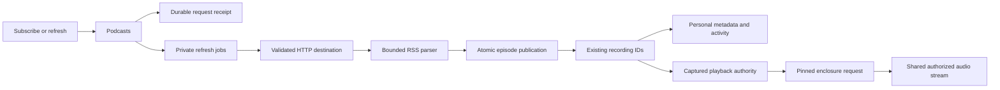

# Podcasts in development

RSS support is being built in `feature/podcasts`. Private subscriptions, episode publication, authorized audio, subscription lifecycle and the HTTP runtime are verified in development. RSS is not deployed to the normal server or available in the web interface yet. Scheduled updates, complete browser/native workflows and explicit downloads remain unfinished.

## Ownership

`Podcasts` owns private subscriptions, refresh jobs and episode origins inside core. It uses the existing catalog and collection, so an episode has a stable recording ID and can retain personal metadata, likes, progress and playlist occurrences. RSS subscriptions do not create plugin installations.

A subscription retrieves feed metadata. It does not open an enclosure or create a persistent download. Publication gives each episode a stable podcast source UUID. Enclosure addresses stay private inside core; public source facts contain an ID and the label "Podcast audio".

Explicit playback captures the current enclosure address, revision, subscription generation and account authority. Later opens and reads check that snapshot. A replaced enclosure invalidates old grants rather than letting them open the new address. Source choices still apply, and suitable local files and saved downloads retain priority.

An episode is identified by its subscription and opaque RSS GUID. Without a GUID, its enclosure address is the fallback identity. Titles and dates do not prove identity. A changed title or enclosure on an existing GUID updates its inherited metadata while retaining its episode and recording IDs. Missing items are retained rather than deleting listening state.

## Subscription controls and HTTP

Unsubscribing hides the subscription and stops its podcast audio authority. It preserves episodes, recording and source IDs, personal edits, likes, progress and playlist occurrences. Queued refreshes are cancelled. A running refresh retains its lease until its worker retires; a new subscription request conflicts while that obsolete work is still running.

Subscribing again with a new request UUID and the same normalized feed address reactivates the existing subscription and queues a fresh refresh. The original account, private library and access grant must still match. A changed generation prevents an old playback grant from becoming valid again. Replaying an earlier subscribe or unsubscribe request returns its original receipt without changing a later subscription cycle. Unsubscribe receipts share the existing transactional request-history budget.

The development server exposes authenticated JSON routes through the shared account extractor. The Rust handlers generate OpenAPI and TypeScript.

| Method | Route | Result |
| --- | --- | --- |
| GET | `/api/v1/podcasts` | The account's active subscriptions |
| POST | `/api/v1/podcasts` | A subscription receipt, HTTP 202 |
| GET | `/api/v1/podcasts/{id}/episodes` | An authorized continuation page |
| POST | `/api/v1/podcasts/{id}/refresh` | A refresh receipt, HTTP 202 |
| POST | `/api/v1/podcasts/{id}/unsubscribe` | An immutable acknowledgement |

Two polling workers belong to the server host and join its shutdown. Episodes use the existing recording-source and audio routes. Feed retrieval starts no audio or persistent download.

The lifecycle workflow passes through unsubscribe, restart, exact receipt replay and reactivation, including exact WAV playback and retained private state. A separate held-request scenario proves reactivation conflicts while the genuine old worker future is pending, then succeeds after that same worker retires. The old audio grant is first checked after reactivation and remains revoked.

The actual TCP server workflow passes account setup, subscription, background episode publication, source discovery and exact WAV delivery. Another account and anonymous requests cannot read the private episodes or audio. The fixture and host join on success or failure. Twenty-two selected core cases, this HTTP workflow, the additional held-worker case, strict core/server all-target Clippy and the generated frontend production build pass. This is selected development evidence, with no claim about UI operation or shutdown during every active network phase.

## Network and parsing

The HTTP implementation validates every resolved address and pins connections to that snapshot. Each redirect passes the same checks. Private destinations require an exact origin in administrator-controlled `CoreConfig.podcast_network`; ordinary subscription requests cannot supply an exception. No runtime environment setting or settings UI exists for this configuration yet.

The transport disables proxies, cookies, automatic redirects and retries. It uses fixed request headers, separate DNS/connect limits and a deadline for obtaining headers. Feed retrieval has a 20-second total limit and an 8 MiB body limit. Enclosure requests reuse the validated transport, with a 10-second header deadline and a 15-second limit on each awaited body read. There is no whole-audio deadline. Podcast audio allows 16 simultaneous streams and two per account, separate from the existing provider audio limits. Permits stay with the stream until completion, error, drop or revocation.

Podcast and provider audio share the strict representation parser, bounded buffering, revocation monitor and stream framing. The monitor can close an unread connection and release its permits after authority changes. It retains the tracing span and subscriber for safe deferred diagnostics.

The current parser accepts UTF-8 RSS 2.0, including iTunes author and duration fields. It treats descriptions as text and rejects DTDs, unknown entity references, malformed XML and duplicate episode identities. Its bounds include 64 levels of XML nesting and 5,000 audio episodes. Other feed formats and encodings have not been accepted.

## Verified so far

The earlier core-media checkpoint on 17 October 2026 passed 41 core cases and one production-process logging case. The core cases included 17 foundation checks, four media scenarios and 20 existing playback/provider compatibility checks. Lifecycle and HTTP evidence is recorded above. These are selected checks, not a full-suite or release result.

Foundation checks cover opaque GUIDs, relative enclosure addresses, empty optional feed fields, XML name validation, rejected external and undeclared entities, declared and unique expanded attribute names, actual pinned TCP delivery, blocked private redirects, mixed DNS rejection and rejection of empty userinfo before a connection or subscription is persisted.

The public scenarios use temporary SQLite and owned HTTP feeds. They verify restart durability, exact subscription and refresh receipt replay, stable episode/recording IDs after a refresh, and preservation of personal titles, likes, progress, playback speed and duplicate playlist occurrence IDs. Artist discovery follows inherited author changes while preserving personal overrides. Out-of-range duration and byte-length values preserve the last good snapshot and release the worker so another feed can proceed. Metadata-only scenarios never retrieve an enclosure or create a download intent.

The media scenarios verify exact deterministic WAV playback through a captured grant and HEAD, bounded ranges, suffix ranges and truthful 416 responses through `Catalog.open_audio`, the server's core entry point. Actual upstream requests contain only the expected safe headers. A replacement-enclosure scenario retains two old unread bodies, observes account saturation, then opens two fresh bodies before touching the old ones. Both new bodies return the replacement WAV; old grants and bodies reject further access without network I/O. Source identity and personal state survive. None of these operations creates a persistent download.

The logging regression launches the real server with a temporary database and `RUST_LOG=trace`, then contacts an owned HTTP plugin. It verifies private hostnames, credentials and paths stay out of logs while safe application DEBUG events and HTTP correlation remain available. Server and desktop initialization share the hard target filter. The desktop path has no equivalent process-level privacy evidence yet.

The request-work case uses 60,003 terminal jobs and 60,003 retained request receipts. Indexed job lookup and transactional receipt counters reduce measured new subscription work from about 840,000 to between 100 and 300 SQLite VM instructions, and refresh work from about 660,200 to between 200 and 300. Exact replays stay below 200 instructions at the meter's 100-instruction resolution.

Archive browsing uses a retained episode count and indexed continuation queries. Pages order dated episodes first, by publication time and episode ID descending, followed by undated episodes in descending ID order. Continuation cursors belong to one account, subscription and content revision; a successful refresh requires browsing to restart. A 100,000-episode fixture with repeated dates and 40,000 undated entries reaches deep pages through the public API. Twenty-row pages at depths 0, 59,998 and 99,980 each use about 2,200 to 2,900 SQLite VM instructions in the current media build, compared with about 602,500, 962,600 and 1,202,000 before the change. Exact episode and recording order, total counts and the terminal page are verified. These are query-work measurements, not latency benchmarks.

A separate public scenario verifies that refreshing the same GUIDs invalidates an old cursor while retaining episode IDs, total count and personal state. A fresh continuation works with a changed page size. Basic malformed-cursor, foreign-account and wrong-subscription reads are rejected. More malformed payload and concurrent authority boundaries remain unverified.

Personal-library creation belongs to identity and access management. RSS, provider adoption, playlist copies and Follow reuse that private library operation. Six existing provider, playlist-copy and Follow scenarios pass after moving the helper without changing its SQL, labels or ownership behavior. Strict Clippy passes for all core targets.

These checks do not establish the public release gates. The populated full-migration regression now reaches 0042 and preserves its prior data checks; the historical reset migration remains tested through 0039. A separate closed/reopened 0040-to-0041 database verifies typed old rows, rowids, generated sort keys, schema and migration checksums, private metadata/activity and duplicate playlist occurrences, then reopens through the latest core migration. Exactly two new podcast source UUIDs remain stable across two core restarts, and an existing unavailable local source stays intact. This is a migration fixture, not a deployment backup rehearsal.

Podcast-specific pending-handshake/read cancellation, logout, original-grant replacement, mixed manual source choices, hostile framing/redirect races, candidate iteration and global stream saturation still need broader public coverage. Existing provider cases exercise several shared mechanisms, but do not prove those podcast paths. Crash recovery, retained-episode removal, native output and release performance also remain open.

## Remaining integration

The next work includes scheduled and conditional refresh, complete failure recovery, Inertia contracts, shared UI workflows, authorized browser/native playback, and explicit downloads. A complete browser workflow and a restored-volume migration rehearsal are required before deployment. See [the release checklist](../TODO.md).
