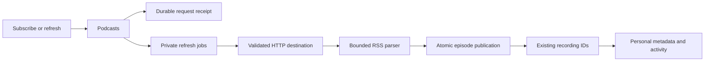

# Podcasts in development

RSS support is being built in `feature/podcasts`. It is not deployed to the normal server or available in the web interface yet. The release requirement still includes scheduled updates, playback, progress and explicit downloads.

## Ownership

`Podcasts` owns private subscriptions, refresh jobs and episode origins inside core. It uses the existing catalog and collection, so an episode has a stable recording ID and can retain personal metadata, likes, progress and playlist occurrences. RSS subscriptions do not create plugin installations.

A subscription retrieves feed metadata. It does not open an enclosure or create a persistent download. The current foundation does not publish a playable RSS source.

An episode is identified by its subscription and opaque RSS GUID. Without a GUID, its enclosure address is the fallback identity. Titles and dates do not prove identity. A changed title or enclosure on an existing GUID updates its inherited metadata while retaining its episode and recording IDs. Missing items are retained rather than deleting listening state.

## Network and parsing

The HTTP implementation validates every resolved address and pins connections to that snapshot. Each redirect passes the same checks. Private destinations require an exact origin in administrator-controlled `CoreConfig.podcast_network`; ordinary subscription requests cannot supply an exception. No runtime environment setting or settings UI exists for this configuration yet.

The transport disables proxies, cookies, automatic redirects and retries. It uses fixed request headers, separate DNS/connect limits and a deadline for obtaining headers. Feed retrieval has a 20-second total limit and an 8 MiB body limit. Audio delivery will need its own authorization and streaming limits.

The current parser accepts UTF-8 RSS 2.0, including iTunes author and duration fields. It treats descriptions as text and rejects DTDs, unknown entity references, malformed XML and duplicate episode identities. Its bounds include 64 levels of XML nesting and 5,000 audio episodes. Other feed formats and encodings have not been accepted.

## Verified so far

Docker verification on 17 October 2026 passes seven parser/HTTP boundary cases, six public core scenarios, two query-work cases, two migration regressions and one production-process logging case. They cover opaque GUIDs, relative enclosure addresses, empty optional feed fields, XML name validation, rejected external and undeclared entities, declared and unique expanded attribute names, actual pinned TCP delivery, blocked private redirects, mixed DNS rejection and rejection of empty userinfo before a connection or subscription is persisted.

The public scenarios use temporary SQLite and owned HTTP feeds. They verify restart durability, exact subscription and refresh receipt replay, stable episode/recording IDs after a refresh, and preservation of personal titles, likes, progress, playback speed and duplicate playlist occurrence IDs. Artist discovery follows inherited author changes while preserving personal overrides. Out-of-range duration and byte-length values preserve the last good snapshot and release the worker so another feed can proceed. No scenario retrieves an enclosure or creates a download intent.

The logging regression launches the real server with a temporary database and `RUST_LOG=trace`, then contacts an owned HTTP plugin. It verifies private hostnames, credentials and paths stay out of logs while safe application DEBUG events and HTTP correlation remain available. Server and desktop initialization share the hard target filter. The desktop path has no equivalent process-level privacy evidence yet.

The request-work case uses 60,003 terminal jobs and 60,003 retained request receipts. Indexed job lookup and transactional receipt counters reduce measured new subscription work from about 840,000 to between 100 and 300 SQLite VM instructions, and refresh work from about 660,200 to between 200 and 300. Exact replays stay below 200 instructions at the meter's 100-instruction resolution.

Archive browsing uses a retained episode count and indexed continuation queries. Pages order dated episodes first, by publication time and episode ID descending, followed by undated episodes in descending ID order. Continuation cursors belong to one account, subscription and content revision; a successful refresh requires browsing to restart. A 100,000-episode fixture with repeated dates and 40,000 undated entries reaches deep pages through the public API. Twenty-row pages at depths 0, 59,998 and 99,980 each use about 2,500 to 2,600 SQLite VM instructions, compared with about 602,500, 962,600 and 1,202,000 before the change. Exact episode and recording order, total counts and the terminal page are verified. These are query-work measurements, not latency benchmarks.

A separate public scenario verifies that refreshing the same GUIDs invalidates an old cursor while retaining episode IDs, total count and personal state. A fresh continuation works with a changed page size. Basic malformed-cursor, foreign-account and wrong-subscription reads are rejected. More malformed payload and concurrent authority boundaries remain unverified.

Personal-library creation belongs to identity and access management. RSS, provider adoption, playlist copies and Follow reuse that private library operation. Six existing provider, playlist-copy and Follow scenarios pass after moving the helper without changing its SQL, labels or ownership behavior. Strict Clippy passes for all core targets.

These checks do not establish the public release gates. The populated full-migration regression reaches 0040 and preserves its prior data checks; the historical reset migration remains tested through 0039. Broader migration, failure, cancellation, privacy and retention verification remain open.

## Remaining integration

The next work includes scheduled and conditional refresh, subscription lifecycle, complete failure recovery, authenticated HTTP and Inertia contracts, shared UI workflows, authorized browser/native playback, and explicit downloads. A complete browser workflow and a restored-volume migration rehearsal are required before deployment. See [the release checklist](../TODO.md).
