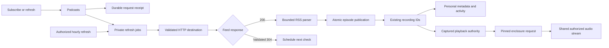

# Podcasts in development

RSS support is being built in `feature/podcasts`. Private subscriptions, episode publication, authorized audio, subscription lifecycle, scheduled conditional updates and the HTTP runtime are verified in development. The branch includes shared subscription and episode pages with manual feed refresh and unsubscribe. RSS is not deployed to the normal server. Complete browser/native acceptance and explicit podcast downloads remain unfinished.

## Ownership

`Podcasts` owns private subscriptions, refresh jobs and episode origins inside core. It uses the existing catalog and collection, so an episode has a stable recording ID and can retain personal metadata, likes, progress and playlist occurrences. RSS subscriptions do not create plugin installations.



A subscription retrieves feed metadata. It does not open an enclosure or create a persistent download. Publication gives each episode a stable podcast source UUID. Enclosure addresses stay private inside core; public source facts contain an ID and the label "Podcast audio".

Explicit playback captures the current enclosure address, revision, subscription generation and account authority. Later opens and reads check that snapshot. A replaced enclosure invalidates old grants rather than letting them open the new address. Source choices still apply, and suitable local files and saved downloads retain priority.

An episode is identified by its subscription and opaque RSS GUID. Without a GUID, its enclosure address is the fallback identity. Titles and dates do not prove identity. A changed title or enclosure on an existing GUID updates its inherited metadata while retaining its episode and recording IDs. Missing items are retained rather than deleting listening state.

## Subscription controls and HTTP

Unsubscribing hides the subscription and stops its podcast audio authority. It preserves episodes, recording and source IDs, personal edits, likes, progress and playlist occurrences. Queued refreshes are cancelled. A running refresh retains its lease until its worker retires; a new subscription request conflicts while that obsolete work is still running.

Subscribing again with a new request UUID and the same normalized feed address reactivates the existing subscription and queues a fresh refresh. The original account, private library and access grant must still match. A changed generation prevents an old playback grant from becoming valid again. Replaying an earlier subscribe or unsubscribe request returns its original receipt without changing a later subscription cycle. Unsubscribe receipts share the existing transactional request-history budget.

The development server exposes authenticated JSON routes through the shared account extractor. The Rust handlers generate OpenAPI and TypeScript.

| Method | Route | Result |
| --- | --- | --- |
| GET | `/api/v1/podcasts` | The account's active subscriptions |
| POST | `/api/v1/podcasts` | A subscription receipt, HTTP 202 |
| GET | `/api/v1/podcasts/{id}/episodes` | An authorized continuation page |
| POST | `/api/v1/podcasts/{id}/refresh` | A refresh receipt, HTTP 202 |
| POST | `/api/v1/podcasts/{id}/unsubscribe` | An immutable acknowledgement |

Two polling workers belong to the server host and join its shutdown. Episodes use the existing recording-source and audio routes. Feed retrieval starts no audio or persistent download.

The lifecycle workflow passes through unsubscribe, restart, exact receipt replay and reactivation, including exact WAV playback and retained private state. A separate held-request scenario proves reactivation conflicts while the genuine old worker future is pending, then succeeds after that same worker retires. The old audio grant is first checked after reactivation and remains revoked.

The actual TCP server workflow passes account setup, subscription, background episode publication, source discovery and exact WAV delivery. Another account and anonymous requests cannot read the private episodes or audio. The fixture and host join on success or failure. A separate public HTTP case verifies strict inputs, browser-origin protection, all five served OpenAPI operations and immutable command replay across reactivation. This is development evidence, with no claim about UI operation or shutdown during every active network phase.

## Status and saved playback reads

Subscriptions expose pending work, the last failed check, the last successful check time and the archive revision. A failed retry may still be pending, so failure and pending are independent. Failed checks retain the last successful archive. Feed addresses, enclosure addresses, validators and internal job details stay private.

`Collection.saved_playback` reads current saved positions and speeds for at most 200 requested recording IDs. It authenticates empty reads, rejects mixed inaccessible IDs, preserves the first requested order and omits authorized recordings without progress. It checks the session again after the query and has a one-second deadline. It does not search the latest 200 history entries. The authenticated `POST /api/v1/recordings/progress` route exposes this read through the shared account and strict JSON extractors.

The Inertia routes `/podcasts` and `/podcasts/{id}` return generated page contracts. Detail reads authorize the subscription even for partial requests that ask only for shared props. Episode and progress props load only when requested; one batch covers the selected episode page. These reads start no audio or persistent download.

The subscription page preserves an immutable request after an uncertain acknowledgement, polls pending checks with a bounded retry budget and retains the last good list after a read failure. Definitive input rejection permits a corrected feed with a new request UUID. A delayed acknowledgement preserves any newer draft.

The episode page renders its initial episodes and progress without fetching or playing. Resume sends the saved position, while Start over explicitly sends zero. Pagination replaces the shown page only after the new episodes and their saved positions both load. A stale archive cursor offers Load latest episodes. Account changes and unmounts abort reads and ignore late private responses. The current playback-start command restores position; restoring saved speed through that command remains unfinished.

Manual refresh retains its exact request UUID after an uncertain acknowledgement. Status polling refreshes the episode page and saved progress together. Older server-rendered props cannot replace a newer archive, and a completed check with an unchanged revision releases pagination after a pending check. Refresh leaves the shared player alone. Independent reviews accepted these workflows after regressions demonstrated and corrected both stale-state cases.

Unsubscribe retains its immutable command after a lost acknowledgement, including when status already omits the subscription. Navigation waits for the matching receipt. Accepted Like and playlist changes stay accepted without reloading an inactive detail page. The lifecycle cancels its own pending detail reload before sending unsubscribe and retires that read on account changes or unmount. It does not cancel unrelated router work or control the shared player. Two review cycles exposed the late-mutation and already-started-reload orderings; public-page regressions now verify both fixes.

Docker verification passes the public refresh-state and saved-playback cases, all three existing native saved-position cases, ten core library cases and three server podcast cases. Strict core/server all-target Clippy and formatting pass. The frontend passes 242 tests across 77 files, both TypeScript checks and the production build. These are component and HTTP checks, not complete browser/native podcast acceptance. Independent reviews accepted the private reads, subscription and episode workflows, and manual refresh.

The saved-playback work regression grows an analyzed one-record database to 100,000 owned recordings, closes and reopens it, then measures actual public reads with inherited, absent and fresh statistics. Before fixing join order, inherited statistics caused about 900,000 SQLite VM instructions for one recording and interrupted a 200-ID read at ten million. Indexed probes now use about 6,800 instructions for 200 IDs in each statistics state. Single-ID reads fall below the meter's 100-instruction sampling resolution. Exact results, ordering and privacy checks pass. These are query-work measurements, not latency benchmarks.

## Browser verification

A disposable host runs the real core, HTTP runtime and built Inertia UI with temporary SQLite and an owned 45-second PCM WAV. Only its exact RSS fixture origin is allowed. The example adds no production network setting or route. The browser refuses an initialized server before typing fixture credentials.

The guarded Chromium and WebKit workflow verifies subscription through the UI, metadata with zero enclosure requests, actual WAV delivery and advancing media time, uninterrupted navigation, seeking and pause, persisted progress, reload Resume and explicit Start over. It then likes the episode and refreshes the feed through the UI. The updated archive preserves episode, recording and source IDs, the like and exact saved progress. The player stays paused at the same position and source; refresh fetches no audio and creates no persistent download. Both engines use ordinary click gestures without an autoplay override. WebKit classifies its audio request differently; the test still requires its exact media URL, complete WAV length/header, duration and advancing position. This uses a source-mounted development host, not a packaged release image, native output or a physical phone.

The same workflow then unsubscribes through the UI and verifies its matching receipt and navigation to All podcasts. The active list and episode route no longer expose that subscription. Retained source IDs remain present but unready, while the recording's Like and exact progress remain readable. The paused media element keeps its source and position, with no new feed, enclosure, browser-audio or download request. This does not prove revocation during every active browser or native playback phase.

To reproduce from the repository root, use an isolated Compose project and the podcast overlay. Build the tools image, install/build the web app and compile the example first:

```sh
podcast_compose() {
  docker compose -p hito-podcast-e2e -f compose.yaml -f scripts/plugins/compose.tools.yaml -f scripts/podcasts/compose.e2e.yaml "$@"
}
podcast_compose --profile tools build rust
podcast_compose --profile tools run --rm node sh -eu -c 'npm ci && npm run build'
podcast_compose --profile tools run --rm rust cargo build --locked -p hito-server --example podcast_browser
podcast_compose --profile e2e up -d --no-build --wait e2e-server
podcast_compose --profile e2e run --rm browser npm run e2e -- e2e/podcast.spec.ts --browser=chromium
```

Recreate `e2e-server` with `up -d --force-recreate --no-build --wait e2e-server` before running `--browser=webkit`; every run requires a fresh first-run database. Finish with `podcast_compose --profile e2e down`. The overlay publishes no host ports and mounts no persistent application data.

## Scheduled and conditional updates

Successful feed checks schedule the next update one hour later. The public worker admits due subscriptions inside its existing claim transaction. Automatic checks create no client request receipts and retain the existing limits of 16 pending jobs per account, 128 globally, one running per account and two globally.

Core stores validated ETag and Last-Modified values with the exact normalized address of the successful representation. Conditional headers go only to that address, including across redirects. A 304 response requires a previous complete publication and a conditional request actually sent to the final address. It advances the successful-check time and schedule without publishing episodes or changing archive cursors, source identities or playback grants. A 200 response replaces validators, clearing omitted values. A valid 304 retains missing values. Malformed, duplicate or oversized optional validators are ignored.

Only a successful, authorized transaction may retain a new fetch address from an entirely permanent redirect chain. The original feed identity remains unchanged. Failed retrieval, parsing or publication preserves the last good snapshot. Recoverable publication errors roll back a savepoint before the worker records failure and releases its lease. Ordinary retries wait two and four seconds; a third failure or exhausted recovered lease postpones the next automatic job by one hour.

Cleanup keeps the newest 32 terminal jobs without client receipts for each subscription. Jobs referenced by immutable subscribe or refresh receipts remain retained. Both receipt lookups have dedicated indexes. This cleanup changes refresh bookkeeping, not listening history or personal data.

The public due-check fixture reopens core, ages only the due timestamp and verifies the actual conditional request and accepted 304. Its old cursor and captured grant still work, including exact WAV delivery. A real same-origin redirect to another path receives no old validators; its unsolicited 304 is rejected without replacing the last successful feed state. Another fixture performs 36 automatic checks after an initial publication and explicit refresh. Exactly the newest 32 automatic jobs and both receipt-backed jobs survive, with unchanged private metadata, duplicate playlist entries, progress, activity, synchronization events and exact receipt replay. These tests advance fixture timestamps; they do not prove an hour of wall-clock scheduling.

## Network and parsing

The HTTP implementation validates every resolved address and pins connections to that snapshot. Each redirect passes the same checks. Private destinations require an exact origin in administrator-controlled `CoreConfig.podcast_network`; ordinary subscription requests cannot supply an exception. No runtime environment setting or settings UI exists for this configuration yet.

The transport disables proxies, cookies, automatic redirects and retries. It uses fixed request headers, separate DNS/connect limits and a deadline for obtaining headers. Feed retrieval has a 20-second total limit and an 8 MiB body limit. Enclosure requests reuse the validated transport, with a 10-second header deadline and a 15-second limit on each awaited body read. There is no whole-audio deadline. Podcast audio allows 16 simultaneous streams and two per account, separate from the existing provider audio limits. Permits stay with the stream until completion, error, drop or revocation.

Podcast and provider audio share the strict representation parser, bounded buffering, revocation monitor and stream framing. The monitor can close an unread connection and release its permits after authority changes. It retains the tracing span and subscriber for safe deferred diagnostics.

The current parser accepts UTF-8 RSS 2.0, including iTunes author and duration fields. It treats descriptions as text and rejects DTDs, unknown entity references, malformed XML and duplicate episode identities. Its bounds include 64 levels of XML nesting and 5,000 audio episodes. Other feed formats and encodings have not been accepted.

## Verified so far

The conditional-refresh checkpoint on 17 October 2026 passed 26 core cases and three server cases. Formatting and strict core/server all-target Clippy pass. The HTTP milestone also regenerated OpenAPI and TypeScript and passed the frontend production build. Separate independent reviews of lifecycle/HTTP and scheduled/conditional production changes each passed their first round. These are selected checks, not a full-suite or release result.

The earlier core-media checkpoint passed 41 core cases and one production-process logging case, including 20 existing playback/provider compatibility cases. Its coverage overlaps the current checks and must not be added to their count.

Foundation checks cover opaque GUIDs, relative enclosure addresses, empty optional feed fields, XML name validation, rejected external and undeclared entities, declared and unique expanded attribute names, actual pinned TCP delivery, blocked private redirects, mixed DNS rejection and rejection of empty userinfo before a connection or subscription is persisted.

The public scenarios use temporary SQLite and owned HTTP feeds. They verify restart durability, exact subscription and refresh receipt replay, stable episode/recording IDs after a refresh, and preservation of personal titles, likes, progress, playback speed and duplicate playlist occurrence IDs. Artist discovery follows inherited author changes while preserving personal overrides. Out-of-range duration and byte-length values preserve the last good snapshot and release the worker so another feed can proceed. Metadata-only scenarios never retrieve an enclosure or create a download intent.

The media scenarios verify exact deterministic WAV playback through a captured grant and HEAD, bounded ranges, suffix ranges and truthful 416 responses through `Catalog.open_audio`, the server's core entry point. Actual upstream requests contain only the expected safe headers. A replacement-enclosure scenario retains two old unread bodies, observes account saturation, then opens two fresh bodies before touching the old ones. Both new bodies return the replacement WAV; old grants and bodies reject further access without network I/O. Source identity and personal state survive. None of these operations creates a persistent download.

The logging regression launches the real server with a temporary database and `RUST_LOG=trace`, then contacts an owned HTTP plugin. It verifies private hostnames, credentials and paths stay out of logs while safe application DEBUG events and HTTP correlation remain available. Server and desktop initialization share the hard target filter. The desktop path has no equivalent process-level privacy evidence yet.

The request-work case uses 60,003 terminal jobs and 60,003 retained request receipts. Indexed job lookup and transactional receipt counters reduce measured new subscription work from about 840,000 to between 100 and 300 SQLite VM instructions, and refresh work from about 660,200 to between 200 and 300. Exact replays stay below 200 instructions at the meter's 100-instruction resolution.

Archive browsing uses a retained episode count and indexed continuation queries. Pages order dated episodes first, by publication time and episode ID descending, followed by undated episodes in descending ID order. Continuation cursors belong to one account, subscription and content revision; a successful 200 publication requires browsing to restart, while an accepted 304 retains the cursor. A 100,000-episode fixture with repeated dates and 40,000 undated entries reaches deep pages through the public API. Twenty-row pages at depths 0, 59,998 and 99,980 used about 2,200 to 2,900 SQLite VM instructions in the core-media checkpoint, compared with about 602,500, 962,600 and 1,202,000 before the change. Exact episode and recording order, total counts and the terminal page are verified. These are query-work measurements, not latency benchmarks.

A separate public scenario verifies that refreshing the same GUIDs invalidates an old cursor while retaining episode IDs, total count and personal state. A fresh continuation works with a changed page size. Basic malformed-cursor, foreign-account and wrong-subscription reads are rejected. More malformed payload and concurrent authority boundaries remain unverified.

Personal-library creation belongs to identity and access management. RSS, provider adoption, playlist copies and Follow reuse that private library operation. Six existing provider, playlist-copy and Follow scenarios pass after moving the helper without changing its SQL, labels or ownership behavior. Strict Clippy passes for all core targets.

These checks do not establish the public release gates. The populated full-migration regression now reaches 0043 and preserves its prior data checks; the historical reset migration remains tested through 0039. A separate closed/reopened 0040-to-0041 database verifies typed old rows, rowids, generated sort keys, schema and migration checksums, private metadata/activity and duplicate playlist occurrences, then reopens through the latest core migration. It accepts only the intended additive validator column in the original table definition, verifies NULL legacy values and checks both exact receipt-index definitions. Exactly two new podcast source UUIDs remain stable across two core restarts, and an existing unavailable local source stays intact. This is a migration fixture, not a deployment backup rehearsal.

Podcast-specific pending-handshake/read cancellation, logout, original-grant replacement, mixed manual source choices, hostile framing/redirect races, candidate iteration and global stream saturation still need broader public coverage. Existing provider cases exercise several shared mechanisms, but do not prove those podcast paths. Crash recovery, retained-episode removal, native output and release performance also remain open.

## Remaining integration

The next work includes broader failure recovery, complete shared UI workflows, authorized browser/native playback and explicit podcast downloads. Status, saved-position reads, Inertia pages, manual refresh and unsubscribe are implemented; full podcast acceptance remains open. Existing persistent-download admission and storage capture plugin origins only; RSS needs its own durable origin and authority support before exposing Download. Complete browser/native acceptance and a restored-volume migration rehearsal are required before deployment. See [the release checklist](../TODO.md).

Admission saturation, exhausted-lease recovery, missing-validator responses, publication rollback and cancellation during publication still need direct broader coverage. Passing conditional and retention fixtures does not establish those boundaries.
