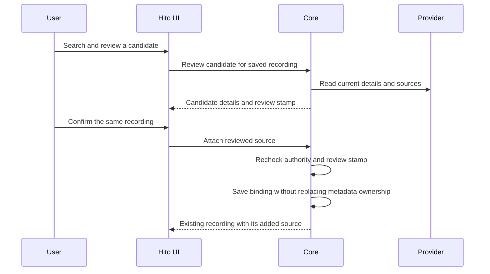

# Attaching audio to saved recordings

A saved recording can use audio from several connected providers. Adding a source preserves its recording ID, personal metadata, likes, progress and playlist entries. Imported copies and duplicate entries remain independent.

In track details, select **Find a source**, choose a connected music service and search. **Review match** compares the saved track with the provider's current details. **Use this source** confirms the association. Hito owns this interface; plugins return structured data.

A provider that does not offer sources can still save a recording from Discover. Hito keeps its metadata and artwork and stores no sources from it. Play finds audio through the other approved providers. **Find a source** still needs a provider that offers sources.

The user must check that the candidate is the same recording. Covers, live performances and remixes must remain separate. This workflow does not establish automatic matching.

Review does not save a recording, fetch audio or change the collection. Confirmation rechecks the account, current provider connection and review stamp. Stale or altered reviews are rejected. Account or track changes cancel pending UI work and suppress late responses.

Playback can refresh several existing provider bindings, accept a ready result while another provider stalls, and retry near the current position. Manual availability checks remain a separate action. Neither operation associates an unreviewed candidate.

## Verification and limits

The source is deployed in the normal local server on migration 0027. Its stopped backup, cloned restoration and migration preservation checks passed; see [deployment evidence](status.md#running-local-deployment). Public HTTP tests verify review, explicit attachment, stale-stamp rejection, account isolation and preservation of collection state. The frontend passed 142 cases, TypeScript checks and its production build. A release-image Chromium workflow passed import, two explicit attachments to one saved recording, playback and recovery through actual owned audio, stable duplicate playlist entries, private-account isolation and desktop/mobile control checks.

Search currently shows the first 20 results. Two provider refreshes run concurrently within a shared ten-second playback budget. Two stalled providers can delay later candidates; admission and started SQLite writes can also extend observed latency. These checks do not establish the release p95 target, official YouTube playback, codec compatibility or other-browser/platform acceptance.
