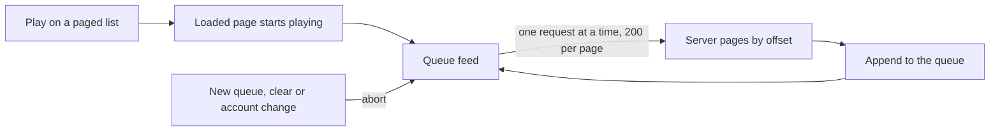

# Playback queue

The queue is the ordered list of entries a listener has chosen to play. Each entry has its own ID, so one recording can appear several times and each copy is edited on its own. In a browser, the Playback store in the page owns the queue. In the desktop app, the Rust player owns it and the page sends commands. Both expose the same `Player` interface to React.

## Operations

| Operation | Browser | Native |
| --- | --- | --- |
| Play a list | `playQueue` replaces the queue | `replace`, then `append` in chunks of 1,000 |
| Add later pages | queue feed appends batches | queue feed sends `append` commands |
| Select, remove, clear | yes | `select`, `remove`, `clear` |
| Move | `moveEntry(entry, before)` | `move` command with the same arguments |

`moveEntry` takes the ID of the entry to move and the ID of the entry it should land before, or `null` for the end. It never restarts the playing track. The playing entry keeps its ID, and its index is recomputed. Shuffle order is stored by entry, so a move leaves it alone. After a move the browser asks for its next-entry preparation again. If the next entry is unchanged, the buffered audio stays. If it changed, the old preparation is cancelled and the new next entry is prepared. See [next-entry preparation](next-entry-preparation.md).

## Playing a whole result

The Play button on the library, likes, search and album pages queues the whole result, not only the loaded page.

- The first page plays at once. The remaining pages arrive one request at a time, 200 entries each, through the existing paged JSON routes (`/recordings`, `/releases/{id}`).
- Play on a page after the first starts at the beginning of the whole result. Clicking a row plays from that row to the end of the result. Entries before a clicked row on an earlier page are not queued.
- The queue holds at most 100,000 entries, the same limit as the native owner. When a result is larger, the feed stops there and says so.
- Replacing the queue, clearing it, closing the native session or switching accounts aborts the request in flight. A page that arrives late is dropped.
- If a page fails, the entries already loaded keep playing and the player shows "The rest of the list could not be loaded."
- With shuffle on, each batch is mixed uniformly into the part of the shuffle order that has not played yet. A shuffled playthrough therefore covers the whole result, not one page at a time. The first track is still the clicked or first one.
- Playlists and history load all their entries with the page, so they already queue everything. Artist pages still queue only the loaded page. They need the same one-line listing wiring that the album page has.

## Large queues

The queue panel shows a window of rows, not pages. Each row is 56 pixels high and only the rows in view plus six on each side exist in the DOM. Page data is fetched in blocks of 50 through `queuePage`, and the previous block stays visible while a newer one loads. Position updates do not reach the list, so playback ticks never re-render rows.

The panel offers three ways to move an entry: a drag handle, and Move up and Move down buttons that work from the keyboard. After a button move, focus returns to the same control on the moved row and a polite live region announces the new position.

The release plan's gate is a library of 100,000 tracks, so the queue cap and tests use that size. It sets no latency number for queue edits.

## Measured so far

Browser numbers come from Vitest in Node (jsdom), no real network, on the development laptop. Native numbers come from a Rust debug build calling the player directly, without HTTP.

| Operation | 10,000 entries | 100,000 entries |
| --- | --- | --- |
| Browser move, p95 | 0.16 ms | 0.18 ms |
| Browser remove, p95 | 0.09 ms | 0.11 ms |
| Browser next, p95 | 0.35 ms | 0.16 ms |
| Browser queue page of 50, p95 | 0.005 ms | 0.006 ms |
| Native move, average | 0.11 ms | 0.35 ms |
| Native remove, average | 0.59 ms | 7.9 ms |
| Native page of 50, average | 0.8 ms | 0.8 ms |

A shuffled 100,000-entry result fed in 499 batches of 200 took 0.5 seconds in the browser test. The longest gap between two batches was 3.5 ms. These are unit timings. They do not include network time for 500 page requests, real layout, or scroll frame rates on a physical device. The Vitest suite asserts a loose 50 ms bound, not these numbers.

Moving and removing are still linear in queue size, because they shift an array. The constants are small enough that the cost does not show below 100,000 entries.

## Tests

- `BrowserQueue.reorder.test.ts` covers identity, no restart, preparation retargeting and shuffle.
- `BrowserQueue.supply.test.ts` and `NativeQueue.test.ts` cover feeding, cap, cancellation, failure and shuffle mixing.
- `QueueList.test.ts` renders 10,000 entries and checks the row count stays under 40.
- `catalog-play-all.test.ts` checks the exact page requests for library, likes, search and album.
- `BrowserQueue.scale.test.ts` holds the timings above.
- The Rust unit test in `traversal.rs` checks the shuffle mix.
- `e2e/queue-reorder.spec.ts` plays a three-page library in Chromium, reorders by keyboard and by drag, and follows the new order across a natural transition.
