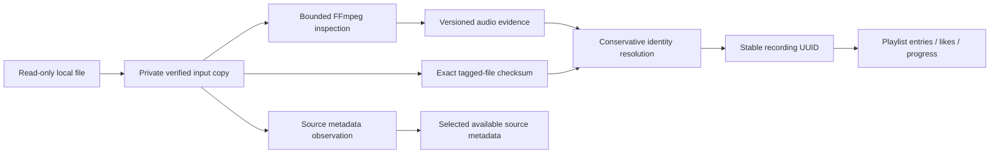

# Recording identity

A recording has a stable UUID. A playable source belongs to that recording. A local-file locator belongs to a source and a backend host. Changing tags or moving a file does not prove that its audio changed. Reusing its path does not prove that the recording stayed the same.

## Evidence and matching

`local_files.file_checksum` identifies the current file bytes, including tags. An unchanged checksum reuses a completed inspection. A failed inspection is retried on a later scan. A completed unsupported audio profile can reuse its exact-file result.

`recording_evidence` stores an algorithm and digest separately from the recording UUID. The current `ffmpeg-pcm-f64-v1` algorithm hashes decoded 64-bit floating-point PCM together with the codec name, sample rate, channel count, and channel layout. It does not round everything to 16-bit audio. Codec differences remain separate even when a listener might consider them the same performance. This is conservative content evidence, not acoustic fingerprinting or provider matching.

The resolver first checks continuity against the previous source's verified bytes or audio evidence. It then checks exact file anchors and an unambiguous audio match within the same library. Multiple historical candidates remain separate. Matching titles, durations, or paths alone never merge recordings. Replacing audio disables the former source locator while preserving the old recording and personal references.

Tags belong to individual sources. A recording keeps its selected metadata source while that source is available. If it disappears or is replaced, another available local source supplies the displayed metadata. Search updates in the same transaction. When no source survives, Hito keeps the last displayed metadata and clears its owner. Personal overrides and provider provenance are later release work.

## Existing libraries

Migration 0007 preserves every existing recording UUID and collection reference. The old whole-file hash becomes an immutable `initial_file_checksum` anchor. Current file checksums are stored independently.

Before resolving new files, an upgrade scan searches its configured root for unchanged checksum witnesses from the same host and library. Those witnesses can establish audio evidence for existing recordings before directory ordering affects matching. Immutable anchors remain discoverable after their old locator disappears, including on later scans. Existing locators reuse the witness inspection during the normal pass. A newly discovered witness can require a second decode. Evidence-only lookup can find historical roots; filesystem reads remain inside the current configured root.

If every legacy copy was changed before the first upgraded scan, Hito cannot prove continuity from the old checksum. It keeps the old recording and references unavailable and creates a separate recording for the changed file. It does not guess from the reused path. Historical aliases sharing audio evidence are retained rather than silently merged.

## Inspection limits

The scanner opens its selected music directory once and resolves reads relative to that owned handle through [cap-std](https://docs.rs/cap-std/4.0.3/cap_std/fs/struct.Dir.html). Descendant symlinks cannot grant access outside that directory. Media tools read a private temporary copy whose bytes supplied the checksum. Hito checks the original through the same directory handle before accepting the result. Temporary copies are removed after the last child process releases them. They are inspection files, not playback cache or persistent downloads.

Each inspector shares two file-reader permits and two child-process permits. File reads check cancellation and deadlines every 64 KiB, reject growth/truncation, and hold their permit until blocking work stops. Probe output is limited to 64 KiB; digest output to 256 bytes. Any error-level diagnostic, failed exit, malformed/empty hash, timeout, or cancellation rejects the inspection. Raw diagnostics are never logged.

Directory enumeration streams entries through a 32-path channel without collecting and sorting whole directories. It checks cancellation before advancing even through non-audio files and keeps at most 64 open directory iterators. Deeper trees fail the scan without reconciling missing sources. Stale sources are reconciled in batches of 64, including sources from a displaced configured root on the same host and library. The current configuration has one root; the planned multiple-folder model must reconcile against its complete configured folder set.

Default command timeout is five minutes, with a fifteen-second probe limit. Inputs allow only file/pipe protocols and the supported audio demuxers. Probe allocation and analysis budgets are explicit. Multi-audio-stream inputs, integer PCM above 32 bits, and profiles outside the rate/channel limits receive no decoded-audio evidence and use exact-file matching only.

## Verification and limits

Docker public-capability tests cover retagging with collection references, actual replacement and restoration, scan order and moved-root upgrades, transient decoder failure, metadata-owner fallback, cache reuse, private input ownership, process timeout/cancellation, and prompt shutdown during large-file verification. Controlled tag rewrites cover WAV, FLAC, MP3, Vorbis/Ogg, Opus, AAC/M4A, AAC/ADTS, AIFF, AAC/MP4, and WMA. Separate fixtures distinguish sample-rate changes and a one-bit difference in 32-bit PCM.

These tests exercise the pinned Linux Docker environment and its FFmpeg build. They do not establish native Symphonia compatibility, gapless playback, cross-platform decoder equivalence, acoustic matching, or the public-release performance gates. Decoder changes require compatibility verification before changing the evidence algorithm or accepting new evidence.
