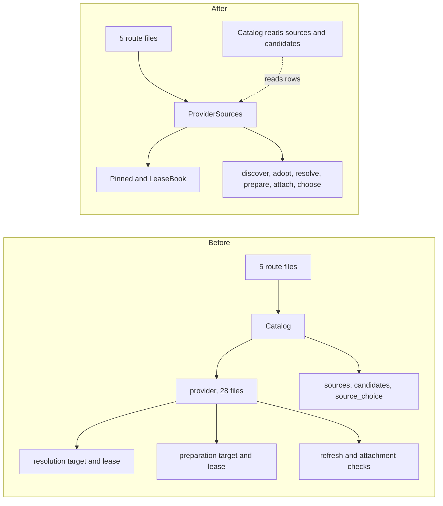

# RFC 0001: Provider source lifecycle as one module

Status: Proposed

Scope: design only. No code changes come with this document.

## Problem

Finding audio for a recording that has none is one idea. Discover candidates, resolve one, prepare it, attach it, let the listener choose it. In the tree that idea is spread over about 45 files, and each step repeats the same safety work.

Where the files are:

- `crates/core/src/catalog/provider/` has 28 files. They cover adoption (`adoption.rs`), attachment (`attachment.rs`), `preparation/` (8 files), `resolution/` (9 files), refresh (`refresh.rs`, `refresh/playback.rs`), `search.rs` and `sources.rs`.
- Five more core entries sit beside it. `crates/core/src/catalog/sources.rs`, `playback_sources.rs`, `candidates.rs`, `source_choice.rs` and the four files in `source_choice/`.
- The server has `apps/server/src/api/source_resolution.rs`, `source_preparation.rs`, `source_refresh.rs`, `source_bindings.rs`, `source_choice.rs`, plus `apps/server/src/source_resolution.rs` and `apps/server/src/runtime/source_preparation.rs`.

What repeats:

- Each verb re-derives what it must pin. `provider/refresh.rs`, `provider/metadata.rs`, `provider/preparation/requests.rs`, `provider/preparation/authority.rs` and `provider/resolution/authority.rs` each select the access grant or binding revision for themselves.
- Each long-running verb has its own lease. `provider/resolution/receipts.rs:22` defines a `Lease` with a token and a cancel path. `provider/preparation/lease.rs:8` defines a different `Lease`, a `Heartbeat` (line 19) and a claim query that folds three eligibility cases into one `EXISTS`.
- Each verb has its own target. `provider/resolution/authority.rs:8` and `provider/preparation/authority.rs:5` both carry `library_id`, `access_grant`, `binding_id` and `binding_revision`. Both are checked again at publication (`provider/resolution/publication.rs:19`, `provider/preparation/publication.rs:12`).
- Each verb has its own receipt and status type. They are exported one by one from `crates/core/src/catalog/mod.rs:18` and `:30`.
- `Catalog` carries state for only one verb. `resolution_callers` (`crates/core/src/catalog/mod.rs:82`) is per-account admission for resolve.

The server mirrors the split. Five route files each map one verb. `apps/server/src/source_resolution.rs` owns task lifetime and `apps/server/src/runtime/source_preparation.rs` owns a worker loop. A reader who wants to know what happens when a binding is revoked mid-resolution must compare the resolve, prepare, attach, refresh and choice files.

The cost shows in tests. `crates/core/tests` has 20 `source_resolution*` files and 8 `provider_source*`, `source_preparation*` and `source_choice*` files. Many exist because a rule is proven once per verb.

## Constraints

From `AGENTS.md` and existing invariants.

- Core capability services own identity, catalog, collection transactions and indexing. Service composition has no business forwarding methods. `Services` may gain a field, not a layer of wrappers.
- SQLite, SQL, migrations and transaction rules stay private to core.
- HTTP adapters authenticate through the shared extractor, map typed requests and results, and keep transport policy. Task lifetime for a disconnecting client is transport policy and stays in the server.
- Transactions. Publication rechecks access and the pinned binding revision inside the write transaction. A repeated `request_id` observes the first attempt.
- Privacy. No logs of titles, search terms, private paths, signed URLs, credentials or raw bodies. Safe outcomes and correlation IDs only.
- Identity. Provider evidence never merges recordings on a weak match.
- Recovery. Leases expire, submission uncertainty survives restarts (`submission_unknown`), and a restored database resumes without double submission.
- Generated OpenAPI and TypeScript keep coming from real routes and wire types. Wire names do not change here.
- No per-table repository traits. No one-file-per-function split.

## Options

### Option A. One `ProviderSources` capability

A new core service, a sibling of `Catalog`, owns the lifecycle. Callers see a handful of verbs and one receipt type per verb.

```rust
pub struct ProviderSources { /* store, plugins, SourceAuthority, LeaseBook, admission */ }

impl ProviderSources {
    pub async fn discover(&self, a: &Actor, q: ProviderSearch) -> Result<Vec<ProviderCandidate>>;
    pub async fn adopt(&self, a: &Actor, r: AdoptProviderRecording) -> Result<Recording>;
    pub async fn resolve(&self, a: &Actor, rec: &str, r: ResolveSource,
                         cancel: impl Future<Output = ()>) -> Result<SourceResolution>;
    pub async fn prepare(&self, a: &Actor, rec: &str, r: PrepareSource) -> Result<SourcePreparationReceipt>;
    pub async fn attach(&self, a: &Actor, r: AttachReviewedProviderSource) -> Result<Vec<Source>>;
    pub async fn choose(&self, a: &Actor, rec: &str, c: ChooseSource) -> Result<SourceChoiceReceipt>;
    pub async fn run_worker_tick(&self, stop: impl Future<Output = ()>) -> Result<bool>;
}
```

Usage stays one call per route: `services.provider_sources.resolve(&actor, &id, request, cancelled)`.

What it hides. Which binding revision a verb pinned and how publication rechecks it. Lease tokens, heartbeats and expiry. Which table holds the attempt. Deadlines and caller admission. One private `Pinned { library, access_grant, binding, revision }` with one `recheck(&mut tx)` replaces the two `Target` types.

Dependency strategy. In process. SQLite is a local dependency, tested with a real temporary database. Plugins are reached through the existing `Plugins::operation` boundary and tested against owned HTTP fixtures.

Trade-offs. Largest move. The payoff is that "what protects a publication" has one answer. Seven public verbs is wide, but each is a workflow a caller sees. Read-side listing (`Catalog::sources`, `playback_sources_until`, `playback_candidates`) stays in `Catalog`, since it reads the same rows without being a workflow.

### Option B. One job interface

All long-running verbs become kinds of one job. Callers submit and poll.

```rust
pub enum SourceJob { Resolve(ResolveSource), Prepare(PrepareSource), Refresh(RefreshSources) }
impl ProviderSources {
    pub async fn submit(&self, a: &Actor, rec: &str, job: SourceJob) -> Result<JobReceipt>;
    pub async fn status(&self, a: &Actor, job: JobId) -> Result<JobStatus>;
}
```

It hides the most, since leases, retries and recovery live in one queue. But `source_resolutions` and `source_preparations` already hold live rows with different phases and receipts. Resolve is synchronous with a deadline and prepare is polled. Folding them needs a migration of live state and changes the generated API. Resolve would become an artificial submit-then-wait.

### Option C. Shared kernel only

Leave every verb where it is. Extract the repeated parts into `catalog/provider/kernel.rs` (`Pinned`, one lease helper, one digest helper) and delete the two `authority.rs` targets.

```rust
pub(super) struct Pinned { pub library: String, pub access_grant: String, pub binding: String, pub revision: i64 }
impl Pinned { pub(super) async fn recheck(&self, tx: &mut SqliteConnection) -> Result<()>; }
```

Cheap and safe. The caller's view does not change: the 45-file spread, the `Catalog` namespace and five route files remain. It is the first step of Option A, not a rival.

## Recommendation

Option A, reached through Option C. Do C first. It is small and shows whether the pinned-target idea holds for every verb. Then move files under `crates/core/src/provider_sources/` and add `Services.provider_sources`. Reject B because it forces a live-data migration and an API change to remove duplication that A also removes.

Server task lifetime (`apps/server/src/source_resolution.rs`) stays in the server and calls `resolve` with a cancel future, as it does today.

## Migration plan

Each step is its own commit and leaves the suite green.

1. Add `Pinned` and `recheck` in `provider/kernel.rs` with a capability test that revokes membership between pin and publish. Adopt it in `resolution` only.
2. Adopt `Pinned` in `preparation`, then `refresh`, then `attachment`. One commit each. Delete the two `Target` types as they empty.
3. Unify the lease behind `LeaseBook` for resolution, then preparation. Both tables stay.
4. Add `ProviderSources` to `Services` and move `search`, `adopt` and `attach`. Routes switch receiver.
5. Move `resolve`, then `prepare` with the worker tick, then `choose`. `runtime/source_preparation.rs` calls `run_worker_tick`.
6. Drop the moved exports from `crates/core/src/catalog/mod.rs`. Update `docs/architecture.md`, `docs/provider-sources.md` and `docs/source-preparation.md`.

No stored data changes in any step. Table names stay.

## Test impact

- Existing capability tests (`source_resolution*`, `source_preparation*`, `provider_source*`) already call `Catalog` verbs. They become boundary tests of `ProviderSources` by changing the receiver, not the assertions. `*_upgrade.rs` tests do not change.
- HTTP tests under `apps/server/tests/source_*` are untouched. Routes and wire types are stable.
- TDD order. Write the step 1 kernel test first. For each later step, change the test receiver first, watch it fail to compile, then move the code.
- Tests that exist only to repeat one rule per verb can merge into the kernel test. Do that in a separate commit after the move so a failure points at one cause.

## Risks and open questions

- Does `choose` belong to this lifecycle or to playback preference? It reads and writes the same bindings, so this RFC includes it. Say if you want it left out.
- Seven public verbs is wide. If you prefer, split `choose` and `discover` out.
- The move conflicts with any open worktree touching `catalog/provider`. Sequence it after other release-plan slices land.
- Step 3 touches lease expiry. A bug there can double-submit to a debrid provider. The `source_preparation_recovery` and `source_preparation_uncertainty` tests must stay unchanged and green.

## Ownership before and after


