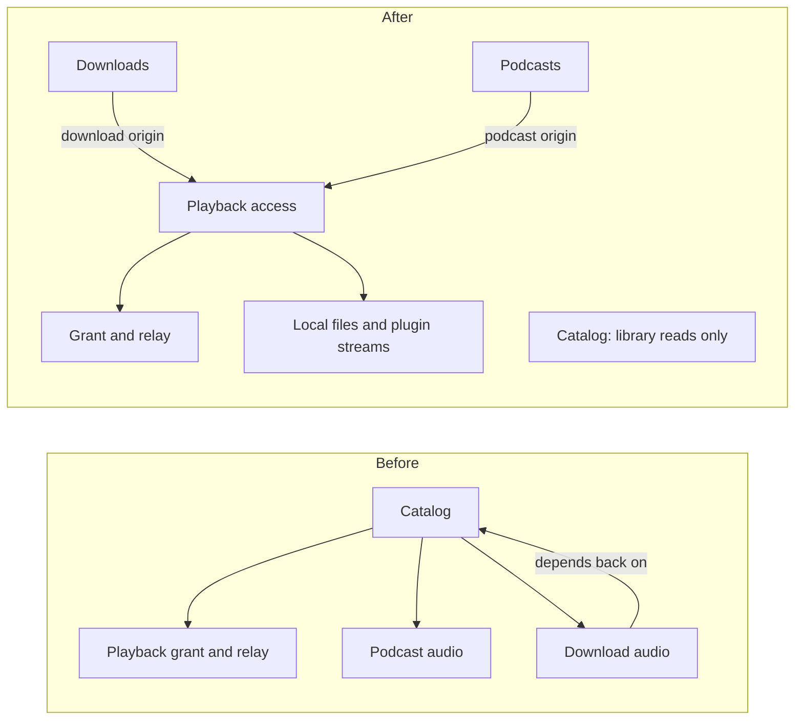

# RFC 0002: Give playback access its own owner

Status: Implemented

## The problem

The catalog is the service that answers questions about the library: albums, artists, search. It had also become the place that opens audio for every kind of source: local files, downloads, provider streams and podcast episodes. To do that, it held podcast and download state that belonged to other services.

That caused three issues:

- Changing how podcasts stream or how downloads are kept meant editing the catalog, and catalog tests needed podcast and download fixtures.
- The catalog and the downloads service depended on each other in a loop.
- The playback grant, the security check that decides whether an account may hear one exact source right now, was spread across six files mixed in with library reads.

## What must stay true

The playback grant rules from [playback access](../playback-access.md) stay exactly the same:

- The session must be valid and the account must still belong to the library.
- The source must be the same one the grant was issued for, whether that's the same folder, download, plugin connection or podcast episode.
- A failed check ends the grant for good.
- Revocation is noticed within a quarter of a second.
- A grant never exposes private paths or signed links, and logs use only the grant's number.

Download clean-up and podcast stream limits keep their behavior. Stored data and the HTTP API don't change.

## Options

**A. A new playback access service.** It owns the grant and the audio relay. Each kind of source plugs in as an origin, supplied by the service that owns its data: downloads supply the download origin and podcasts supply the podcast origin. Local files and plugin streams live in the playback service itself.
This moves the most code, but it breaks the loop, and a new kind of source means adding one origin without touching the grant.

**B. Origins plugged into the catalog.** Same plug-in idea, but the catalog keeps the grant.
This is a smaller move, but the catalog still owns a security boundary that has nothing to do with browsing.

**C. Just group the code.** Collect the podcast and download pieces inside the catalog.
Tidier, but the loop and the mixed responsibilities stay. It's useful only as a first step.

## Decision

Option A, starting with C as an interim step. The grant is a security boundary and deserves its own owner, and only a one-way plug-in removes the loop.

## What we did

1. Wrote one contract test that every origin must pass through the public grant, and ran it against the old code first.
2. Grouped the podcast and download state inside the catalog. That interim step is gone now.
3. Replaced the fixed list of source kinds with an ordered set of origins. A test pins the order (plugin, podcast, download, local), and the first match wins.
4. Moved the download origin into the downloads service and the podcast origin into the podcasts service. The catalog no longer depends on downloads.
5. Created the playback access service. Callers changed only which service they call, and tests changed the same way.
6. Podcasts now read episode recordings through a shared recording reader instead of holding the whole catalog.

The API and generated types did not change.

## What is still imperfect

- Downloads and podcasts no longer hold the catalog, but they still borrow two small helpers from it.
- The audio relay is shared by downloads and plugin media, so a dependency loop remains at the module level. The playback service itself doesn't depend on downloads or podcasts.
- Playback access still reuses some of the catalog's source queries and its local file reader. Artwork extraction needs that reader too.

## Ownership before and after

