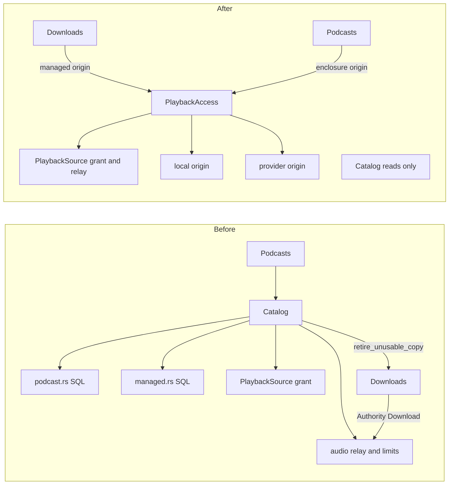

# RFC 0002: Separate podcasts and downloads from Catalog

Status: Implemented

Scope: design. The code follows in the commits listed under What changed.

## Problem

`Catalog` is the library read service. It also opens audio for four kinds of source (local file, managed download, provider stream, podcast enclosure), and to do that it carries podcast and download state that other services own.

Evidence in the current tree:

- `crates/core/src/catalog/mod.rs:74-88` defines `Catalog`. It holds `managed` (line 84), `podcast_remote` (85), `podcast_audio_slots` (86) and `podcast_audio_accounts` (87). None of these serve browsing or search.
- `crates/core/src/catalog/podcast.rs` runs podcast SQL (`current_podcast_sources`) inside `Catalog`. `crates/core/src/catalog/managed.rs:31` runs download SQL over `download_files`, `download_intents` and `retained_download_intents`.
- `crates/core/src/catalog/audio/enclosure.rs` opens podcast audio with Catalog-owned limits. `crates/core/src/catalog/media.rs:26-30` opens managed files and calls `crate::downloads::retire_unusable_copy`, so Catalog reaches into Downloads.
- The dependency runs both ways. `crates/core/src/catalog/audio/remote.rs:11` has `Authority::Download(crate::downloads::DownloadAuthority)`, and `crates/core/src/downloads/podcast.rs:37` builds it.
- `Podcasts` holds the whole `Catalog` (`crates/core/src/podcasts/mod.rs:25`) and uses it for one thing, `recordings_by_ids` (`crates/core/src/podcasts/episodes.rs:113`).
- `crates/core/src/lib.rs:127-142` builds `Catalog` with podcast fields, then clones `Catalog` into `Podcasts` (line 149). `Downloads` (`crates/core/src/downloads/mod.rs:33-41`) gets its own copy of the same `RemoteHttp`.
- `crates/core/src/catalog/playback.rs:27` defines `Binding { Local, Provider, Podcast }`. Download audio is a `Local` binding whose location is `Location::Managed` (`crates/core/src/catalog/media.rs:17`). The grant revalidates each kind by re-running that kind's query (`playback.rs` `check`).

The effect. Changing podcast enclosure rules or download retention means editing `Catalog`, and `Catalog` tests need podcast and download fixtures. The playback grant, which [playback access](../playback-access.md) calls a security boundary, is spread over `playback.rs`, `media.rs`, `managed.rs`, `podcast.rs`, `audio.rs` and `audio/*`.

## Constraints

- Playback grant invariants stay exact. Session identity and expiry, durable library membership, per-kind location pinning (folder generation, download intent and access grant, provider audio generation, enclosure revision), one second authority checks, a grant permanently invalid after any check failure, 250 ms revocation polling. See [playback access](../playback-access.md).
- A grant never exposes private paths, locators or signed URLs, and logs use the numeric grant ID.
- SQLite and SQL stay private to core. No per-table repository traits.
- No forwarding methods in `Services`. If the public `Catalog::playback_source` moves, it moves; it is not wrapped.
- Public callers (`hito-playback`, the desktop host, `apps/server/src/audio.rs`) change by receiver only.
- Download retirement on a missing file, and podcast per-account and global stream limits, keep their behavior.
- Upgrade tests and stored schema do not change.

## Options

### Option A. `PlaybackAccess` capability with pluggable origins

A new core service owns the grant and the audio relay. Each source kind is an origin supplied by the capability that owns its data.

```rust
pub struct PlaybackAccess { store: Store, origins: Origins, relay: RelayLimits }

pub(crate) trait AudioOrigin: Send + Sync {
    async fn locate(&self, actor: &Actor, source: &str) -> Result<Option<Located>>;
    async fn still_valid(&self, actor: &Actor, source: &str, located: &Located) -> Result<bool>;
    async fn open(&self, grant: &PlaybackSource, req: AudioRequest) -> Result<OpenedAudio>;
}

impl PlaybackAccess {
    pub async fn playback_source(&self, a: &Actor, recording: &str, source: &str) -> Result<PlaybackSource>;
    pub async fn open_audio(&self, a: &Actor, source: &str, r: AudioRequest) -> Result<OpenedAudio>;
}
```

`Downloads` implements the managed origin and `Podcasts` the enclosure origin, next to their SQL. Local files and provider streams are implemented in `PlaybackAccess` itself (local needs `Directories`, provider needs `Plugins`). `Catalog` loses `managed`, `podcast_*` and the audio modules.

What it hides. The order in which kinds are tried, the grant lifetime, the stream limits and the revalidation loop. A new source kind means one new origin and no edit to the grant.

Dependency strategy. In process. The trait is internal (`pub(crate)`), so there is one real adapter per kind and no mock. Tests use real SQLite, owned HTTP fixtures for podcast and provider bytes, and generated WAV files.

Trade-offs. Moves the most code (about 15 files). Resolves the Catalog and Downloads cycle, because the origin trait points one way. The enum `Binding` becomes a trait object plus an opaque `Located`, which is less exhaustive than an enum. Matching on kinds in tests gets harder.

### Option B. Origins injected into Catalog

Keep `Catalog::playback_source` and `open_audio`. Catalog holds `Vec<Arc<dyn AudioOrigin>>` and no podcast or download fields. `Podcasts` and `Downloads` register their origin at composition in `crates/core/src/lib.rs`.

```rust
Catalog { origins: vec![downloads.origin(), podcasts.origin(), local, provider], .. }
```

It removes the fields and SQL from Catalog with a smaller move and no public rename. But Catalog stays the owner of the playback grant, so the name still says "library reads". Order of origins becomes a hidden rule set in `lib.rs`.

### Option C. Group the fields

Wrap the four fields in `AudioRelay` inside Catalog and move `podcast.rs` and `managed.rs` into `catalog/audio/`. No new service, no trait.

It makes `Catalog` shorter and groups the code, but the Catalog and Downloads cycle and `Podcasts` holding `Catalog` both remain. Fine as an interim step.

## Recommendation

Option A, with Option C as its first commit and Option B's registration idea inside A. The grant is a security boundary and deserves its own owner. The cycle between `Catalog` and `Downloads` is the real defect, and only a one-way trait removes it.

`Podcasts` also stops holding `Catalog`. Replace the `recordings_by_ids` call with a read model owned by `Podcasts` or with a function in core's recording read module, whichever the user prefers (see questions).

## Migration plan

Each step is a commit and stays green.

1. Group `managed`, `podcast_remote`, `podcast_audio_slots` and `podcast_audio_accounts` into `AudioRelay` inside Catalog (Option C). Move `podcast.rs` and `managed.rs` under `catalog/audio/`.
2. Add `AudioOrigin` and an internal `Origins` registry. Express the existing four kinds as origins with no behavior change. `Binding` still exists and is built from `Located`.
3. Move the managed origin into `downloads/` and the enclosure origin into `podcasts/`. Break `Authority::Download` by moving authority checks behind `AudioOrigin::still_valid`.
4. Create `PlaybackAccess` in `Services`. Move `playback.rs`, `media.rs`, `audio.rs` and `audio/*` into it. Update `hito-playback`, desktop and `apps/server/src/audio.rs`.
5. Remove the `Catalog` field from `Podcasts`. Update `docs/playback-access.md`, `docs/podcasts.md` and `docs/architecture.md`.

## Test impact

- The playback grant tests (logout, expiry, membership revoke and restore, folder reconnect, provider credential removal, capability withdrawal) are already public capability tests. They change receiver from `catalog` to `playback` and nothing else.
- Podcast and download audio tests move their fixtures to the owning module's tests but keep calling the public grant.
- Add one origin contract test run against all four origins: stale `locate` result must fail `still_valid`; revoked grant never revives.
- TDD order. Step 2 first adds the contract test against the existing code (it should pass for local and fail nowhere). Steps 3 and 4 then keep it green. A failing test here means a moved check was lost.
- Upgrade tests (`podcast_download_upgrade`, `podcast_media_upgrade`) do not change.

## Risks and open questions

- Is `recordings_by_ids` for podcast episodes better as a shared core read function or as SQL inside `Podcasts`? The first keeps one recording-shape. The second duplicates a join.
- Should `PlaybackAccess` also own `audio_file` (used by local file streaming) or stay with Catalog? This RFC moves it.
- Origin ordering today is implicit (managed before indexed, provider first). The registry must keep it. Needs a test, not a comment.
- Native playback owner and desktop compile against `Catalog::playback_source`. A rename breaks them in the same commit as step 4.

## Ownership before and after



## What changed

Implemented as Option A, with Option C as the first step, in separate commits:

1. `tests/playback_origin_contract.rs` runs one contract over the local, managed, provider and podcast origins through the public grant. It passed on the old code.
2. `managed`, `podcast_remote`, `podcast_audio_slots` and `podcast_audio_accounts` moved into one `AudioRelay` struct inside `Catalog`. This step was interim and is gone now.
3. `AudioOrigin`, the opaque `Located` value and an ordered `Origins` registry replaced the `Binding` enum. A unit test pins the order (provider, podcast, managed, local) and first-match-wins.
4. `ManagedOrigin` moved to `downloads/` and `EnclosureOrigin` to `podcasts/`. Stream authority became the `AuthorityCheck` trait, so the relay no longer names `DownloadAuthority`. `Catalog` no longer imports `Downloads`.
5. New `PlaybackAccess` service (`Services::playback`) owns `playback_source`, `open_audio`, `audio_file`, `preferred_playback_source`, `playback_candidates`, `PlaybackSource` and the relay. `hito-playback` and `apps/server/src/audio.rs` changed by receiver. Tests changed by receiver only.
6. `Podcasts` reads episode recordings with the shared `recordings_on` function and no longer holds `Catalog`.

Open questions, answered by the smallest change:

- `recordings_by_ids` for episodes: a shared core read function. `recordings_on` already served audiobooks and artist groups, so the recording shape stays in one place.
- `audio_file`: moved to `PlaybackAccess` with the rest of the local file path.
- Origin ordering: pinned by a unit test.
- Native playback and desktop: they compile against `PlaybackSource` and `Services::playback`; only `hito-playback` needed edits.

`Catalog` keeps a private `LocalFiles` reader because artwork extraction reads embedded pictures from local files. `PlaybackAccess` shares it for the local origin. A provider source opened through `open_audio` still skips grant admission, as before. The old guard that rejected a provider binding in the grant-based open path is gone, because the source-kind filter in SQL already excluded those sources.

Remaining coupling, stated precisely:

- `Downloads` and `Podcasts` no longer hold `Catalog`, but they still import from it. `downloads/managed_origin.rs` and `podcasts/enclosure_origin.rs` use `catalog::push_source_choice`, and `podcasts/episodes.rs` uses `catalog::recordings_on`.
- There is still a module-level cycle through `playback_access`. `downloads/podcast.rs` and `plugins/media` import `playback_access::relay`, while the managed and enclosure origins live under `downloads/` and `podcasts/` and are only wired together in `lib.rs`. `PlaybackAccess` itself names neither `Downloads` nor `Podcasts`.
- `PlaybackAccess` reads `catalog` SQL predicates and `LocalFiles`.

`docs/openapi.json` and `apps/web/src/generated.ts` are unchanged.
