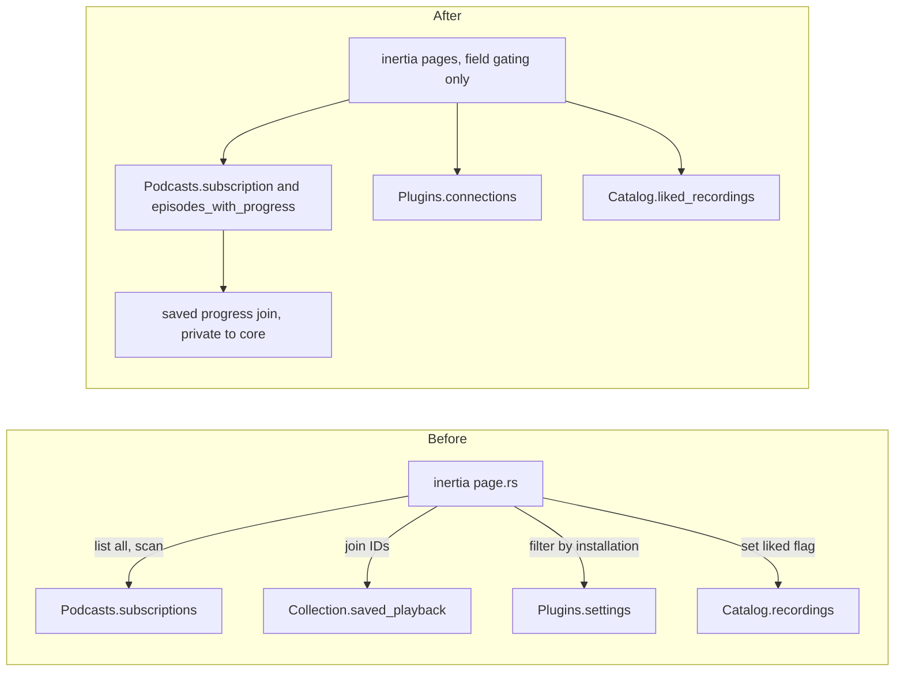

# RFC 0003: Inertia page assembly into core read models

Status: Implemented

Scope: design. The Recommendation and Migration plan below were implemented; see What changed at the end.

## Problem

`apps/server/src/inertia/page.rs` (481 lines) turns a path into page props. In doing so it makes data decisions that belong to a capability: how to find one podcast, which services a page may show, how to join saved progress, and how to filter likes. Transport code (which props a partial reload asked for) and library rules are interleaved in one `match`.

Evidence:

- Podcast lookup by linear scan. `Screen::Podcast` calls `services.podcasts.subscriptions(actor)`, loads every subscription, and finds one by ID (`apps/server/src/inertia/page.rs:117-125`). A point lookup would be one indexed query, and `subscriptions` is built to list.
- Saved progress join. The same arm collects episode recording IDs, parses each as a UUID, and calls `services.collection.saved_playback` (`page.rs:136-152`). Two capabilities are joined in the adapter. The 200 recording cap in `crates/core/src/collection/saved_playback.rs:19` holds only because episode pages clamp to 200 (`crates/core/src/podcasts/episodes.rs:65`). The adapter does not know about that coupling.
- Opposite connected-services rules. `PlaylistIndex` keeps only services with an installation (`page.rs:372-387`). `Discover` returns all services (`page.rs:421-435`). Both start from the same `services.plugins.settings(actor)` (`crates/core/src/plugins/installations.rs:12`). The difference is not named anywhere.
- Likes. The Likes page mutates the caller's search, `search.liked = Some(true)` (`page.rs:291-293`), duplicating a flag the JSON route also accepts (`apps/server/src/api/catalog.rs:30`). "The liked list" is not a core concept.
- Optional-field plumbing repeats. Each arm has the shape `if fields.requested("x") { Some(call().await?) } else { None }`. Most of the 18 screens repeat it.

`PageComponent` now exists as an enum (`apps/server/src/inertia/props.rs:17`), so naming components is solved. What remains is the data assembly.

Tests: `apps/server/tests/podcast_pages.rs` drives the page and the JSON API with a full server to check one join. The rule is not testable without HTTP.

## Constraints

- HTTP adapters authenticate through the shared extractor, map typed requests and results, and keep transport policy. Which props a partial reload requests (`Protocol::requested`) is transport policy and stays in the server.
- Core owns SQL, joins and transactions. No SQL in the server.
- Privacy and access. Every read checks the actor's session and library membership. Another account's subscription must read as not found, not forbidden.
- Generated OpenAPI and TypeScript come from real routes and wire types. Page prop types in `props.rs` keep their wire shape, so `docs/openapi.json` and `apps/web/src/generated.ts` do not change.
- No forwarding methods in `Services`. Core read models are real methods on the owning capability, not pass-throughs.
- Page rendering and workflow hooks in the web app are unchanged.

## Options

### Option A. Named read models on the owning capability

Add typed reads where the data lives. Keep field gating in the server.

```rust
impl Podcasts {
    pub async fn subscription(&self, a: &Actor, id: Uuid) -> Result<PodcastSubscription>;
    pub async fn episodes_with_progress(&self, a: &Actor, id: Uuid, q: PodcastEpisodeQuery)
        -> Result<EpisodesWithProgress>;           // page + saved progress, one authorised read
}
impl Plugins {
    pub async fn connections(&self, a: &Actor) -> Result<Connections>;
}
pub struct Connections { pub installations: Vec<PluginInstallation>, pub services: Vec<PluginService> }
impl Connections { pub fn connected_services(&self) -> impl Iterator<Item = &PluginService>; }
impl Catalog {
    pub async fn liked_recordings(&self, a: &Actor, s: Search) -> Result<Page<Recording>>;
}
```

Usage in `page.rs`: `services.podcasts.subscription(actor, id).await?`. The adapter decides whether to ask for progress by field name, then calls one method.

What it hides. The scan versus lookup. The UUID parsing and the 200 cap. Which join pairs episodes with progress. The meaning of "connected". The liked flag.

Dependency strategy. In process, real temporary SQLite. `episodes_with_progress` lives in core and may call the same SQL helper `Collection::saved_playback` uses, kept private to the crate.

Trade-offs. Four small new methods. The two connected-services rules stay different on purpose but are now named (`connected_services()` versus all `services`), and the choice is visible at the call site.

### Option B. One `Views` service with a method per page

```rust
impl Views {
    pub async fn page(&self, a: &Actor, screen: ScreenId, want: &FieldSet) -> Result<ScreenData>;
}
```

Core would return the whole `ScreenData` enum. It removes the most code from the server but moves `FieldSet`, a partial reload protocol detail, into core. Core would then know about Inertia. It also grows into a second API model that mirrors `props.rs`, which `AGENTS.md` says not to hand-maintain.

### Option C. Split `page.rs` by page, no core change

Move each arm of `props` into `inertia/pages/<page>.rs` with a small function each. `page.rs` shrinks to routing. No behavior change.

Safe and mechanical. It makes the file smaller but the linear scan, the cross-capability join and the filtering rules stay in the adapter and still need a server test to prove them.

## Recommendation

Option A first, then Option C for whatever is left. A puts the rules where they can be tested without HTTP. C afterwards is cheap because each arm is by then one call. Reject B: core must not learn the partial-reload protocol.

## Migration plan

Small commits, each green.

1. `Podcasts::subscription` with a capability test: another account's ID reads as not found. Replace the scan in `page.rs`.
2. `Podcasts::episodes_with_progress` with a test that returns progress for the page's episodes and honors the 200 cap by paging. Replace the join in `page.rs`.
3. `Plugins::connections` and `Connections::connected_services`. Capability test for both rules. `PlaylistIndex` and `Discover` call them.
4. `Catalog::liked_recordings`. The Likes arm calls it. The JSON route may keep its query flag.
5. Split `page.rs` into per-page modules under `apps/server/src/inertia/`.
6. Update `docs/architecture.md` (data flow) and `docs/podcasts.md`.

Wire shapes do not change in any step, so regenerate nothing. If a regenerate shows a diff, stop and treat that as a bug.

## Test impact

- `apps/server/tests/podcast_pages.rs` keeps its HTTP checks for contract shape. The join and not-found rules get capability tests in `crates/core/tests`, written first.
- Existing podcast and plugin settings tests are unchanged.
- TDD order. Each step starts with a failing capability test, then the core method, then the adapter swap. The HTTP test must stay green throughout and is the guard that the wire output is identical.
- Add one server test that proves a partial reload of `episodes` alone does not call the progress read.

## Risks and open questions

- Is the difference between `PlaylistIndex` (connected services only) and `Discover` (all services) intentional? The names are used for labels. If one is a bug, the user should say which.
- Should `episodes_with_progress` always include progress, with the server dropping it when not requested? That costs one extra read on pages that omit it. The sketch keeps it as a separate call, but progress-only reloads then need the page IDs again.
- The Likes page's `liked` filter may want pagination semantics distinct from search. Not decided here.
- Partial reload protocol stays in the server. If a second adapter (desktop) needs the same assembly, revisit.

## Ownership before and after



## What changed

Implemented as Option A, then Option C, in separate commits:

1. `Podcasts::subscription` replaces the list-and-scan. Another account's ID, an unknown ID and a malformed ID all read as not found, and the session is checked before the ID is parsed. It no longer inherits the 100-row scan cap of `subscriptions()` (a 101st subscription used to read as not found; it now resolves). This is intentional.
2. `Podcasts::episodes_with_progress` returns the episode page and saved progress for exactly that page. The progress read is a crate-private helper shared with `Collection::saved_playback`, including its one-second deadline and outcome logging. A reload that asks only for `episodes` does not run it; a server test checks this through the debug log.
3. `Plugins::connections` returns `Connections`. `connected_services()` keeps `PlaylistIndex` behaviour (installed services only) and `offered_services()` keeps `Discover` behaviour (all services). The difference is preserved, not decided; it is still an open question.
4. `Catalog::liked_recordings` forces the liked filter, so the Likes page no longer mutates the caller's search. The JSON route keeps its `liked` query flag.
5. `inertia/page.rs` (481 lines) is split into `inertia/pages/` (`mod.rs` routing and shared props, `catalog.rs`, `playlists.rs`, `audiobooks.rs`, `podcasts.rs`, `discover.rs`).

`docs/openapi.json` and `apps/web/src/generated.ts` are unchanged. `docs/podcasts.md` records the core read models.
