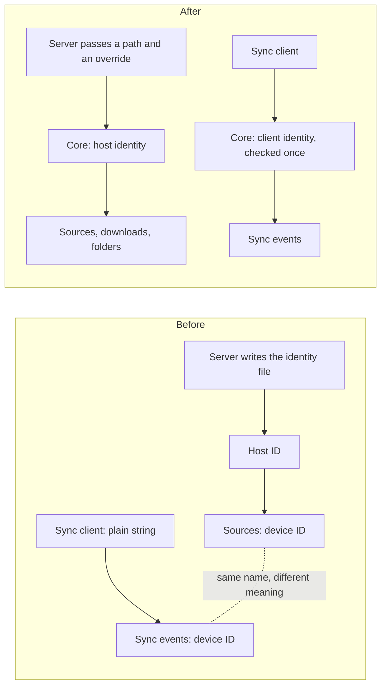

# RFC 0004: Tell host identity and sync client identity apart

Status: Proposed

## The problem

Hito has two identities that look alike and mean different things:

- **Host identity** says which machine owns local files and downloads. A local source only plays on the machine that holds the file.
- **Sync client identity** says which app or device sent a change, so that synchronization can order and deduplicate it.

The code doesn't keep them apart. Both are stored in columns called "device ID". The host identity also appears under two more names, and the API sends the host identity in a field whose name suggests the client. The client identity is a plain string, checked by a copy of the host identity's validation rule. And the code that creates and stores the host identity file lives in the server, even though file ownership belongs to the core. The desktop app reaches into the server to use it.

The [operations guide](../operations.md) already explains that the two are different. The code should make it impossible to mix them up.

## What must stay true

- A host identity never grants access just because a client sent it. A client identity never selects local files.
- Local sources are matched on the stored host identity. Changing stored values would leave audio unplayable.
- An existing database without an identity file still adopts the legacy value `server`.
- A restored backup works with the new version, as long as the identity file was kept next to the database.
- Database migrations are never edited, and the existing upgrade tests keep passing.
- The API and TypeScript types are still generated from the Rust code.

## Options

**A. Separate types and clear names, no database change.** Give each identity its own type in the core and move the identity file handling into the core. Rename the API fields to "host ID" and "client ID", and keep accepting the old name from older clients. Database column names stay as they are, with a note explaining what each one holds.
No stored data changes, so there's nothing to roll back.

**B. A plus renaming the database columns.** The names match everywhere. But a database upgraded this way can't be opened by an older version, so rolling back means restoring a backup. The change also touches about 150 lines across four areas of the core, plus several triggers and a view.

**C. Add new columns, copy the data, drop the old columns later.** Rolling back stays possible during the overlap, but every writer has to write both columns for a whole release. That's a lot of machinery for a name.

## Recommendation

Option A now. It fixes the part that causes bugs, one plain string used for two concepts, without any risk to stored data. Consider B later as its own release, after rehearsing it on a restored copy of a real database. Reject C.

Keep the identity file name, the legacy `server` value and the environment variable that overrides the host identity. Renaming them would break existing installs and backups for no change in behavior.

## Plan

1. Give the sync client identity its own type, validated once when a request is read.
2. Rename the client field in the API. Accept the old name on input, and send the new one.
3. Rename the host identity type throughout the code.
4. Move identity file handling from the server into the core, and keep one server test for the override.
5. Rename the host field on sources in the API. Rename the download field too, if the owner agrees.
6. Document what each database column holds, and update the operations, architecture and API docs.

## Open questions

- Does any external sync client already read the old field name in responses? The sync client is unfinished, so probably not.
- Should the download field be renamed as well? It's clearer, but the web app's download pages use the current name.
- Is it worth keeping the identity file name forever? Keeping it costs nothing today.
- Test fixtures mix the two identities. They should be cleaned up during step 3.

## Ownership before and after

