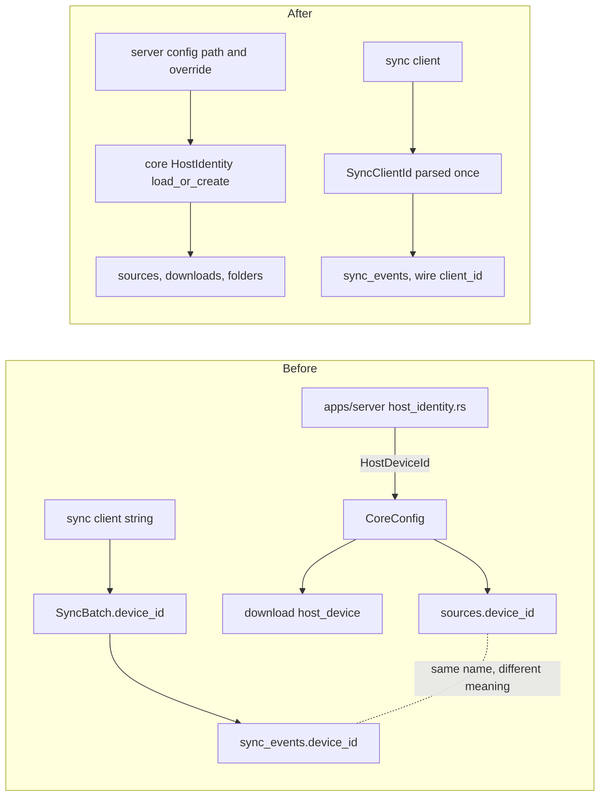

# RFC 0004: Host identity and sync client identity

Status: Proposed

Scope: design only. No code changes come with this document.

## Problem

Hito has two identities that look alike and are not. The backend host identity says which machine owns local files and downloads. The synchronization client identity says which client sent an operation. `AGENTS.md` requires them to stay different concepts. The names do not help.

Evidence in the current tree:

- Three names for the host. SQL uses `sources.device_id` (`crates/core/migrations/0002_library.sql:37`) and `music_folders.host_device` (`crates/core/migrations/0008_music_folders.sql:4`). The download tables use `host_device` (`crates/core/migrations/0029_persistent_downloads.sql:4`). Download wire types use `host_device_id` (`crates/core/src/downloads/types.rs:34`). The Rust type is `HostDeviceId` (`crates/core/src/context.rs:22`).
- The client identity borrows the plain name. `sync_events.device_id` (`crates/core/migrations/0046_playlist_metadata_refresh.sql:10`) holds the client. `SyncBatch.device_id` (`crates/core/src/collection/types.rs:151`) and `SyncEvent::Operation.device_id` (line 172) carry it on the wire. A reader sees `device_id` in `sources` and `sync_events` and cannot tell which concept it is.
- The wire `Source` leaks the host through the client-like name. `Source.device_id: Option<String>` (`crates/core/src/catalog/types.rs:43`, generated at `apps/web/src/generated.ts:3526`). The web app does not read it outside generated types.
- The client ID is a bare `String`. `validate_batch` (`crates/core/src/collection/service.rs:88-97`) re-implements the same 1 to 128 character, letters-digits-hyphen-underscore rule that `HostDeviceId::new` enforces (`crates/core/src/context.rs:25-36`). Two copies of one rule, for two different things.
- The host file protocol lives in the server. `apps/server/src/host_identity.rs:5-38` decides the sidecar name (`hito.device-id`), writes it with a hard link for atomic creation, and adopts the legacy `server` ID for a database that already exists. `AGENTS.md` puts filesystem ownership in core. The desktop host reaches this through the server crate (`apps/desktop/tests/local_lifecycle.rs:36` reads the file).
- The override is `HITO_DEVICE_ID` (`apps/server/src/config.rs:58`).

[Operations](../operations.md) already tells the operator the two are separate. The code says it in prose, not in types.

The VPS holds live data. Local `sources` rows carry the host ID and the legacy value `server`. Anything that changes stored values or column names must run safely on that database.

## Constraints

- Identity invariants. A host ID never grants access by being sent by a client. A client ID never selects local files. Neither is a credential, but both are not logged beyond safe correlation use.
- Local sources are matched on the stored host ID. Changing a stored value strands audio. An existing database without a sidecar must still adopt `server`.
- Recovery. A restored backup must work with the new binary. Preserving `hito.device-id` beside the database (see [operations](../operations.md#backups)) stays the instruction.
- Migrations. SQLx migrations are append-only and checksummed. Edit none. Upgrade tests (`crates/core/tests/*/*_upgrade.rs`) pin schema from older versions and must keep passing.
- Generated OpenAPI and TypeScript come from real wire types. No second API model.
- SQLite and filesystem ownership stay in core. The server only supplies a path and an optional override.

## Options

### Option A. Types and naming, no SQL change

Add two types in core and move the file protocol into core. Rename Rust fields and wire fields. Leave column names alone.

```rust
pub struct HostIdentity(String);
impl HostIdentity {
    pub async fn load_or_create(database: &Path, override_id: Option<HostIdentity>) -> Result<Self>;
    pub fn as_str(&self) -> &str;
}

pub struct SyncClientId(String);
impl SyncClientId { pub fn parse(value: impl Into<String>) -> Result<Self>; }

pub struct SyncBatch { pub client_id: SyncClientId, pub operations: Vec<Operation> }
```

Usage: `server::config` calls `HostIdentity::load_or_create(&database, env_override)`. `Collection::accept` takes `SyncBatch` whose `client_id` was validated when it was parsed, so `validate_batch` loses its string checks.

What it hides. The sidecar name, the atomic create, the legacy `server` adoption and the character rule. A column stays `device_id` but only the module that writes it names it.

Wire. `Source.device_id` becomes `host_id`. `SyncBatch` and `SyncEvent` use `client_id`, with `#[serde(alias = "device_id")]` on input so an older client still parses. Regenerate OpenAPI and TypeScript.

Trade-offs. No stored data changes and nothing to roll back. SQL still says `device_id` in two places with two meanings, which is why a comment at each column and a short SQL-naming note in [architecture](../architecture.md) are part of the plan.

### Option B. Option A plus column rename

Add migration 0056 using `ALTER TABLE ... RENAME COLUMN`: `sources.device_id` to `host_id`, `music_folders.host_device` and the download columns to `host_id`, `sync_events.device_id` to `client_id`.

SQLite rewrites indexes, triggers and views for a renamed column, including the triggers and the `current_podcast_sources` view that mention `sources.device_id` (`crates/core/migrations/0041_podcast_media.sql:12,20,32,62`) and the CHECK constraint on `sync_events`. A failure leaves a half-migrated chain, as [database maintenance](../database-maintenance.md) warns.

Trade-offs. Names match everywhere. But a database migrated forward can no longer be opened by the old image, so rollback means restoring a pre-migration backup. About 150 lines in `crates/core/src` mention these columns, across `library_storage`, `downloads`, `catalog` and `podcasts`. That is a large blast radius for a naming gain.

### Option C. Expand then contract

Add `sources.host_id` and `sync_events.client_id` with backfill, write both for one release, read the new, drop the old later.

Rollback to the old image keeps working during the overlap. But dual writes add triggers or code in every writer of `sources` (local scan, downloads, podcasts), and the contract step is another migration. Too much machinery for a column name.

## Recommendation

Option A now. It fixes the part that causes bugs, a bare string used for two concepts and the host protocol outside core, with zero stored-data risk. Defer B. If the user still wants SQL names to match, do B as its own release after A, with the rehearsal in the plan below. Reject C.

Keep the sidecar file name `hito.device-id`, the `server` legacy value and the `HITO_DEVICE_ID` variable. Renaming any of them breaks existing deployments and backups for no behavioral gain. Document them as the stored names of the host identity.

## Migration plan

Each step is a commit and stays green.

1. Add `SyncClientId` with the shared rule. Parse in `SyncBatch` deserialization. Remove the string checks in `validate_batch`. Capability test: empty, 129-character and punctuation IDs are rejected as before.
2. Rename the Rust field to `client_id` with `serde(alias = "device_id")`. Regenerate OpenAPI and TypeScript. HTTP test: old and new key both accepted; responses use the new key.
3. Introduce `HostIdentity` as the new name and keep `pub type HostDeviceId = HostIdentity` for one step. Rename uses crate by crate.
4. Move `host_identity.rs` logic into `crates/core/src/host_identity.rs`. Port `apps/server/tests/runtime/runtime_config.rs` assertions (lines 51, 87, 111, 142) to a core test and keep one server test for the env override.
5. Rename wire `Source.device_id` to `host_id`. Regenerate. Rename download wire `host_device_id` to `host_id` only if the user agrees (see questions).
6. Drop the alias type. Add one comment at each SQL column that holds an identity. Update [operations](../operations.md), [architecture](../architecture.md) and [api](../api.md).

If B is chosen later, rehearse first. Take a whole-volume backup of the VPS data while the server is stopped. Run the migration-only executable on a restored clone, as [database maintenance](../database-maintenance.md) records for migrations 0046 to 0048. Check a local source plays, a download plays, and an old sync event reads back. Only then migrate the live volume.

## Test impact

- `crates/core/tests/catalog/collection_event_upgrade.rs` and the other `*_upgrade.rs` tests do not change under A, because the schema is unchanged. This is the main reason to prefer A.
- `apps/server/tests/runtime/runtime_config.rs`, `fixtures/maintenance.rs:218` and `apps/desktop/tests/local_lifecycle.rs:36-68` already assert the sidecar behavior. They keep passing, and step 4 moves the unit-level cases into core.
- Tests that read `device_id` over HTTP (for example `apps/server/tests/podcasts/podcast_pages.rs`, `download_runtime.rs`) update key names in steps 2 and 5.
- TDD order. Step 1 and step 4 start with failing core tests. Steps 2 and 5 start with a failing HTTP test for the new key and the old alias.
- Add a test that a `SyncClientId` cannot be passed where a `HostIdentity` is expected. It is a compile-fail doc test or a code review item.

## Risks and open questions

- Does any external sync client already send `device_id`? The `alias` makes this safe on input. Output rename may break a client that reads `SyncEvent.device_id`. Per docs the sync client is unfinished, so likely none. Please confirm.
- Rename download wire `host_device_id` to `host_id`? It is clearer but breaks the generated type that the web app uses in download pages.
- Is the sidecar file name worth keeping forever? Keeping it costs nothing today. Renaming it later needs a read-both migration step.
- Option B is not recommended now. If chosen, SQLite must support `RENAME COLUMN` (3.25 or later). The plan should verify the bundled version with a migration test rather than assume it.
- The test hosts (`"server"`, `"catalog-test"` in `crates/core/src/test_support/support.rs:78,111`) mix the two concepts in fixtures. Clean them in step 3.

## Ownership before and after


