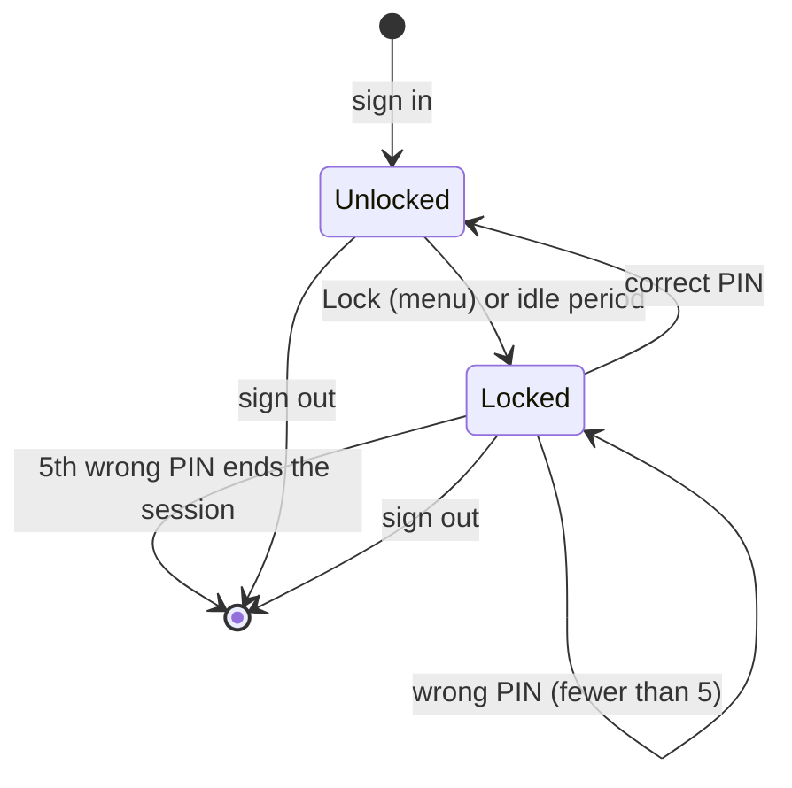
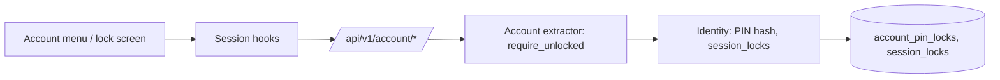

# Screen lock and optional PIN

An account may set an optional numeric PIN (4 to 8 digits) to lock one of its signed-in sessions while the person steps away. The PIN never replaces the password. It is checked only for the session it unlocks, it cannot sign in, and five wrong PINs end that session so the account password is needed again.

This describes behavior implemented and tested on the development tree (migration 0058). It runs on the local development server. It is not part of a public release.

## States of one session

The lock belongs to one session of one account. Other sessions of the same account and other accounts are unaffected. Removing the PIN unlocks every session of that account.

## Rules

- Setting, changing or removing the PIN, or changing the idle period, requires the account password (`422` when it is wrong). Only the PIN's slow salted Argon2 hash is stored, with the same verifier the password uses.
- Idle locking is off by default. The account chooses never, 5, 15 or 60 minutes. Only an explicit activity signal (`POST /account/activity`, sent by the web page when a person uses the keyboard, pointer or touch) refreshes the idle clock. Background requests such as progress saves, polls and audio range requests do not, so a tab left playing music still locks. The page sends the signal at most every 30 seconds, so the lock can trigger up to about 30 seconds earlier than the chosen period. The server enforces the period even when the page is closed or stops sending the signal.
- The lock is stored on the server with the session, so another browser tab or the desktop window cannot bypass it. A locked session refuses every authenticated route except lock-state, unlock and sign-out with HTTP `423` and error code `locked`. Pages render a lock screen that carries only the account name.
- A wrong PIN returns `422` with the attempts left. The fifth wrong PIN deletes the session (`401`). Attempts are counted before the PIN is checked, so parallel guesses cannot exceed five.
- Without a PIN, locking is unavailable (`422`).
- Signing out is always allowed.
- The PIN routes (`PUT /account/pin`, `POST /account/pin/remove`, `POST /account/unlock`) share a per-address limit of 10 requests a minute and the same limited Argon2 slots as sign-in, with their own counter so wrong PINs cannot use up sign-in attempts. The password is confirmed before a new PIN is hashed.
- Unlock values that are not 4 to 8 ASCII digits count as a wrong attempt without being hashed.
- Setting, changing or removing the PIN resets the wrong-PIN count of the account's other sessions, and removing it unlocks them. This follows from needing the account password and is accepted.
- Locking and unlocking clear the browser's cached page history, and the lock page response asks the client to clear history, so Back cannot restore library data.

## Where the rules live

Core `Identity` owns PIN hashing, the lock row, idle evaluation and the wrong-PIN count. The shared HTTP `Account` extractor rejects locked actors; `LockableAccount` is used only by lock-state, lock, unlock and logout. The web app stops the account's playback before locking, reloads into the server-rendered lock screen, and treats a `423` from any request as a reason to reload.

## API

| Operation | Endpoint |
| --- | --- |
| Lock state | `GET /account/lock` |
| Lock this session | `POST /account/lock` |
| Record user activity (idle clock) | `POST /account/activity` |
| Unlock with the PIN | `POST /account/unlock` |
| Set or change the PIN and idle period | `PUT /account/pin` |
| Remove the PIN | `POST /account/pin/remove` |

## Evidence and limits

Core, HTTP, upgrade and browser cases cover password re-authentication, locked refusals, wrong-PIN counting, the fifth-attempt sign-out, idle locking, session and account isolation, log privacy (no PIN, hash, token or password) and playback stopping when the web player locks.

## Long-lived holders and background jobs

The session check that gates data and playback access (`check_session`) refuses a locked session, or one whose idle period has run out, with `Error::Locked`. Playback grant rechecks, the native player's 250 ms authority check, player commands, collection and plugin operations all use it. The native player maps it to withdrawn authority, so it clears its queue, stops output and clears system Now Playing metadata, and OS media keys are ignored, without any command from the web page. A lock from the menu, the idle period or another tab all take effect the same way.

Background jobs that resume a stored session (queued artwork fetches and community reports) deliberately keep running while a session is locked. They return no library data to anyone and each still requires the session to exist.

Open: already open streaming responses and sync event streams are not cut at the moment of locking; new requests are refused. The PIN is a convenience screen, not protection against someone with the server's files or the account password.
