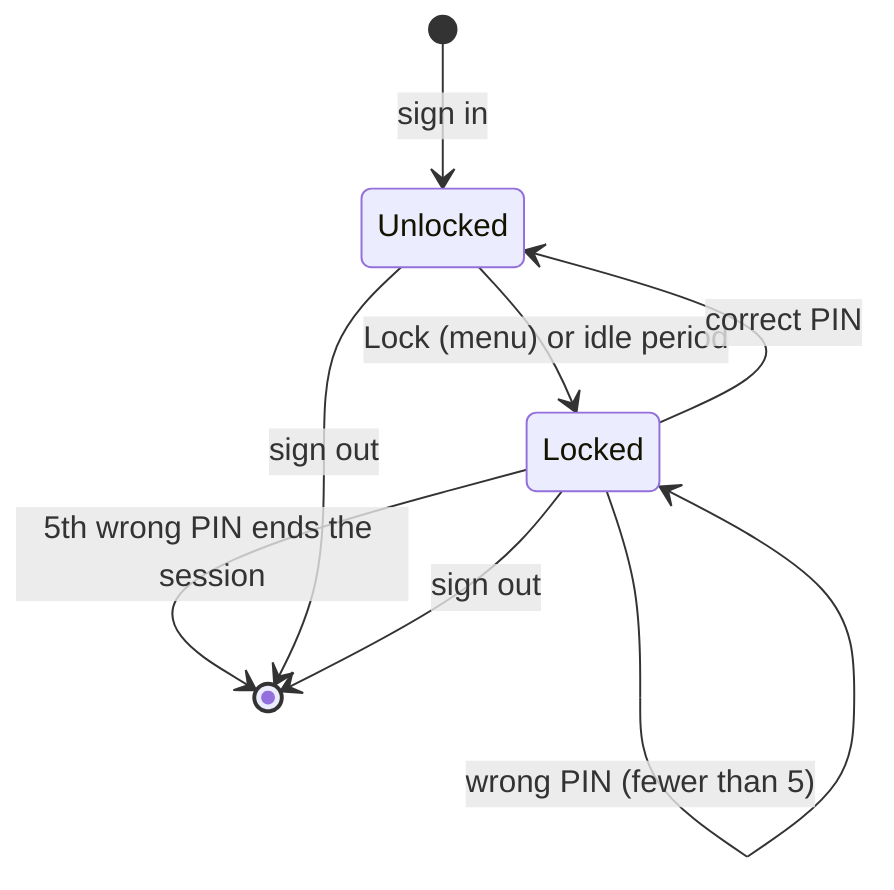
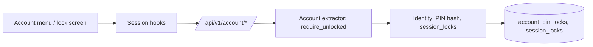

# Screen lock and optional PIN

An account may set an optional numeric PIN (4 to 8 digits) to lock one of its signed-in sessions while the person steps away. The PIN never replaces the password. It is checked only for the session it unlocks, it cannot sign in, and five wrong PINs end that session so the account password is needed again.

This describes behavior implemented and tested on the development tree (migration 0058). It is not deployed on the normal server.

## States of one session

The lock belongs to one session of one account. Other sessions of the same account and other accounts are unaffected. Removing the PIN unlocks every session of that account.

## Rules

- Setting, changing or removing the PIN, or changing the idle period, requires the account password (`422` when it is wrong). Only the PIN's slow salted Argon2 hash is stored, with the same verifier the password uses.
- Idle locking is off by default. The account chooses never, 5, 15 or 60 minutes. Any authenticated API request counts as activity; the web page also sends a light lock-state check while a person is using it.
- The lock is stored on the server with the session, so another browser tab or the desktop window cannot bypass it. A locked session refuses every authenticated route except lock-state, unlock and sign-out with HTTP `423` and error code `locked`. Pages render a lock screen that carries only the account name.
- A wrong PIN returns `422` with the attempts left. The fifth wrong PIN deletes the session (`401`). Attempts are counted before the PIN is checked, so parallel guesses cannot exceed five.
- Without a PIN, locking is unavailable (`422`).
- Signing out is always allowed.

## Where the rules live

Core `Identity` owns PIN hashing, the lock row, idle evaluation and the wrong-PIN count. The shared HTTP `Account` extractor rejects locked actors; `LockableAccount` is used only by lock-state, lock, unlock and logout. The web app stops the account's playback before locking, reloads into the server-rendered lock screen, and treats a `423` from any request as a reason to reload.

## API

| Operation | Endpoint |
| --- | --- |
| Lock state | `GET /account/lock` |
| Lock this session | `POST /account/lock` |
| Unlock with the PIN | `POST /account/unlock` |
| Set or change the PIN and idle period | `PUT /account/pin` |
| Remove the PIN | `POST /account/pin/remove` |

## Evidence and limits

Core, HTTP, upgrade and browser cases cover password re-authentication, locked refusals, wrong-PIN counting, the fifth-attempt sign-out, idle locking, session and account isolation, log privacy (no PIN, hash, token or password) and playback stopping when the web player locks.

Open: native (desktop) playback that is already running is stopped by the shared web player when the page locks; a lock applied from another device while native audio plays is not pushed to the native engine. The PIN is a convenience screen, not protection against someone with the server's files or the account password.
