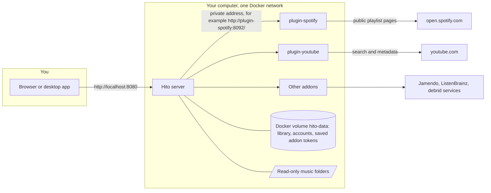

# Self-hosting Hito with addons

This guide is for the person who runs a Hito server. It covers the optional services called addons: what they do, how to start and connect them, and what to do when one stops working. You do not need the developer documents.

Status: this describes a development build run on your own computer or home server. It is not a public release. The addon commands below were followed from a fresh clone of the repository; see [what was tested](#what-was-tested).

## What an addon is

Hito plays the music in the folders you share with it. It works fully with only those folders.

An addon is a small separate program that gives Hito one more source of music or information. Each addon runs in its own Docker container next to the Hito server. Hito talks to it over a private Docker network. Your browser never talks to an addon directly.

You can run none, one or all of them. Stopping or removing an addon never removes your folder library, playlists you made, likes or history.



Where data lives:

| Data | Place |
| --- | --- |
| Library, accounts, playlists, likes, history, offered addon addresses | Docker volume `hito-data`, file `hito.db` |
| Encrypted addon tokens that people typed in | The same volume. The key is `hito.plugin-key` beside the database. Back both up together |
| Your music files | Your folders, mounted read-only |
| Spotify and YouTube addons | Nothing is kept. They have no volume. The YouTube addon uses a small temporary memory area |
| Folder demo addon | Its own volume `plugin-folder-state` |
| Jamendo, ListenBrainz and debrid addon keys | A private Docker volume that you create. See the addon rows below |

## The addons

All nine ship in the repository. Spotify and YouTube are the ones to start with. The others need a key or an account you provide.

| Addon | What it does for the listener | Account, key or token | Compose file | Default address inside Docker |
| --- | --- | --- | --- | --- |
| `spotify` | Imports a public Spotify playlist link as your own editable Hito playlist. Titles, artists, albums and order only. No Spotify audio | None. No Spotify account, no developer app | `deploy/compose/spotify.yaml` | `http://plugin-spotify:8092/` |
| `youtube` | Search in Discover, save results, and find audio for tracks. Used to play imported Spotify playlists | None. See the [YouTube limit](#youtube-limit) | `deploy/compose/youtube.yaml` | `http://plugin-youtube:8093/` |
| `folder` | A demo collection of three generated tones, or a folder you choose, served as a source | None | `deploy/compose/folder.yaml` | `http://plugin-folder:8090/` |
| `jamendo` | Search and play free-licensed music, and browse popular albums | A Jamendo client ID from [developer.jamendo.com](https://developer.jamendo.com/). The operator provides it once for the whole server | `deploy/compose/jamendo.yaml` | `http://plugin-jamendo:8093/` |
| `listenbrainz` | A "Similar artists" section on artist pages | An operator contact (an email or page) and a service token that you make up. No ListenBrainz account | `deploy/compose/listenbrainz.yaml` | `http://plugin-listenbrainz:8095/` |
| `real-debrid` | Plays files from a curated list you prepare, through your Real-Debrid account | Real-Debrid API token, a service token, and a catalog file | `deploy/compose/real-debrid.yaml` | `http://plugin-real-debrid:8096/` |
| `all-debrid` | Same, through All-Debrid | All-Debrid API token, service token, receipt key, catalog file | `deploy/compose/all-debrid.yaml` | `http://plugin-all-debrid:8097/` |
| `premiumize` | Same, through Premiumize | Premiumize API token, service token, receipt key, catalog file | `deploy/compose/premiumize.yaml` | `http://plugin-premiumize:8099/` |
| `torbox` | Same, through TorBox | TorBox API token, service token, state key, catalog file | `deploy/compose/torbox.yaml` | `http://plugin-torbox:8100/` |

The four debrid addons, Jamendo and ListenBrainz are for people who are comfortable with Docker volumes and private files. Their setup is not simplified yet. This guide shows the commands to start Spotify and YouTube, and points to the developer document for each of the rest.

Debrid addons play only the recordings you list in their catalog file. They do not search your provider account or add downloads. See [debrid adapters](../guide/plugins.md).

### YouTube limit

Current behavior, and an external dependency. YouTube may refuse to hand audio to a service that runs on a server in a data center. On the project's own test server, search and metadata worked but every attempt to get audio was refused (`LOGIN_REQUIRED`). Hito does not use cookies, a signed-in account or a proxy to get around this.

On a home connection, audio extraction worked in the project's tests, including playing a track found for an imported Spotify playlist. That is a test result, not a promise: YouTube can change this at any time. Some browsers also cannot decode the AAC audio YouTube returns. The project's test Chromium has no AAC and its test Firefox failed to decode it; common desktop browsers were not part of those tests.

If audio is refused, YouTube still works as a search source. Play then looks in your other connected sources, or reports that no source was found. Details: [YouTube plugin](../guide/plugins.md).

## Before you start

- Docker running, with Compose version 2.20 or newer (`docker compose version`).
- The repository cloned, and a terminal open in its folder.
- Hito already working. See [Try Hito](../README.md#try-hito).
- Free disk space. Building the two addons adds a few GB and several minutes on the first run.

## Start Spotify and YouTube

Pick one way.

### Option A: the setup launcher

Run the launcher again (`Hito Setup.command` on macOS, `Hito Setup.ps1` on Windows, `./hito-setup` on Linux). After you choose music folders, it asks:

> Also start the Spotify and YouTube addons? They add playlist import and search. Hito works without them.

Choose **Start addons**. The default is **Not now**, and closing the dialog also means no. The launcher builds both addons, starts them with the server, and tells the server their addresses. Your folders and library are kept. Run the launcher again to change the choice; it asks every time and offers your last choice.

### Option B: one Compose command

From the repository folder:

```sh
docker compose -p hito -f compose.yaml -f deploy/compose/addons.yaml --profile plugins up -d --build
```

This builds and starts the server, `plugin-spotify` and `plugin-youtube` on one network. On a fresh clone it also starts Hito itself; the music folder is `HITO_MUSIC_FOLDER` and the port is `HITO_PORT` (default 8080). Use this option for an install that did not come from the launcher. If you installed with the launcher, use option A: it manages its own Compose file, project and data volume, and mixing the two would start a second, empty Hito.

The addon ports `8092` and `8093` are published on your computer's loopback address only. If either is taken, set `HITO_SPOTIFY_PORT` or `HITO_YOUTUBE_PORT` before the command.

### Check that they are running

```sh
docker compose -p hito -f compose.yaml -f deploy/compose/addons.yaml --profile plugins ps
curl --fail http://localhost:8092/v1/manifest
curl --fail http://localhost:8093/v1/manifest
```

Each `curl` prints a short JSON description of the addon. A healthy addon shows `healthy` in `ps`.

## The server offers them for you

When the server starts with the `addons.yaml` file, it reads this setting:

```text
HITO_PLUGIN_SERVICES=spotify=http://plugin-spotify:8092/,youtube=http://plugin-youtube:8093/
```

For each `label=address` pair the server reads the addon's description, checks it with the same rules as an administrator's manual offer, and adds it to **Settings → Plugins → Services for this server**. This is called an offer. Facts about the setting:

- It only offers. It never connects anyone's account. Each person still reviews and connects.
- It is safe to repeat. An address that is already offered is skipped. After a restart nothing is added twice.
- If you withdraw an offered service, the server does not offer it again on the next start.
- If the addon is not running yet, the server keeps trying in the background: after 1 second, then with growing waits up to every 5 minutes, until the addon answers or the server stops.
- A label is 1 to 32 lowercase letters, digits or hyphens. Up to 16 addresses are allowed. An address must be `http://` or `https://` with no user name, query or fragment. A wrong value stops the server at startup with a clear message.
- The server logs one line per outcome (`offered` or the failure reason, for example `upstream`). It never logs the address.

Without this setting you can offer an address by hand. That works for every addon in the table: in **Settings → Plugins → Services for this server**, enter the address and select **Offer service**.

## Connect your account

Offering makes the addon available. Each person then connects their own account:

1. Open **Settings → Plugins**. Under **Available on this server**, the offered plugins are listed. If none is listed, ask the administrator to check that the addon runs and is offered.
2. Pick **Spotify public playlists**. Leave **Bearer token** empty. Select **Continue**.
3. Read what the addon declares (Spotify: playlists and covers), then select **Accept and connect**. It now appears under **Your plugins** with "No token saved", which is correct because it needs none.
4. The card now offers the next service. Select **Connect YouTube**, then **Continue** and **Accept and connect** again. YouTube asks for search, playback, track details and covers.

Use it:

- **Spotify:** open **Playlists**. In **Import a playlist**, make sure **Import a copy** is selected, paste a public playlist link and select **Import a copy**. The link must be public. Hito copies the track list, not audio. The new playlist shows, for example, "50 entries, 0 ready, 50 unavailable": tracks have no audio yet. Hito looks for audio through your other sources, such as YouTube, when you press play.
- **YouTube:** open **Discover**. Under **Search your services**, select **YouTube**, type a track or artist and select **Search**. Use **Play** or **Add** on a result.

Playing a track does not download a permanent copy.

## Update an addon

Pull the new version of the repository, then rebuild and restart:

```sh
git pull
docker compose -p hito -f compose.yaml -f deploy/compose/addons.yaml --profile plugins up -d --build
```

An updated addon may declare new abilities. In **Settings → Plugins**, a banner such as "New: album covers" appears with **Review**. Select **Accept changes** in the dialog. Until you accept, the old approval stays in force. **Check connection** does the same check by hand.

The same applies to the `docker compose up --build` of the server.

## Stop and remove an addon

Stop the addons and keep everything else:

```sh
docker compose -p hito -f compose.yaml -f deploy/compose/addons.yaml --profile plugins stop plugin-spotify plugin-youtube
docker compose -p hito -f compose.yaml -f deploy/compose/addons.yaml --profile plugins start plugin-spotify plugin-youtube
```

Remove the addon containers (the images stay for a quick restart):

```sh
docker compose -p hito -f compose.yaml -f deploy/compose/addons.yaml --profile plugins rm -sf plugin-spotify plugin-youtube
```

Then clean up inside Hito:

- A person removes a connection in **Settings → Plugins → Remove**. That clears their saved token. Recordings they saved stay in the library and become unavailable through that connection.
- The administrator withdraws the service in **Settings → Plugins → Services for this server → Withdraw service**. This disconnects everyone and clears their tokens.
- If the `HITO_PLUGIN_SERVICES` setting is still present, a withdrawn service stays withdrawn. To stop the setting from offering new addresses on a fresh database, start without `deploy/compose/addons.yaml`.

Do not run `docker compose down -v` on a library you want to keep. That removes the data volume.

## Starting the other addons

Each has its own Compose file. They all share the server's network when started in the same project, so Hito reaches them by the names in the table.

**Folder demo:**

```sh
docker compose -p hito -f compose.yaml -f deploy/compose/folder.yaml run --rm --build --no-deps plugin-folder --music /demo --state /state --initialize-state
docker compose -p hito -f compose.yaml -f deploy/compose/folder.yaml up -d plugin-folder
```

Run the first command once. See [folder plugin](../guide/plugins.md) for using your own folder.

**Jamendo, ListenBrainz and the debrid addons** need a private Docker volume with files in it, created before the first start, and extra variables that the Compose file requires (for example `HITO_JAMENDO_CREDENTIAL_VOLUME`). Compose refuses to start without them and names the missing variable. Follow the document for each: [Jamendo](../guide/plugins.md), [ListenBrainz](../guide/library.md), [debrid adapters](../guide/plugins.md) and the `plugins/torbox` and `plugins/premiumize` READMEs. Then offer the address from the table by hand in Settings. Build and image details are in [development](../develop/development.md#plugin-images).

Keys and tokens belong in those private files only. Never put them in a Compose file, a command line or a chat.

## When an addon is down

Hito keeps working. Only the features that need that addon stop.

- **Settings → Plugins** shows a red notice, "The plugin service could not be reached", with **Reload connections**. Nothing is lost; the connection and token stay saved.
- **Discover** search shows "YouTube could not finish. The plugin service could not be reached" with **Refresh services**. Try again after the addon is back.
- **Saved recordings** stay in your library. Pressing play on one that needs the addon fails, and the track reports that its source is unavailable. When the addon returns, play works again without any action.
- **Followed playlists** keep their last good copy and retry later.
- **Folder music, your own playlists, likes and history** are not affected.
- When the server starts before an addon, it keeps trying to offer the addon (see above). Connect once it appears.

### Pin DNS for the addons

Docker copies the host resolver into a container when it is created. If the host later switches resolver, a running addon keeps the old one and cannot find `www.youtube.com`. The YouTube addon then reports `outcome: network` in its log for every search and play, and nothing else about the library changes.

To make this stable, pin a resolver in a Compose override file next to `compose.yaml`, for example `compose.override.yaml`:

```yaml
services:
  plugin-youtube:
    dns:
      - 1.1.1.1
      - 9.9.9.9
```

Use resolvers you trust, or your own router address. Then recreate the addon:

```sh
docker compose -p hito -f compose.yaml -f deploy/compose/addons.yaml -f compose.override.yaml --profile plugins up -d --force-recreate plugin-youtube
```

Recreating without the override also picks up the host's current resolver. The addon logs only the failure class (`network`, `refused`, `video_unavailable`, `format_missing`, `deadline` or `unavailable`), never the yt-dlp message, video ids or addresses. Settings → Plugins does not yet show a "Hito cannot reach YouTube" state; the addon's own error text for this class is "Hito cannot reach YouTube".

## Troubleshooting

| What you see | Likely cause and fix |
| --- | --- |
| No plugin under **Available on this server** | The server has not offered it. Check the addon runs (`ps`, `curl` the manifest). Look in the server log for a `Configured plugin service not offered` line and its `outcome`. Or offer the address by hand |
| "The plugin service could not be reached" | The addon is stopped, still starting, or the address is wrong. Use the internal name (`http://plugin-spotify:8092/`), not `localhost`. `localhost` inside the server container is the server itself |
| "The music service is not responding right now" | The addon answered 502, 503 or 504, or did not answer within 10 seconds, usually because the music service behind it was slow. Try again in a moment. If it keeps happening, check the addon log |
| "The music service is busy" | The addon answered 429. Wait a moment and try again |
| "The plugin service refused the request" | The addon answered 401 or 403. It may need a bearer token that you did not enter or that is wrong. Check the connection in Settings → Plugins |
| Settings → Plugins shows "Hito cannot reach YouTube" on the YouTube card | The YouTube addon saw three network failures within two minutes and no success since. Its container cannot resolve or reach YouTube: see the next row. The warning clears by itself after the next successful search or play, or two minutes after the last failure |
| Every YouTube search and play fails within a second, and the YouTube addon log says `outcome` is `network` | The addon container cannot resolve or reach YouTube. Docker keeps the resolver the container saw when it was created, so a host that changes resolver (Tailscale, AdGuard or a VPN switching) leaves old containers with a dead one. Recreate the addon, or pin `dns:`; see [Pin DNS for the addons](#pin-dns-for-the-addons) |
| Settings shows "YouTube is refusing requests right now", or `outcome` is `refused` in the addon log | YouTube answered with a bot check or HTTP 403 or 429 for this connection. See the [YouTube limit](#youtube-limit) |
| YouTube `outcome` is `video_unavailable` or `format_missing` | That video is private, removed, blocked in your region, or has no supported audio. Other videos still play |
| "The plugin service rejected the request" | The addon answered with another error. It is probably unhealthy. Check its log |
| "The plugin service did not return JSON data" or "returned invalid JSON data" | The address points at something that is not an addon, for example a web page. Check the port |
| "This service is already offered" | That address is already offered. Nothing to do |
| "Use an HTTP or HTTPS service address without credentials, query, or fragment" | The address has a user name, `?query`, `#fragment` or another scheme. Fix the address |
| "This server already offers 64 plugin services" | Withdraw services you do not use |
| "Spotify does not allow public access to this playlist" | The playlist is private. Make it public or use another link |
| "The Spotify playlist was not found" | The link is wrong or the playlist was removed |
| "The Spotify service is busy. Try again later" or "The playlist request timed out" | Spotify limits or is slow. Wait and try again |
| "This playlist snapshot is no longer available. Import the playlist again" | The import took too long between steps. Import again |
| "Spotify returned an invalid playlist response" | Spotify changed its public page format. The Spotify addon reads an undocumented public page, so this can happen at any time. Update Hito later |
| Imported tracks show as unavailable | The Spotify addon supplies no audio. Connect YouTube or another source. If YouTube is connected, audio may be refused on your connection; see the [YouTube limit](#youtube-limit) |
| Play says no source was found | No connected source matched. Open the recording's details and use **Find a source** |
| After an update a banner says "New: ..." | The addon declares something new. Select **Review**, then **Accept changes** |
| `docker compose` says a variable is not set | A Jamendo, ListenBrainz or debrid file needs its variables. Use the document for that addon. Spotify and YouTube need none |
| Addon port already in use | Set `HITO_SPOTIFY_PORT` or `HITO_YOUTUBE_PORT` to a free port. The addon address inside Docker does not change |
| Settings → Plugins says credential storage is unavailable | `hito.plugin-key` is missing or unsafe. Restore it from your backup. Addons without tokens still connect. See [plugins](../develop/plugins.md) |

Useful logs:

```sh
docker compose -p hito -f compose.yaml -f deploy/compose/addons.yaml --profile plugins logs --tail=100 server
docker compose -p hito -f compose.yaml -f deploy/compose/addons.yaml --profile plugins logs --tail=100 plugin-spotify
```

Logs contain outcomes and timings. They never contain tokens, search terms, titles, playlist links or audio.

## Security notes

- Each addon is a separate container: read-only root file system, no extra Linux capabilities, `no-new-privileges`, limits on processes and memory, a non-root user. The Spotify and YouTube addons mount no Hito volume. They cannot read your library, your music or `hito.db`.
- Addon ports are published on `127.0.0.1` only, so other computers on your network cannot reach them. Other containers on the same Docker network can. Do not attach unrelated containers to that network.
- Only the Hito server calls an addon. The browser gets Hito addresses for audio and covers, never an addon address.
- Only an administrator can offer an address, because the server will send requests to it. The `HITO_PLUGIN_SERVICES` setting is set by the person who controls the server's configuration, and has the same trust.
- What an addon sees: Spotify sees the playlist link you import. YouTube sees your search words and the video it fetches. Hito sends them the request it needs and, if you entered one, your bearer token. It sends no account name and no cookies. The upstream sites (Spotify, YouTube) see the request come from your server's internet address.
- Bearer tokens are encrypted in the database with a key kept beside it. Keep `hito.plugin-key` in your backups.
- This is a development build for your own machine. For access from the internet you need an HTTPS reverse proxy and the settings in [operations](operations.md#network-and-sessions). Addon ports should stay private.

## What was tested

Current behavior is described above. Evidence, from 2026-11-05:

- Automated: the address list parser and the offer rules (labels, addresses, idempotent repeat, a withdrawn service staying withdrawn, unreachable and invalid addons, retry when an addon starts late, log content), the environment setting at startup, and the launcher's generated Compose file with and without addons.
- Walk-through from a fresh clone of the repository in an isolated Compose project (own network, volumes and ports, never the normal `hito` project), following this guide with option B: the build and start worked; the server offered both addresses by itself; a new administrator connected Spotify and YouTube; a live public Spotify playlist (50 tracks) imported through the Spotify addon; YouTube search returned results and **Add** saved one with details and sources from the addon; after a server restart nothing was offered twice; with the YouTube addon stopped, Settings and Discover showed the "could not be reached" messages quoted above; the update command and the remove command worked.
- The generated launcher Compose file with addons on was checked with `docker compose config` and resolves the server and both addons.

Not verified: playing audio in a browser (the test browser has no AAC), Spotify tracks resolving to YouTube audio in the browser, the Windows and Linux launcher dialogs and the macOS dialog (reviewed, not run), every browser's AAC support, long-running behavior, and any addon other than Spotify and YouTube.
