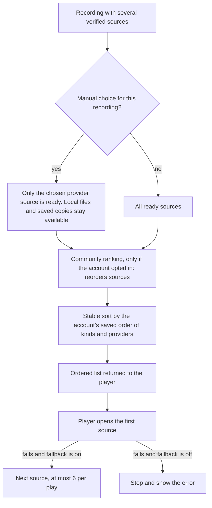

# Choosing the audio source for a recording

A recording can have several playable audio sources: a file in a music folder, a copy Hito saved, a podcast enclosure, and one or more sources from connected providers. This page records which one plays first, and what happens when it does not open.

## The default order

This is the order before the source preference below existed. With no saved preference it is still exactly what an account gets.

1. **Manual override.** A source the listener chose for this recording (see [manual sources](manual-sources.md)) makes every other provider source of that recording not ready for that account. Local files and saved copies stay available. A choice is never changed by ranking or by a failed open.
2. **Local files.** A file in a connected music folder that is available on this host.
3. **Saved copies.** A managed download that is ready and whose origin is permitted by the current choice.
4. **Podcast enclosure**, for podcast episodes.
5. **Provider sources**, in the order the community ranking gives them when the listener opted in, otherwise by source ID. The community ranking only applies when the recording has no ready local file or saved copy, at least two ready provider sources exist, and the recording has no protected choice. It reorders the ready provider sources of that one recording, including across providers. If the ranking service is slow, unreachable or inconsistent, the unranked order is used.

Where each surface applies it:

| Surface | Where the order comes from | If a source fails |
| --- | --- | --- |
| Browser | `GET /api/v1/recordings/{id}/sources` (`Catalog::playback_sources_until`) returns the sources in the order above. The player takes the ready ones in that order. | `PlaybackSources` moves to the next ready source, once per source, with no limit on how many. When none is left it refreshes the provider sources once, then asks Hito to find audio once, then skips the track. |
| Desktop (native) | `PlaybackAccess::playback_candidates` yields local files, then saved copies, then the podcast enclosure, then each provider binding in binding order. The community ranking is not applied. | The player asks for the next candidate until they run out, then refreshes once, then reports the error. |
| Single source | `PlaybackAccess::preferred_playback_source` (local, then saved, then podcast, then provider). Used for one-shot reads. | Not applicable. |

Every candidate is authorized for the requesting account when it is read and again when it opens. Another account's sources, connections and choices are never in the list.

Not covered by the preference: source conversion and bitrate settings do not exist yet.

## Source preference (current behavior)

Each account can save an ordered list of source kinds: **Local files**, **Saved copies**, and one entry for each connected provider that can supply audio. Settings, Playback, Source preference shows the list with Move up and Move down, and a switch, "Try the next source if one fails".

Rules, in the order they apply:

1. **A manual choice for one recording wins.** It is applied before the preference, so the preference never ranks a provider source the listener excluded.
2. **The saved order decides between kinds and providers.** The list is sorted with a stable sort, so sources keep their incoming order inside one entry. A podcast enclosure sorts just after Saved copies.
3. **Local files and Saved copies default to the top.** An account that never saved a preference keeps the default order above, and providers keep the community or source-ID order. A saved list that leaves them out still puts them first; the user moves them by placing them elsewhere.
4. **Community ranking orders inside a provider, not across the user's order.** It runs first, and the stable sort then groups sources by the user's order. With no saved preference the community ranking still reorders across providers as before.
5. **A provider connected after the order was saved** is listed last until the listener moves it. A removed or inactive connection drops out of the list; its saved place is ignored, never ranked.

**Direct fallback.** When the opened source fails, the player moves to the next ready source from the same ordered list:

- Each source is tried once per play. At most 6 sources are tried (`MAX_FALLBACK_ATTEMPTS`), counting the first. After the limit the player stops with its usual error.
- With the switch off, the browser player stops after the first source fails: it opens no second source and does not refresh or search for another. The track then shows its usual unavailable error.
- The browser logs `playback.source_fallback` (recording ID, source ID, step number, reason `previous_source_failed`), `playback.source_fallback_off` and `playback.source_fallback_limit`. Core logs `playback_source_fallback` with the outcome `next_source`, `fallback_off`, `attempt_limit` or `exhausted` for the desktop player. No titles, addresses or credentials are logged.
- The switch is read from the server only after a first source has failed, so a normal play makes no extra request.

**Where it applies.**

| Surface | Preference order | Fallback switch and bound |
| --- | --- | --- |
| Browser (`/api/v1/recordings/{id}/playback-sources`) | Yes. The legacy `/sources` list is unchanged. | `PlaybackSources` consults the switch before moving on and stops at 6, also for the next-track lookahead. |
| Desktop (`PlaybackAccess::playback_candidates`) | Yes. Local files, saved copies, the podcast enclosure and each provider binding are ordered by the saved list. | `PlaybackCandidates::next` stops after the first when the switch is off and after 6, and `ended()` returns why (`Exhausted`, `FallbackOff`, `AttemptLimit`). |
| `preferred_playback_source` | No. It still returns local, saved, podcast, then provider. | Not applicable. |

**API.** `GET /api/v1/source-preferences` returns `revision`, `fallback` and `entries`. `PUT` takes the same three fields with the revision last read. Each entry is `{"kind":"local_files"}`, `{"kind":"saved_copies"}` or `{"kind":"provider","installation_id":"..."}`. The read lists the full effective order: stored entries that still apply, the defaults for anything missing, then newly connected providers. The write rejects duplicates, more than 32 entries, and any provider that is not one of the caller's own active connections with the audio capability (`422`); a stale revision is a `409`. Nothing is shared between accounts, and a request for another account's connection answers like an unknown one. Storage is one row per account (`account_source_preferences`, migration 0089) that account deletion removes.

**Evidence.** Core cases with two owned fake providers: the defaults and per-account isolation, rejected writes, saved order deciding between providers, a manual choice still winning, community ranking not overriding the saved order, desktop candidate order, the switch off, the 6-source bound with nine copies, and exhaustion; a table test for the selection order. HTTP case with anonymous, wrong-account, peer isolation and malformed bodies. Web cases for the card (order, Save payload, switch, conflict and reload, account change) and for `PlaybackSources` (the bound, switch on and off). One browser case saves an order and the switch and reads them back after a reload. Migration 0089 has upgrade fixtures and schema bounds like earlier migrations.

**Not done.** Source conversion and bitrate settings. A per-recording view of why a source was skipped (reasons are in logs only). Measuring fallback time against real provider failures.
