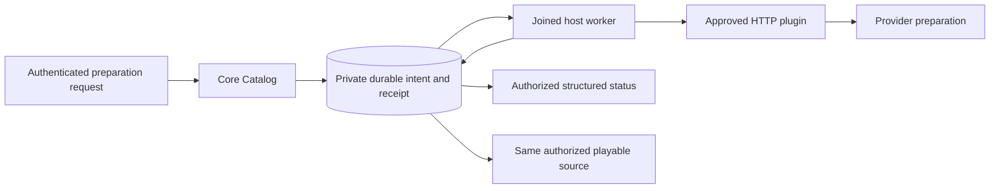
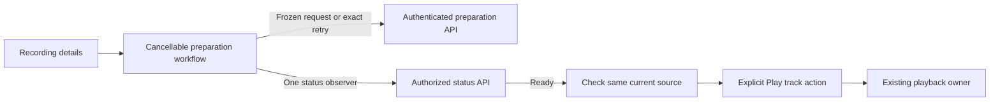

# Source preparation

The generic source-preparation backend is deployed to the normal local development server on migration 35. Its shared web UI is implemented and verified in a separate release image, but is not yet deployed to that server. Deferred playback, the four debrid adapters and release acceptance remain unfinished.

## Ownership

A source belongs to a recording and an approved personal plugin connection. A plugin declaring `source_preparation` must also declare `sources`. Existing source responses keep their `id`, `label` and `ready` fields. Hito owns rendering; plugins return structured data and cannot add executable UI.

The plugin owns the mapping from its opaque recording/source identifiers to one exact origin and file. An identifier must not silently change to a different file. Hito does not parse provider identifiers as URLs or pass one plugin's identifier to another plugin as an origin.

The worker captures account, library grant, recording/source membership, binding and approved connection revisions. It operates independently of the initiating browser session. Revocation must prevent publication under obsolete authority. Preparation must preserve recording/source identities and existing playback authority when readiness changes.

Preparation history retains its provider-source mapping. That mapping retains the underlying source. Preparing a plugin source therefore does not add a direct history lookup to cleanup of unrelated managed-download sources.

Preparation does not create a persistent Hito download. A provider may prepare remote audio as part of source availability; Hito retains a managed copy only after a separate explicit **Download** request.

## Plugin HTTP contract

Requests use the approved connection's service authentication and `X-Hito-Plugin-Protocol: 1`. That bearer authenticates the plugin service. It must not be silently treated as a debrid provider API key. Provider-specific credential handling remains separate work.

| Request                              | Body                                                                |
| ------------------------------------ | ------------------------------------------------------------------- |
| `POST v1/sources/prepare`            | Nonempty `operation_id` UUID, opaque `recording_id` and `source_id` |
| `POST v1/sources/preparation/status` | The same identities and the acknowledged private `handle`           |

Every response echoes the exact operation and target identities. A status response also echoes the exact acknowledged handle. Unknown fields, mismatched identities and malformed or oversized values are rejected. Remote recording/source identifiers are limited to 256 bytes and handles to 2,048 bytes. Handles stay private to core and the plugin.

The submit response has a `submission` tagged by `outcome`:

- `accepted` contains a handle and structured status.
- `not_submitted` contains a controlled reason and optional retry delay. It guarantees that no upstream preparation was submitted.
- `submission_unknown` means submission cannot be established safely.

The status response contains a `status` tagged by `phase`:

| Phase                | Additional fields                                                              |
| -------------------- | ------------------------------------------------------------------------------ |
| `queued`             | `poll_after_seconds`                                                           |
| `preparing`          | Optional `progress_basis_points`, optional `eta_seconds`, `poll_after_seconds` |
| `ready`              | None                                                                           |
| `blocked`            | Controlled `reason`, optional `retry_after_seconds`                            |
| `failed`             | Controlled `reason`                                                            |
| `submission_unknown` | None                                                                           |

Progress uses integer basis points from 0 to 10,000. ETA is bounded to seven days. Supplied poll/retry delays must be between five seconds and one day. Reasons are the SDK's fixed values for authorization, quota, rate limiting, provider restrictions, source availability/change, unsupported operations, provider outages and invalid responses. Responses must not carry stream URLs, credentials or arbitrary provider diagnostics.

## Durable requests and uncertainty

The public request uses a strict request UUID. Replaying it returns its original receipt; reusing it for another target conflicts. Different request UUIDs must not create duplicate unresolved work for the same source. An unresolved submission must prevent another submission across process restarts and recreated personal connections.

Processing obtains transport admission, records durable `submitting` state, then performs a bounded HTTP exchange. A lost or malformed begin acknowledgement cannot prove that the provider did nothing. Hito must retain `submission_unknown` rather than submit again blindly. An acknowledged handle permits status queries after restart. Submission certainty and current execution authority are separate facts; revocation does not establish that an upstream operation never happened.

A known terminal provider outcome is retained separately from public cancellation. Revoking a connection cancels its execution authority without erasing that outcome. A completed operation therefore does not permanently block a replacement connection. An unresolved operation still prevents another submission for the same provider source, even when the personal connection is recreated. Old request receipts keep their original preparation identity.

The public routes are generated from actual Rust handlers and wire types:

| Request                                                            | Result                                                                            |
| ------------------------------------------------------------------ | --------------------------------------------------------------------------------- |
| `POST /api/v1/recordings/{recording}/sources/{source}/preparation` | `202` with immutable request/preparation/recording/source identities              |
| `GET /api/v1/recordings/{recording}/sources/{source}/preparation`  | Authorized phase, bounded progress, safe reason and timestamps; `404` when absent |

The public interface exposes Hito identities, never provider identifiers or handles. It is independent of download references and per-device playback queues. Logs must use safe Hito correlation identities, static outcomes and timings. Credentials, handles, provider identifiers, bodies and signed URLs must not appear in logs.

## Shared browser workflow

Recording details show an Audio availability section independently of metadata provenance. Source reads return a human label and current `can_prepare` eligibility. Core derives these from the current source generation, binding, account and approved connection capabilities without contacting a provider. Local sources use a fixed label and cannot be prepared. Revoking a plugin connection removes its eligibility while preserving retained source identities.

One cancellable workflow hook owns the selected account, recording and source. Prepare audio freezes a request UUID and body. If the acknowledgement is lost, malformed or unsuccessful, Retry preparation request resends that exact request. A status GET cannot acknowledge a pending POST. Mismatched preparation identities stop observation rather than switching to unrelated work.

Polling never overlaps and starts at a five-second minimum. Unchanged work slows to thirty seconds, failures back off through 5, 15, 60 and 300 seconds, and a later server scheduling hint takes precedence. Terminal, denied and unscheduled uncertain states stop polling. Changing account, recording or source and unmounting cancels requests and rejects late results. Explicit availability refresh can recover a stopped observer without discarding a pending request receipt.

Ready status checks the current sources once, then offers Play track only when that same authorized source is ready. Preparation does not play audio or create a Download. A known failed or ready operation permits a fresh explicit preparation if that source later becomes unavailable and remains eligible. Cancellation, blocked status and unresolved submission do not prove that resubmission is safe.

## UI verification

The frontend passes 218 cases across 59 files, both TypeScript checks and the production build. Public HTTP fixtures verify provider-free labels and eligibility, current capability and revocation changes, account isolation and shared local-source privacy. Two independent specialist review rounds are complete; the final ready-to-unavailable recovery finding has direct failing-then-passing coverage.

The combined core/server run passed 353 distinct cases before one existing uncertainty test failed because its whole-source snapshot expected preparation eligibility to survive connection revocation. A test-only correction changes that eligibility expectation and retains the remaining snapshot and uncertainty assertions. The corrected case and the previously unreached storage-manifest case pass separately. The aggregate is 355 distinct passing cases and one normally ignored case out of a 356-case inventory. This is not a claim of a single fresh, fully passing combined run. Workspace formatting, strict default-workspace all-target Clippy and the directed final test-target Clippy pass.

Release image `sha256:e3d2e830ce8875ae4ae12188ae4e99efad32d0d56fbc44a823b607eac624c8af`, built from source `bc72f4a`, passes the actual isolated Chromium workflow in 8.4 seconds. A committed preparation acknowledgement is deliberately lost; retry recovers the identical receipt and request body with only one provider begin. The page shows 25% progress, observes readiness for the same source and keeps audio paused with no Download until an explicit Play advances the owned WAV. The old deployed image fails this case at the missing availability label/control.

The same isolated image passes health, exact generated OpenAPI, exact served JavaScript/CSS bytes, anonymous native-player rejection and fixture-secret/title log-redaction checks. It has no published ports or persistent data mounts and is stopped after verification. The normal server and its plugin services remain unchanged. These checks do not establish native GUI, live debrid, automatic matching or public-release acceptance.

## Evidence and remaining work

The SDK passes 13 cases, including six preparation contracts and existing manifest/authorization compatibility. Strict SDK Clippy passes with all targets and features. Seven HTTP/runtime cases cover approved-capability rejection, durable acceptance, immutable replay, coalescence, one begin request, private handles, polling after restart, ready publication, complete WAV playback, preserved playback authority and absence of a persistent Download. A recreated connection cannot duplicate an unresolved preparation. Terminal acknowledgement before or after connection revocation permits a later operation while preserving old receipts.

A ten-account regression verifies 411 distinct requests per account. All 4,110 receipts retain their exact replay mappings while coalescing to ten preparations. The case also verifies account isolation, absence of implicit preparation/audio/download work and admission of another target. Active pending limits remain 16 per account and 128 globally.

An accepted handle receiving `submission_unknown` remains queryable after restart and becomes ready with exactly one begin and two status requests. Continued uncertainty and transport errors use a bounded 5/15/60/300-second backoff. A malformed acknowledgement instead leaves submission uncertain without a usable handle. A real-host case verifies restart, receipt replay/coalescence, seven seconds without another begin or status request, and rejection after connection replacement. Uncertainty without an acknowledged handle still requires a separate reconciliation contract; Hito must not infer that no upstream submission occurred.

An acknowledged preparation also resumes after two days offline. Its fixture uses a valid one-day poll hint and two-day ETA, stops the real host, ages only the owned database's scheduling timestamps, then reopens it. The same operation and handle produce ready audio with one begin, one poll and no persistent Download. Acknowledged handles are exempt from the initial 24-hour admission budget.

The SQL-work diagnostic passes against 20,000 terminal preparations and 50,000 retained receipts. It extracts the production admission and worker queries and checks their results, plans and SQLite VM work with three active preparations and with none. Separate reopened databases cover absent statistics, statistics inherited from before history growth and fresh `ANALYZE`. Latest status preserves the rowid tie-break without sorting retained history. These checks measure query work for this fixture, not release latency or the 100,000-track release gate.

The cleanup regression executes the production managed-source deletion with foreign keys enabled and verifies rollback and unchanged preparation metadata. With 20,000 terminal preparations, the original relationship cost approximately 60,000 SQLite VM steps. The provider-source relationship keeps the measured deletion below the counter's 100-step resolution in all three statistics modes. This is scoped to preparation history; other cleanup relationships still require scale verification.

Two independent review rounds are complete. Their terminal-history, receipt-limit, cleanup and offline-resume findings have direct regression coverage. All ten focused cases pass after the fixes.

Final Docker verification passes 226 distinct core tests and 101 distinct server tests. Four subprocess cases also report their child execution separately, for 331 passing executions in total. One existing filesystem-fault test remains normally ignored. Strict core/server Clippy with all targets, the workspace default-feature all-target compile check and workspace formatting also pass. These checks do not establish desktop GUI, live debrid or public-release acceptance.

Manual retry of an unsubmitted request blocked by its initial budget remains unimplemented. Further submission-loss reconciliation, lease/authority races, broader joined-shutdown checks, deferred playback, deployment of the verified UI, concrete Real-Debrid/AllDebrid/Premiumize/TorBox services, provider credentials, fixture/live checks and release gates remain required. See [the release plan](release-plan.md).
