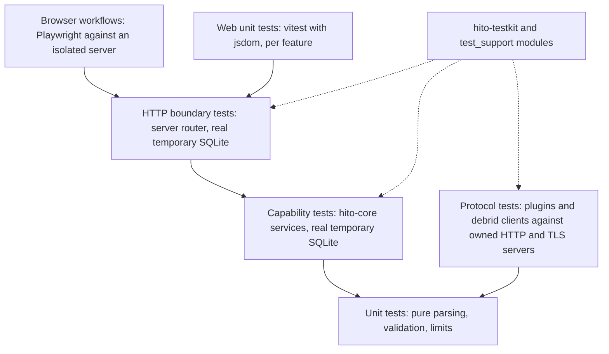

# Testing

Tests in Hito check behavior at a public boundary. They do not check how the code is arranged inside. A green narrow test does not prove a release gate; [status](status.md) records which gates have evidence.

Run every test through Docker. [Development](development.md) has the commands.

Run one area with a `make check-<area>` target: `check-core`, `check-server`, `check-community`, `check-playback`, `check-plugins` or `check-web`. Each runs that area's tests through the `tools` profile. `make verify` runs everything. [Development](development.md#makefile-targets) lists what each target runs.

## Test layers



- **Browser.** `apps/web/e2e` runs against `e2e-server`, which uses temporary storage and generated audio. `make e2e` recreates the server each run. See [Browser e2e sessions](#browser-e2e-sessions).
- **Web unit.** Tests sit in `apps/web/src/features/<domain>/tests`, with data in `fixtures`. Hooks and pages are tested through their rendered behavior and typed API client.
- **HTTP.** `apps/server` tests drive the real router with a real temporary SQLite database. They check status codes, denied access, repeated requests and logs.
- **Capability.** `hito-core` tests call `Catalog`, `Collection`, `Identity`, `LibraryStorage` and `Plugins` directly. Anything that needs a transaction, a migration or a permission rule is tested here against a real database.
- **Protocol.** A plugin or provider client is tested at its wire boundary. The test starts an owned HTTP or TLS server and sends real requests. External services are never called in the normal suite.
- **Unit.** Used for pure functions such as limits and validation, for example the curated catalog admission cases in `crates/plugin-sdk/tests/wire/curated_catalog.rs`.

## Test binaries

Every top-level file in a crate's `tests/` directory, and every `tests/<name>/main.rs`, is a separate test binary that links the whole crate. Linking hundreds of them cost build time and gigabytes of target space, so most tests are grouped by capability area.

- **Grouped binaries.** `tests/<area>/main.rs` declares `mod <file>;` for each file in `tests/<area>/`. Test names gain the module prefix, for example `cargo test -p hito-core --test catalog collection_event_upgrade::`. `hito-core` has 17 area binaries (for example `artist_identity`, `catalog`, `playlists`, `plugins`, `podcasts`, `provider_sync`, `sources`, `storage`), `hito-server` has nine (`artwork`, `community`, `downloads`, `player`, `playlist_follow`, `podcasts`, `providers`, `runtime`, `sources`) beside the existing `api` and `timed_lyrics`, `hito-playback` has `player` and five `native_*` binaries, and `hito-plugin-sdk` has `catalog`, `timed` and `wire`.
- **Shared fixtures.** Files in `tests/fixtures` stay where they are. A test file mounts one with `#[path = "../fixtures/<name>.rs"]` and refers to items its parent module imports with `super::`. Each area binary allows `clippy::duplicate_mod`, because several files mount the same fixture.
- **Standalone binaries.** A test stays a top-level `tests/<name>.rs` file when sharing a process would change what it proves:
  - It installs the process-wide tracing subscriber with `set_global_default` (the `metadata_artist_tags*`, `playlist_follow_revocation`, `playlist_follow_snapshot`, `provider_source_refresh_cancel`, `source_resolution_logging`, `artist_catalog_edition_lifecycle`, `plugin_install_preview_revocation` and `metadata_id3_logs` core tests, and the server `maintenance_lifecycle` and `timed_lyrics_dropped` tests).
  - It runs itself again as a child process with `--exact` and an environment variable, so its test path must not change (`storage_stalls`, `storage_walk_stalls`, `local_audio_faults`, the server `local_audio_http_faults`, the plugin SDK `server_logging`, and the server `download_*_shutdown` and `community_*runtime_config` tests).
  - It installs a global allocator (`catalog_discovery_allocations`, `catalog_validation_allocations`).
  - It builds its own tracing dispatcher without `hito_testkit::logs::anchor_callsite_interest()`. Another test in the same process can register a callsite first and leave it disabled for that dispatcher (`download_capability`, `playlist_import_begin_cancel`, `plugin_install_preview_logging`, `source_resolution_binding_race`, `source_resolution_cancel`, `source_resolution_handoff`, the playback `player_logging` and `player_audiobook_continue_admission`, and the server `logging` and `provider_logging`).
  - It asserts a wall-clock budget that concurrent neighbours would eat (`artist_catalog_similarity`, `inspection_command_deadline`, `download_late_writer`, `provider_upgrade_scale`, `provider_source_upgrade`, `provider_bindings_upgrade`, `community_rankings`).
  - It needs a Cargo feature. The plugin SDK `server` tests keep their `required-features` entry in `Cargo.toml`.
- **Adding a test.** Put it in the area binary that matches its capability and add a `mod` line to `main.rs`. Make it standalone only for one of the reasons above, and add it to that list.
- **Device audio tests.** The `native_*` playback binaries compile only with `--features device`. `scripts/check-playback.sh` runs them with `--ignored --test-threads=1` against the private clocked audio monitor, one binary after another. They share one audio device and its capture, so they must run with `--test-threads=1`; in parallel, tests that need exclusive audio fail even when they build no tracing dispatcher. Tests that build their own tracing dispatcher call `hito_testkit::logs::anchor_callsite_interest()` first.

## Principles

- **Public boundary.** Call a capability, an HTTP route or a rendered page. Do not read internal tables or private fields to prove behavior.
- **Real temporary SQLite.** No mock database. Each test creates its own temporary database, so tests share nothing.
- **Deterministic audio.** Audio fixtures are generated, owned and small. `scripts/audio-fixtures.mjs` writes WAV tones for the browser. `hito_testkit::audio` builds PCM16 WAV bytes and a ramp verifier for Rust tests. No test depends on a third-party recording or a live catalog.
- **Invariants survive refactors.** Transaction, privacy, identity and recovery invariants keep their tests when code moves.
- **TDD for behavior changes.** Write the failing test first, at the boundary. Then change the code. A test that never failed proves little.

## Browser e2e sessions

All default specs share one `e2e-server` and one database. Its data directory is tmpfs, so it is empty at the start of every run. Specs must not depend on state left by earlier specs.

- `apps/web/e2e/global-setup.ts` runs first. On an empty database it completes the "Set up Hito" screen through the real UI. If the administrator already exists, it signs in. It saves a `storageState` file that every spec reuses through `apps/web/playwright.config.ts`.
- A spec that only needs the administrator opens the app with `openSharedAdminSession` from `apps/web/e2e/fixtures/admin-session.ts`. A spec that signs out or signs in as another account starts from an empty `storageState`. A spec that signs out must not use the shared session, because signing out revokes it for every later spec.
- `browser.newContext` inherits the config `storageState`. A context that must be anonymous, such as a second listener, passes `{ cookies: [], origins: [] }`.
- Global setup is skipped when any `HITO_*_E2E=1` gate variable is set. Those gated specs run on their own and use their own sign-in.
- The server allows 10 sign-in or setup attempts per minute per address. A full default run makes 10 sign-in or setup attempts, and at most 6 fall inside any one minute, which leaves 4 spare. Opening the app with `openSharedAdminSession` in `settings-redesign.spec.ts` and `shell-redesign.spec.ts` replaced 3 UI sign-ins. A new default-run spec should reuse the shared session, or create accounts through the API, instead of adding UI sign-ins.
- Browser fixtures own their images in `apps/web/e2e/fixtures/images`.
- A spec that injects a provider audio failure must not assert how many range requests the browser sends. Chromium sends one or two requests after a seek, and the count changes with load. `source-attachment.spec.ts` requires every failed audio response to be the injected 502 and at least one to occur.
- The gated specs have their own Playwright configs in `apps/web`, registered as npm scripts: `e2e:collection-artwork`, `e2e:community-ranking` and `e2e:lyric-provider-choice`. `make e2e E2E_SCRIPT=<script>` runs one against the isolated `e2e-server`. The default `playwright.config.ts` ignores their specs. Each gated run needs its own fixtures and, for the first two, an `/evidence` output directory, so the scripts in `scripts/artwork`, `scripts/community/rankings` and `scripts/lyrics/provider-choice` remain the supported way to run them.

## Fake plugins

`hito_testkit::fake_plugin::FakePlugin` is an owned plugin service for tests. It serves the manifest and the operations a test declares, it speaks the real protocol, and it records what it receives. Use it for any test that needs a plugin service. Do not write a new hand-rolled axum server.

```rust
let mut plugin = FakePlugin::builder(manifest)
    .get("v1/catalog/capabilities", |_| Reply::Json(capabilities_json))
    .post("v1/catalog/artists/profile", |request| {
        match serde_json::from_value::<ArtistProfileRequest>(request.json()) {
            Ok(parsed) if parsed.validate().is_ok() => Reply::Json(profile_json),
            _ => Reply::Refuse,
        }
    })
    .strict(32)
    .start()
    .await;
// plugin.url is the base URL to offer to Hito; every route lives under /prefix/.
```

- **Manifest.** `builder(Manifest)` takes the SDK `Manifest` type and serves it at `v1/manifest`. Replace it later with `plugin.reply("v1/manifest", Reply::Json(..))`.
- **Operations.** `.get(path, handler)` and `.post(path, handler)` register a handler for one path. A handler gets the `RecordedRequest` and returns a `Reply`: `Json`, `Status`, `Raw` (status, headers, body, optionally chunked) or `Refuse`. `Refuse` answers 400 and marks the request as unexpected. Handlers run when the request arrives, so a reply that a test changes while a request is held does not change that request. Change a reply while the plugin runs with `plugin.reply(path, ..)` or `plugin.on(path, handler)`.
- **Authentication.** `.require_bearer(token)` and `.require_protocol()` use the plugin SDK `ServiceAuth` and protocol check, so the fake rejects the same requests a real plugin does: 401 for a missing or wrong bearer token and 400 for a missing protocol header. `plugin.require_bearer(token)` changes the token while the plugin runs.
- **Request log.** Every request is recorded, including rejected and unknown ones. `plugin.requests()` and `plugin.requests_for(path)` return `RecordedRequest` values with the operation, method, query, headers, body and a `handled` outcome. Helpers: `json()`, `has_authorization()`, `protocol()`. `plugin.wait_for_requests(n)` waits until the log holds `n` requests. `unmatched()` counts requests to unknown paths and `unexpected()` also counts refused ones.
- **Strict mode.** `.strict(limit)` refuses a request that has a query string, a body that is not JSON, or arrives after the first `limit` requests. Use it when a test should prove that Hito sends nothing extra.
- **Faults.** `plugin.fault(path, Fault::..)` changes one operation until `clear_fault(path)`: `Status(code)`, `Delay(duration)`, `Malformed` (200 with a body that is not JSON) and `DropConnection` (headers promise a body, then the connection breaks). Request barriers return a `Gate`:
  - `hold(path)` parks every request on the path until `gate.release()` or `gate.open()`. `gate.entered().await` waits until a request is parked. `gate.retired().await` waits until a parked request has finished or its client gave up.
  - `hold_next(path)` parks only the next accepted request. The parked request keeps running after its client disconnects, so it retires only when released.
  - `stall_body(path, prefix)` sends the first `prefix` body bytes, then waits for the gate.
- **Shutdown.** `plugin.finish().await` stops the server and returns `false` if it did not stop cleanly. Dropping the plugin also stops it.

A domain fixture, such as `artist_catalog_discography_service` in `hito-core`, wraps a `FakePlugin` with its constants, expected payloads and a few named switches. Put protocol behavior in the builder and test data in the fixture. The builder's own tests are `crates/testkit/tests/fake_plugin.rs`.

Services that are not plugin services keep their own servers: the community service and podcast feed fixtures, the provider content fixture in `content_service` (its audio range, held tail, broken tail and audio fault behavior depends on one shared state), and the playlist and provider audio fixtures built on it.

## Fault coverage

Provider and server faults are tested with owned loopback fakes, never a real service. The Rust provider fixture (`ProviderServer` in `content_service`) has these audio faults: `audio_statuses(vec)` answers the next requests with the given statuses, `audio_first_byte_delay`, `hold("v1/audio")` for a provider that never answers, `audio_trickle(chunk, interval)`, `audio_ignores_ranges`, `hold_broken_tail(prefix)` (reset after `prefix` bytes), `range_chunks` (answers `Range` requests with `206`; a very large value serves the rest of the body, as for a resume) and a content-length longer than the body. `AudioLibrary::start_paced(StreamPace)` builds a library with a shorter throughput window and floor. The browser provider fixture (`apps/web/e2e/fixtures/provider.ts`) has `failSource(id, status, times)`, `healSource`, `delayAudio`, `resetAudioAfter` and `ignoreRangeRequests`. These tests assert outcomes and bounds, not timing of internals: how many provider requests were made, that a deadline ended the wait, that a slot was freed, and what the listener sees.

| Fault | Browser | Native | Server relay | Downloads |
| --- | --- | --- | --- | --- |
| Slow first byte | `provider-faults.spec.ts` | `player_native_provider_faults`, `provider_input_faults` | `provider_audio_faults` (core, HTTP): ten second header bound | `download_interrupted_transfer`: requeued at the bound |
| Slow or stalled body | audiobook and lyric deadline tests | `provider_input_faults`: trickle completes above the floor, ends in an error below it | `provider_audio_timing`, `provider_audio_faults` (core, HTTP): 15 second read bound; below the throughput floor the stream ends with `stream_too_slow` and frees its slot, above it a trickle completes | `download_interrupted_transfer`: above the floor it completes; below it each attempt is a retryable failure and the third ends `transfer_failed` |
| Expired link (403, 410) | `source-recovery.spec.ts`, `playbackRecovery.test.ts` | `player_native_provider_recovery`, `player_native_provider_faults` | `provider_audio_faults`: 502, one provider request each, no leak | three attempts, then `transfer_failed` |
| Failed seek | `playbackSeekRecovery.test.ts`, `source-recovery.spec.ts` | `player_native_seek_recovery`, `provider_input_faults` | `provider_audio` ranges | not applicable |
| Range refused or ignored | `provider-faults.spec.ts`: keeps playing | `provider_input_faults`: never decodes the wrong offset | `provider_audio_faults`: answered 200 without a range claim | not applicable |
| Connection reset mid-body | `provider-faults.spec.ts`: fresh request, plays past the break | `player_native_provider_faults`, `provider_input_faults` | `provider_audio_faults` (core, HTTP) | `download_interrupted_transfer`: nothing published, clean retry; `download_resume`: continues from the received bytes with a `Range` request, restarts from byte zero when the range is ignored or the `ETag` changed, verifies the checksum, and spends no extra attempt |
| Truncated Content-Length | covered by the reset case | `provider_input_faults` | `provider_audio_bodies` | early end never published |
| 5xx burst | `provider-faults.spec.ts`: four provider requests, then none | `player_native_failures` | `provider_audio_faults`: no hidden retry | retried with backoff, then fails with a reason |
| Hito server outage | `server-unavailable.spec.ts`, `provider-faults.spec.ts`: buffered audio continues | not applicable until a synchronization client exists | not applicable | `download_restart`, shutdown requeue tests |

Download retries are bounded at three attempts with a two and four second backoff. Inside one attempt an interrupted transfer resumes up to three times from the bytes already written, when the provider advertised ranges and the answer still matches the first one (`206`, same `Content-Range` total, same `ETag` and `Last-Modified` where the first answer had them). Otherwise the attempt restarts from byte zero in the same staging file or fails. A failed attempt discards its partial file, so a retry starts from zero. Remote audio is also cut off below a sustained 16 KiB/s over 30 seconds of waiting ([audio throughput floor](plugins.md#audio-throughput-floor)). The fault tests shorten that window through `CoreConfig::stream_pace`; the unit tests of the meter are in `pace.rs`. The recording page says when Hito is retrying because the music service did not deliver the audio, and gives that reason when the download has failed. Not covered: real provider networks, TLS, bandwidth limits, packet loss, community-service outages during playback and reference hardware.

## Log privacy

Every workflow logs structured events. Tests check that logs stay private. `hito_testkit::logs` captures tracing output, and `assert_text_excludes` fails the test if a forbidden value appears. Tests pass the values a log must never contain: credentials, session material, raw bodies, private paths, search terms, titles and signed URLs. Where a workflow also logs at debug or trace, check those levels too.

Tests run concurrently, and tracing-core caches whether a callsite is enabled using the dispatcher of the thread that first reaches it. A callsite first hit on a thread without a capture would then stay disabled for every capture. `hito_testkit::logs::anchor_callsite_interest()` installs one permanent no-op dispatcher, which keeps tracing-core checking every dispatcher. `LogCapture` calls it, and so do the core and server captures. The regression test is `crates/testkit/tests/callsite_interest.rs`.

## Flake policy

Do not raise a timeout, add a sleep, retry or ignore a test to make it pass. A flaky test points to a root cause: a shared global, a race on cleanup, a clock dependency or an unowned resource. Find it and fix it.

Examples of root-cause fixes already in the suite:

- Tests that wait for a connection worker to release a tracing dispatcher instead of sleeping.
- Edition workflow tests whose spans close on sqlx worker threads. They capture closes through the process default dispatcher and await them.
- TorBox bootstrap tests that no longer probe ports, because a concurrent fork or sibling process can hold a listener. They pick ports and listeners deterministically.
- Servers that drain stdout and stderr while waiting for a signal.

## Hang guards

Fixture setup is not the behavior under test, so it must not carry a tight deadline. A short timeout around opening a library, starting a fake provider or compiling a helper turns CPU contention into a false failure.

- **Wrap setup with `hang_guard`.** `hito_core::test_support::hang_guard::hang_guard(label, future)` awaits the future and panics with the label if it takes longer than 60 seconds. The ceiling exists only so a stuck setup fails instead of hanging the run. It is not a speed requirement.
- **Keep behavior deadlines.** A lease, cancellation or budget deadline is the thing being proved, so it stays a plain `tokio::time::timeout` with its own short limit. The same goes for the standalone budget tests listed under [Test binaries](#test-binaries).
- **When unsure, leave it.** A guard that wraps both setup and behavior is left alone until the two are separated.

## Load-sensitive tests

Some tests assert a wall-clock deadline. These are the standalone budget tests listed under [Test binaries](#test-binaries) and the indexing, shutdown and cancellation groups in `hito-core`. A full run on a busy Docker VM can starve them and fail with a deadline error that has nothing to do with the code.

- Run these groups with four test threads: `docker compose --profile tools run --rm -e RUST_TEST_THREADS=4 rust cargo test --locked -p hito-core --test indexing`. Keep the compiler jobs at two, as the tools service sets them.
- Run compiler-heavy checks one after another. Do not start a second build or test run while one is going.
- Device audio tests are the exception: they need `--test-threads=1` ([Test binaries](#test-binaries)).

Known flaky test: `indexing_snapshot` in `crates/core/tests/indexing/`. It waits up to five seconds for a cancelled file reader to stop and for an inspection marker file, so it can miss the deadline under load. The root cause is not fixed. If it fails in a full run, run that one binary again with `RUST_TEST_THREADS=4`. A failure that repeats on a quiet machine is a regression. Do not raise the timeout.

Under investigation: two `artist_review_matched` cases in the `artist_identity` binary. These are `confirming_the_offer_makes_all_four_tracks_one_artist_with_confirmed_provenance` and `dismissing_the_offer_hides_it_for_good_and_it_cannot_be_confirmed`. They failed once, on 2026-11-04. The full binary took 458 seconds that time instead of the usual 190, right after an OrbStack restart. Both panicked on the `request(...).unwrap()` in `crates/core/tests/fixtures/artist_name_library.rs`. They passed 3 of 3 times alone and 218 of 218 in the next full binary run. The batch script keeps only summary lines, so the error value was lost. If either fails again, rerun the binary with its full output and record the error before changing anything.

The web setup in `apps/web/src/test/setup.ts` resets timers, mocks, stubbed globals, local storage and session storage before and after every test. Vitest runs at most four workers (a worker cap of 4). Do not rely on state left by another test.

Docker Desktop has one known quirk that looks like flakiness. Two `hito-core` tag tests need a 64 KiB pipe, which the `rust` service gets through `SYS_RESOURCE`. See [Docker Desktop quirks](development.md#docker-desktop-quirks).

## Where shared helpers live

| Need | Location |
| --- | --- |
| Log capture, owned TLS authority, fake plugin service, plugin HTTP server, WAV helpers | `crates/testkit` |
| Core service fixtures (libraries, accounts, plugins, media tools) | `hito-core` feature `test-support`, module `test_support` |
| Audio engine fixtures | `hito-audio` feature `test-support` |
| Debrid client fixtures | each `crates/debrid/<provider>` crate, feature `test-support` |
| Web test setup and async helpers | `apps/web/src/test` |
| Web feature fixtures | `apps/web/src/features/<domain>/fixtures` |
| Browser audio fixtures | `scripts/audio-fixtures.mjs --e2e`, output `fixtures/e2e-generated` |

Crates that have a `test-support` feature enable it for their own tests through a dev-dependency on themselves, so plain `cargo test --workspace` and `cargo clippy --workspace --all-targets` need no feature list. Normal builds never enable it.

No crate's tests read another crate's directory. If two crates need the same helper, move it into `hito-testkit` or expose it through a `test-support` feature of the crate that owns the behavior.
