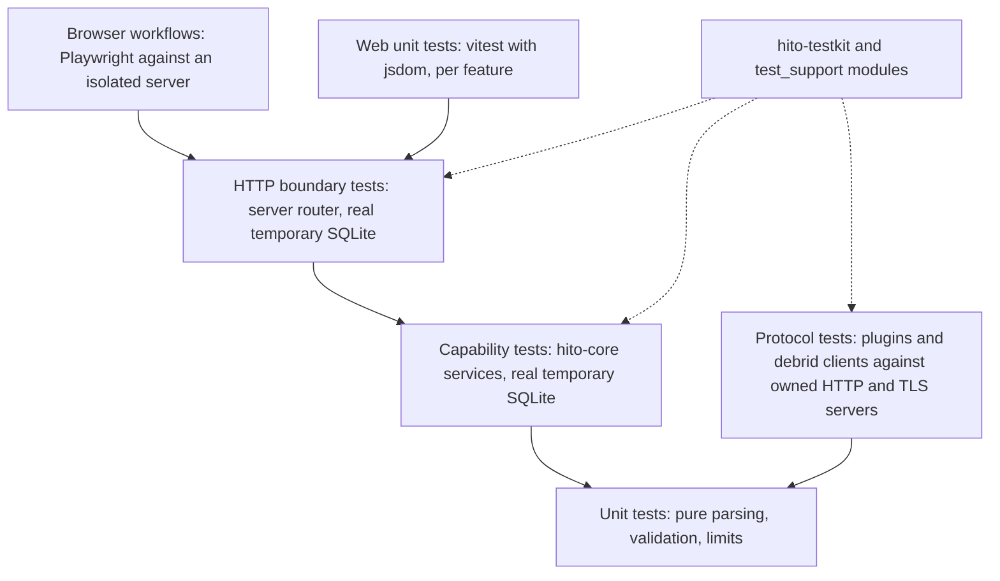

# Testing

Tests in Hito check behavior at a public boundary. They do not check how the code is arranged inside. A green narrow test does not prove a release gate; [status](status.md) records which gates have evidence.

Run every test through Docker. [Development](development.md) has the commands.

## Test layers

- **Browser.** `apps/web/e2e` runs against `e2e-server`, which uses temporary storage and generated audio. `make e2e` recreates the server each run. See [Browser e2e sessions](#browser-e2e-sessions).
- **Web unit.** Tests sit in `apps/web/src/features/<domain>/tests`, with data in `fixtures`. Hooks and pages are tested through their rendered behavior and typed API client.
- **HTTP.** `apps/server` tests drive the real router with a real temporary SQLite database. They check status codes, denied access, repeated requests and logs.
- **Capability.** `hito-core` tests call `Catalog`, `Collection`, `Identity`, `LibraryStorage` and `Plugins` directly. Anything that needs a transaction, a migration or a permission rule is tested here against a real database.
- **Protocol.** A plugin or provider client is tested at its wire boundary. The test starts an owned HTTP or TLS server and sends real requests. External services are never called in the normal suite.
- **Unit.** Used for pure functions such as limits and validation, for example the curated catalog admission cases in `crates/plugin-sdk/tests/curated_catalog.rs`.

## Principles

- **Public boundary.** Call a capability, an HTTP route or a rendered page. Do not read internal tables or private fields to prove behavior.
- **Real temporary SQLite.** No mock database. Each test creates its own temporary database, so tests share nothing.
- **Deterministic audio.** Audio fixtures are generated, owned and small. `scripts/audio-fixtures.mjs` writes WAV tones for the browser. `hito_testkit::audio` builds PCM16 WAV bytes and a ramp verifier for Rust tests. No test depends on a third-party recording or a live catalog.
- **Invariants survive refactors.** Transaction, privacy, identity and recovery invariants keep their tests when code moves.
- **TDD for behavior changes.** Write the failing test first, at the boundary. Then change the code. A test that never failed proves little.

## Browser e2e sessions

All default specs share one `e2e-server` and one database. Its data directory is tmpfs, so it is empty at the start of every run. Specs must not depend on state left by earlier specs.

- `apps/web/e2e/global-setup.ts` runs first. On an empty database it completes the "Set up Hito" screen through the real UI. If the administrator already exists, it signs in. It saves a `storageState` file that every spec reuses through `apps/web/playwright.config.ts`.
- A spec that signs out or switches accounts starts from an empty `storageState` and calls `enterAdmin` from `apps/web/e2e/fixtures/admin-session.ts`.
- `browser.newContext` inherits the config `storageState`. A context that must be anonymous, such as a second listener, passes `{ cookies: [], origins: [] }`.
- Global setup is skipped when any `HITO_*_E2E=1` gate variable is set. Those gated specs run on their own and use their own sign-in.
- The server allows 10 sign-in or setup attempts per minute per address. The default run uses about 9. A new default-run spec should reuse the shared session, or create accounts through the API, instead of adding UI sign-ins.
- Browser fixtures own their images in `apps/web/e2e/fixtures/images`.

## Log privacy

Every workflow logs structured events. Tests check that logs stay private. `hito_testkit::logs` captures tracing output, and `assert_text_excludes` fails the test if a forbidden value appears. Tests pass the values a log must never contain: credentials, session material, raw bodies, private paths, search terms, titles and signed URLs. Where a workflow also logs at debug or trace, check those levels too.

Tests run concurrently, and tracing-core caches whether a callsite is enabled using the dispatcher of the thread that first reaches it. A callsite first hit on a thread without a capture would then stay disabled for every capture. `hito_testkit::logs::anchor_callsite_interest()` installs one permanent no-op dispatcher, which keeps tracing-core checking every dispatcher. `LogCapture` calls it, and so do the core and server captures. The regression test is `crates/testkit/tests/callsite_interest.rs`.

## Flake policy

Do not raise a timeout, add a sleep, retry or ignore a test to make it pass. A flaky test points to a root cause: a shared global, a race on cleanup, a clock dependency or an unowned resource. Find it and fix it.

Examples of root-cause fixes already in the suite:

- Tests that wait for a connection worker to release a tracing dispatcher instead of sleeping.
- Edition workflow tests whose spans close on sqlx worker threads. They capture closes through the process default dispatcher and await them.
- TorBox bootstrap tests that no longer probe ports, because a concurrent fork or sibling process can hold a listener. They pick ports and listeners deterministically.
- Servers that drain stdout and stderr while waiting for a signal.

The web setup in `apps/web/src/test/setup.ts` resets timers, mocks, stubbed globals, local storage and session storage before and after every test. Vitest runs at most four workers (a worker cap of 4). Do not rely on state left by another test.

Docker Desktop has one known quirk that looks like flakiness. Two `hito-core` tag tests need a 64 KiB pipe, which the `rust` service gets through `SYS_RESOURCE`. See [Docker Desktop quirks](development.md#docker-desktop-quirks).

## Where shared helpers live

| Need | Location |
| --- | --- |
| Log capture, owned TLS authority, plugin HTTP server, WAV helpers | `crates/testkit` |
| Core service fixtures (libraries, accounts, plugins, media tools) | `hito-core` feature `test-support`, module `test_support` |
| Audio engine fixtures | `hito-audio` feature `test-support` |
| Debrid client fixtures | each `crates/debrid/<provider>` crate, feature `test-support` |
| Web test setup and async helpers | `apps/web/src/test` |
| Web feature fixtures | `apps/web/src/features/<domain>/fixtures` |
| Browser audio fixtures | `scripts/audio-fixtures.mjs --e2e`, output `fixtures/e2e-generated` |

Crates that have a `test-support` feature enable it for their own tests through a dev-dependency on themselves, so plain `cargo test --workspace` and `cargo clippy --workspace --all-targets` need no feature list. Normal builds never enable it.

No crate's tests read another crate's directory. If two crates need the same helper, move it into `hito-testkit` or expose it through a `test-support` feature of the crate that owns the behavior.
